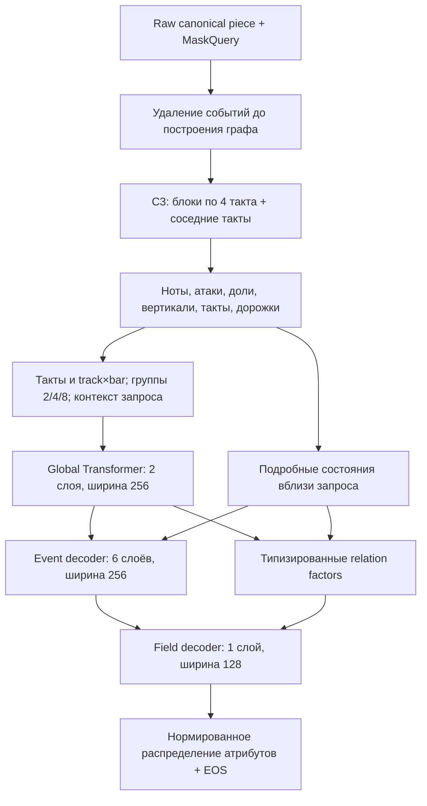

# HCM-1: реализация условной модели музыкальных событий

Дополнение от 28 сентября: новый вариант с контекстом всей песни и банком
повторов 1/2/4/8/16/32 такта описан в [HCM_WHOLE.md](HCM_WHOLE.md).
Этот документ сохраняет контракт исходного HCM-1 с ограниченным окном.

28 сентября 2026. Статус: реализован и проверен на синтетических CPU-примерах
основной путь от маскирования до обучения и восстановления checkpoint.
Качество на музыке, расход памяти и скорость на GPU ещё не измерены.
Основание — [исследование архитектуры](research/HIERARCHICAL_PLL_WORKHORSE_20260928_RU.md).
Пакет `music_critic.pll` добавлен отдельно; действующий критик и его обучение
не переведены на новую модель.

## Что предсказывается

Модель получает известные дорожки, метрическую сетку, интервал запроса и
оставшиеся события. Она предсказывает совместное распределение **всего набора
событий в скрытом фрагменте**, включая их количество, одновременные ноты и
пустой фрагмент. Это условное восстановление с двусторонним контекстом.
Авторегрессия внутри ответа не превращает модель в causal next-note модель
целого произведения: справа от скрытого места остаётся видимый контекст.

Событие: точное время атаки относительно начала запроса, дорожка, тип
(обычная/форшлаг, высотная/ударная), MIDI-высота или номер ударного инструмента,
точная длительность. Velocity, педаль, артикуляция и орфография нот не входят
в предсказываемую проекцию. Это не вероятность полного MIDI со всеми полями.

События сортируются по `(onset, track, kind, pitch, duration)`, повторения
сохраняются. Единственная каноническая последовательность и завершающий EOS
дают нормированную вероятность мультимножества в пределах выбранного профиля.
Время кодируется сокращёнными дробями без округления; грамматика исключает
альтернативные записи той же дроби, неверные префиксы и нарушение сортировки.
Для pitched-события высота факторизуется как pitch class → octave.
Конструктор и CLI заранее проверяют достаточную ёмкость `max_fields` для
всего CodecProfile: разрешённый NOTE не должен упираться в лимит декодера
до завершения события. При стандартном профиле требуется не менее 29 полей;
в конфигурации оставлено 64.

Сумма log-probabilities включает EOS и все атрибуты. Пустой ответ содержит
только EOS. Известные номер дорожки, размер и границы запроса — условия задачи;
число скрытых нот, аккорд, функция и семантическая сегментация условиями не служат.

## Архитектура в коде



`PLLContextEncoder` использует существующий C3 с тремя проходами и relation
gate. Старые 18 теоретических голов остаются в структуре для совместимости
весов, но не вызываются и не входят в новый loss или optimizer. Локальные
состояния имеют явно заданные стадии C3; состояния поздних и ранних уровней
не выдаются за один однородный проход.

`HierarchicalMemory` строит bar, track×bar, track, группы 2/4/8, context и query.
Подробные состояния note/onset/beat/slice выбираются по видимой геометрии;
при превышении детального бюджета используются отдельные по уровню и дорожке
временные группы. Пустота отличается от неизвестного покрытия. Нота,
начавшаяся до блока и продолжающая звучать, сохраняет состояние звучания,
но не создаёт ложную атаку на границе. Владение ядрами блоков исключает
повторный учёт из-за соседних перекрытий.

`ConditionalEventDecoder` видит только завершённые предыдущие события;
вложенный декодер видит только предыдущие атрибуты текущего события. Назначение
атрибутов сохраняется нелинейной композицией token/position embeddings.
Тест проверяет, что перестановка onset и duration не превращает два события
в одинаковое представление, а изменение будущего не меняет прошлые прогнозы.

Отношения разделены по назначению:

| Семейство | Где влияет |
| --- | --- |
| Activity | NOTE/EOS, дорожка, drum key |
| Vertical | Pitch class |
| Melodic | Octave |
| Rhythm | Скрытое состояние декодера времени атаки и длительности |

В режимах `transr` и `bilinear` контекст формирует смесь relation-компонент
с null-компонентой; небольшой обучаемый gate уточняет распределение кандидатов.
Это обучаемые скрытые отношения, а не доказанные именованные функции вроде
«тоника». Ритм не навязывает евклидову близость отдельным байтам дроби.
`relations="none"` отключает этот модуль для будущего сопоставимого контроля.
Реализованы TransR-like и bilinear варианты; отдельного matched MLP-контроля
из исследовательского плана пока нет.

Точный размер стандартного конструктора, включая зарегистрированные старые
головы: **14 333 351 параметр**. Из них при `frozen` обучаются **9 445 270**,
при `upper` — **11 987 639**. Подсчёт выполнен на CPU без чтения checkpoint.
Это не измерение GPU-памяти. Новая проекция граничных признаков обучается
даже при frozen C3; поэтому кэш конечных локальных embeddings в этой версии
не используется.

## Маскирование и границы поддержки

`MaskQuery(start, end, track_ids)` задаёт полуинтервал `[start, end)`.
Если атака ноты на выбранной дорожке попала в него, удаляется всё событие,
включая хвост за границей. Граф, вертикали, агрегаты и IDs создаются заново
из видимых событий. Targets остаются отдельной частью `MaskedExample`;
`encode` принимает только `ObservedMusicView`.

Gold annotations, targets, provenance, voice/staff, исходные ID и сегментация
не попадают в предиктор. Метрическая геометрия должна быть объявлена независимо
от конкретного скрытого заполнения ещё на стороне адаптера. Это требование
к подготовке данных, а не утверждение, что любой существующий экспорт уже
прошёл такую проверку.

Стандартный профиль: окно до 32 тактов, до 16 дорожек и до 512 целевых событий;
ядро локального блока 4 такта, по одному соседнему такту с каждой стороны;
до 2048 видимых нот, 200 000 рёбер и 8192 slices в блоке; общая память до 1152
элементов, подробная — до 512. Знаменатель времени до 65535, числитель до uint64.
Превышение поддержки явно отклоняется. Это не обработка всего длинного
произведения за один проход.

Версия 1 также отклоняет внутренние неполные такты, которые требуют
source-specific repair provenance, и metric offsets вне сетки долей.
Обычные затакты, последний короткий такт и смены размера не исключаются этим
правилом. Неподдерживаемый фрагмент остаётся в отчёте покрытия с причиной,
а не получает низкую музыкальную оценку.

## Данные и выбор масок

`DataManifest` читает `PLLDataManifest@1`. Поля записи:
`record_id`, `source`, `work_id`, `source_group_id`, `piece_id`, `split`,
`path`, `sha256`, `size_bytes`. Путь относителен каталогу манифеста и не может
выйти за него. Поля уровня манифеста: `records`, `source_weights`,
`group_before_window=true`, `cross_source_components_declared=true`,
`split_provenance`, `split_group_fingerprint`, `fingerprint`.
`seal_manifest(payload)` вычисляет два fingerprint, не придумывая provenance.

Runner допускает только TRAIN-манифест. При каждом чтении проверяются размер,
хеш тех же байтов, которые разбираются, и canonical identity/split. Декларация
составителя о группировке произведений не заменяет реальную проверку дубликатов
между Dilemmadata, HookTheory, PDMX и POP909-CL. Автоматическая подготовка этих
корпусов и их cross-source deduplication в этот этап не входят.

Sampler выбирает source по явным весам, затем произведение и запись равномерно,
затем метрический интервал без просмотра его нот. Пустые targets допустимы.
Текущая reference-смесь: длины 1/2/4 такта с весами 0.5/0.3/0.2; с вероятностью
0.5 маскируется одна дорожка, иначе все известные дорожки. Для короткой пьесы
веса перенормируются на помещающиеся длины. Это настраиваемая исходная смесь,
**не точная реализация всех предложенных в исследовании долей и стадий**.
Прогрессия 3–4 → 2–1 → 1 искажений относится к предыдущему парному критику;
здесь обучающая задача — восстановление скрытого фрагмента.

## API и локальные команды

Основные интерфейсы:

```python
from music_critic.pll.contracts import MaskQuery
from music_critic.pll.masking import split_masked_piece
from music_critic.pll.model import HCM1
from music_critic.pll.scoring import score_piece

# piece: уже проверенный CanonicalPiece; query: MaskQuery с точными RationalTime.
example = split_masked_piece(piece, query)
model = HCM1()  # Случайная инициализация; это НЕ загрузка обученного C3.
loss = model(example).nll
loss.backward()
model.eval()
scores = score_piece(model, piece, (query,))
generated_events = model.generate(example.context)
```

Случайная инициализация в этом примере показывает интерфейс; её scores не имеют
проверенного музыкального смысла. `PLLContextEncoder.from_pretrained` требует
путь, SHA256, размер и ожидаемый update выбранного C3; заменять encoder следует
**до** создания `PLLTrainer` и optimizer.

Проверка [reference-конфигурации](../configs/pll/hcm1_reference.json), без чтения
музыки и весов:

```bash
PYTHONPATH=src python scripts/run_pll.py inspect --config configs/pll/hcm1_reference.json
```

Файл является шаблоном. `pretrained=null` означает случайный C3; перед запуском
на выбранном обученном энкодере нужно создать отдельную resolved-конфигурацию
с `pretrained: {path, sha256, size_bytes, update}`. Относительные пути к весам
и resume checkpoint разрешаются от каталога этой конфигурации. Числа 1000
общих updates и 100 updates попытки в шаблоне не являются согласованным
экспериментальным бюджетом и не связаны со старым экспериментом с accuracy.

Для реального запуска сначала требуется `planned`-запись по
[протоколу экспериментов](EXPERIMENT_LOGGING.md), с явным бюджетом и закрытым
TEST. Дополнительное поле записи `pll` должно точно равняться
`run_bindings(load_run_config(config_path), DataManifest.load(manifest_path), device)`;
оно связывает исходники, конфигурацию, манифест, протокол, seed и число updates
попытки. `budget.planned_updates` должен совпасть с `attempt_updates`.
Минимальный исполняемый пример формирования записи есть в
[синтетическом CLI-тесте](../tests/pll/test_cli.py).

Форма команды после подготовки и регистрации конкретного запуска:

```bash
PYTHONPATH=src python scripts/run_pll.py train \
  --config /absolute/path/run.json \
  --manifest /absolute/path/train-manifest.json \
  --experiment-record docs/experiments/records/EXP-HCM1-CHOSEN-ID.json \
  --output outputs/hcm1/EXP-HCM1-CHOSEN-ID --device cuda:0
```

Это пример синтаксиса, не существующий запуск. CLI не проверяет занятость GPU
другими задачами и не получает разрешение на платное облако: эти условия
проверяются перед отдельным зарегистрированным resource gate.

## Обучение, продолжение и артефакты

`PLLTrainer` — FP32, один CPU/CUDA device, последовательные микробатчи с
accumulation; AdamW, gradient clipping, warmup/cosine. Цель шага — средняя
block NLL по примерам. Скорость packed batching, mixed precision и DDP не
реализованы. `freeze_policy`: `frozen`, `upper`, `full`; `unfreeze_update`
переводит frozen в upper на заранее заданной границе. Старые теоретические
головы всегда исключены. Настройки обучения не выбирались по данным.

Checkpoint сохраняет модель, Adam, счётчики, RNG и sampler на границе update.
Загрузка проверяет те же bytes, чей SHA256 сравнивался, структуру и конечность
весов/моментов, состояние optimizer, точный model/data/protocol/source binding
и версию Torch. До успешной проверки модель не должна измениться. Resume
в другом device type или с изменённым кодом отклоняется. Source fingerprint
охватывает Python-код `music_critic`, включая переиспользуемый C3.

Новая попытка продолжения получает новый record, output directory и
`resume: {checkpoint, sha256, update, parent_experiment_id}`. Общий
`training.total_updates` сохраняется; `attempt_updates` ограничивает только
новую попытку. Повторное использование терминальной записи и перезапись
checkpoint запрещены. Тест показывает совпадение следующего CPU-шага после
resume, включая dropout, Adam, RNG и переход frozen → upper. Это не обещание
побитового совпадения между разными GPU и библиотеками.

Runner сохраняет resolved config, manifest, training binding, draw receipts,
metrics JSONL, checkpoints и итоговый receipt в ignored `outputs/`,
`artifacts/experiments/` либо явно выбранном внешнем каталоге. Запись проходит
planned → running → completed/failed/aborted, ledger обновляется. Ошибка
содержимого, противоречащего TRAIN-манифесту, оставляет access evidence
неизвестным с описанием фактического чтения. `KeyboardInterrupt` завершает
попытку как aborted; после SIGKILL возможны running-запись и stale `.pll.lock`,
которые требуют аудита перед продолжением. Автоматического удаления lock нет.

## Оценки и что ещё предстоит

`score_piece` возвращает block NLL, nats/event, nats/quarter-note и покрытие
по заранее заданным запросам. Для пустого target nats/event отсутствует.
TEST закрыт; VALIDATION требует явного `allow_validation=True` и протокола
на стороне вызывающего кода. Raw unlabeled inference допускает `split=None`.
Вероятности перекрывающихся блоков не перемножаются в «вероятность произведения»;
необычность не объявляется плохой музыкой или человеческим предпочтением.

Для [пилота T4 от 28 сентября](experiments/HCM1_T4_PILOT_20260928_RU.md)
подготовлены 934 TRAIN окна из 606 групп произведений; PREPARE-003 и native
CPU/CUDA/resource/resume gate завершены. TRAIN-001 запущен на 10 000 обновлений
с замороженным обученным C3 и сохранением каждые 100 шагов. Облачный runner
`scripts/run_pll_cloud.py` поддерживает штатное завершение текущего шага
по сигналу; root supervisor и независимые таймеры ограничивают срок VM.
Текущее состояние запуска и известный TEST-инцидент предыдущей подготовки
описаны в протоколе; успешный gate не является оценкой музыкального качества.
Следующий этап — завершить этот пилот и отдельно проверить обобщение.
Source-native auxiliary
heads, автоматический curriculum масок, matched MLP-контроль, кэш embeddings,
KV cache и оптимизация batching остаются дальнейшими задачами. Для полноценных
выводов нужны matched ablations и человеческий blind A/B с better/same/worse.

Проверки текущей реализации — synthetic CPU: точный codec и полная маленькая
грамматика, отсутствие утечки, carry-in, память, нормировка/причинность,
backpropagation, generation, immutable resume и CLI lifecycle. Это инженерные
проверки; отдельный научный эксперимент для них не регистрировался. Итоговые
числа общего regression run записаны в [STATUS](STATUS.md).
