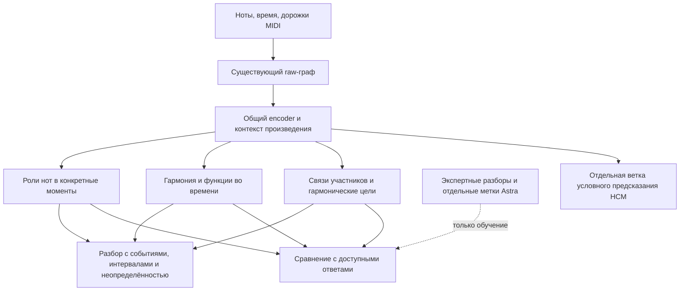

# Как подключить музыкальные разборы к графовому анализатору

7 октября 2026. Исследование текущего рабочего дерева `main`, HEAD
`287bf856643f9e555352e1661a7bf0563772178a`, с существующими изменениями.
Это предложение следующего этапа, не внедрённая архитектура и не запуск обучения.

**Вывод:** собранные разборы полезны как целевые ответы для обучаемого выхода
музыкального анализа. Подготовка файлов и их показ ещё не подключили этот выход
к HCM2. Основной недостающий компонент — предсказание функций и отношений с
адресами участников; одного увеличения количества нотных флагов недостаточно.

## Что сейчас делает модель, а чего ещё нет

| Проверенный факт | Практическое следствие |
|---|---|
| `PLLContextEncoder` возвращает `note`, `onset`, `beat`, `slice`, `bar`, `track`, `song` states | Есть вычисленные представления для нескольких масштабов; не требуется сразу заменять весь GNN. |
| Старые 18 theory-heads заморожены и не вызываются в HCM-пути при любой freeze policy | Их наличие в backbone не означает наличие гармонического анализа в выходе HCM2. |
| `PLLTrainer.step` делает backward только от `result.nll` | T05/T06 и разбор Saints пока не влияют на обучение HCM2. |
| WholePieceHCM строит память по всему предоставленному источнику, но выдаёт её относительно masked query | Для сплошного анализа нужно отдельное чтение состояний, не простое переименование результата PLL. |
| `DenseHarmonicBatch` сохраняет note IDs, точные интервалы, независимые поля/маски и физические связи | Адресация для supervision уже есть; neural readout, временной join и loss ещё нужны. |
| T05 registry содержит 9 флагов; дополнительные T06 passing/neighbor/suspension назначения экспортированы отдельно | Само появление этих ролей в JSON не добавило соответствующих задач в trainer. |

Основания: [encoder.py:35](../../src/music_critic/pll/encoder.py#L35),
[encoder.py:101](../../src/music_critic/pll/encoder.py#L101),
[runtime.py:90](../../src/music_critic/pll/runtime.py#L90),
[runtime.py:133](../../src/music_critic/pll/runtime.py#L133),
[whole_model.py:103](../../src/music_critic/pll/whole_model.py#L103),
[whole_memory.py:178](../../src/music_critic/pll/whole_memory.py#L178),
[dense_harmonic_targets.py:538](../../src/music_critic/tasks/dense_harmonic_targets.py#L538),
[relational_registry.py:11](../../src/music_critic/tasks/relational_registry.py#L11),
[T06](../experiments/DENSE_HARMONIC_TARGETS_20261006_RU.md).

Default whole-profile замораживает local encoder, но ранее использованный
random HCM2 train005 имел `freeze_policy=full`, `freeze_local=false`.
Это различие проверено по сохранённому resolved-config и отражено в
[предыдущем разборе подключения T06](DENSE_TARGETS_TRAINING_FIT_20261006_RU.md).
Обучение новых heads с frozen encoder проверяет возможность прочитать его
представления; только обучение с разрешённым градиентом может изменить encoder.
Выбор исходных весов C3, C4 или HCM2 — отдельный проверяемый выбор, а не
предположение, что более поздний checkpoint лучше для музыкального анализа.

## Два графа с разной ролью

Входной граф сообщает наблюдаемую геометрию: какие ноты звучат, в какие моменты,
в каких дорожках, какие временные/вертикальные отношения между ними доступны.
Выходной граф должен сообщать **интерпретацию**: какая нота задержана относительно
контекста, куда направлена гармония, что продлевает опору и какие участники
образуют этот процесс. Один и тот же вход допускает несколько разборов.

Эталонные рёбра «подготовка», «разрешение» и границы аккордов не добавляются
во входной граф. Иначе во время обучения модель получит часть ответа, а на
обычном MIDI этих данных не будет. В первом варианте связи — предсказания
над существующими представлениями. Обратная передача предсказанных отношений
в GNN возможна позже отдельной абляцией; она не обязательна для старта.
Латентные компоненты `RelationRefiner` и attention weights не заменяют такой
размеченный выход ([relations.py](../../src/music_critic/pll/relations.py)).

## Какие именно выходы добавить

| Масштаб | Что предсказывать | Из чего читать | Чем учить |
|---|---|---|---|
| Нота в контексте времени | Ступень/членство, затем подготовка, задержание, разрешение с участниками | Состояние ноты вместе с raw-временным состоянием и окружающей фактурой | Доступные Dilemmadata/HT поля, T06; отдельно проверенные роли Astra |
| Гармоническое событие | Состав с изменениями, бас, тональный центр, функция относительно указанной цели | Состояния звучащих нот и временных срезов; контекст фразы | Dilemmadata, POP909-CL, доступные HT поля; функции в выбранной системе анализа |
| Связь событий/гармоний | Участники, тип, цель, область действия; возможные альтернативы | Пара либо группа состояний интервалов плюс глобальный контекст | JHT-структура при допустимом входе; точные разборы фраз и новые проверки |
| Партии | Продолжение линии, удвоение, контраст/смена роли | Группы нот во времени с известными или предсказанными ролями | Проверенные source Part/voice; будущие score–annotation пары для инструментальной оси |

Конкретные имена новых модулей и универсальный словарь функций здесь не
утверждаются. Функция требует тонального центра и масштаба: «I в F» и «IV
относительно локальной C» могут описывать один F в разных отношениях. Нельзя
принуждать их к одному взаимоисключающему классу. Исходный аналитический взгляд
и альтернативы должны сохраняться.

Местная и структурная цели не конкурируют в одном общем классе: нужны тип
отношения и его масштаб. Подготовка/пролонгация JHT, разрешение в голосе и
субъективное напряжение — отдельные понятия. Широкую исходную метку
«подготовка или слабое продление» нельзя молча уточнять; fine-прочтение Astra
хранится отдельно. Зависимость может указывать назад во времени.

Одна нота может сменить роль без новой атаки. Поэтому недостаточно одной
неизменной note embedding на всю длительность: нужен readout `(note, raw-time)`.
Точки/интервалы чтения строятся по raw MIDI; source-границы используются для
точного сопоставления с ответами, не для обязательного построения входа.
Если внутри одного доступного raw-интервала несколько несовместимых целей,
нельзя копировать один logit в разные строки и считать задачу решённой:
нужны более точные raw-кандидаты, явное предсказание границы либо маска.

Для дальних отношений недостаточно лишь головы на локальной ноте. В нынешнем
HCM2 global memory доступна декодеру, но не автоматически каждому fine state.
Новый анализирующий readout должен явно читать глобальный контекст. На первом
этапе можно брать пары raw-интервалов и их состояния с временной геометрией;
затем объединять предсказанную гармонию в события.

В минимальном пилоте новую сегментацию лучше не учить одновременно с этими
отношениями: сначала функции и связи между raw-time якорями. Это позволит
отдельно проверить полезность дальнего контекста. Границы и объединение
предсказанных интервалов добавляются следующим шагом.

Проверка с известными аккордовыми границами полезна как отдельная диагностика
декодера и не выдаётся
за результат end-to-end MIDI-анализа.

Надстройки и задержания должны оставаться видимыми через сами ноты, интервалы,
длительности и доступные написания. Представление гармонии не следует сужать
до root+major/minor. T06 сохраняет основной/добавленный состав, но явные
compound-категории 9/11/13 там неизвестны; MIDI-регистр сам по себе не даёт
достоверную такую метку. Предполагаемое влияние E♭ на функцию F7 требуется
проверять на контролируемых контекстах, а не объявлять следствием названия поля.

## Как использовать разные корпуса без обязательного пересечения

| Источник | Роль в проекте | Что остаётся ограничением |
|---|---|---|
| Dilemmadata | Основная нотная и гармоническая supervision; точные классические примеры и исходная идентичность голосов | Неполное покрытие выразительных отношений; Part/staff/voice требуют собственных областей идентичности |
| HookTheory | Мелодия относительно гармонии и поп-идиом; отдельно доступные native-поля | В raw-входе только мелодия: неоднозначная гармонизация ожидаема. Режим с заданными символами аккордов — другой явно обозначенный вход |
| POP909-CL | Распознавание гармонии по сыгранной фактуре | Слитая фактура не даёт истинного разделения партий; annotation channel не является аккомпанементом |
| Original POP909 | Будущее обучение ролям мелодической и сопровождающей партий | Нужен проверенный адаптер MELODY/BRIDGE/PIANO и связь с версиями CL; BRIDGE здесь не название раздела формы |
| PDMX | Разнообразие сырой фактуры, self-supervision и будущий перенос проверенных разборов | Наличие tracks не равно разметке их функций; пока без нового theory gold |
| JHT | Обучение/оценка структурного разбора аккордовых последовательностей | Без совместимого MIDI это отдельный chord-symbol parser. Предобучение общего верхнего декодера возможно, но перенос на предсказанную из MIDI гармонию нужно измерить |
| Другие джазовые и рок/поп-источники | Нативные мелодии, аккорды и именованные аналитические случаи | Каталоговое совпадение не даёт временного переноса; точность зависит от версии и вида аннотаций |
| Книги и статьи с разборами | Небольшой набор содержательных трудных эпизодов; определения отношений и альтернативы | Текст или название пьесы ещё не target. Нужны версия, такты, события, повторная форма и точная область утверждения |
| Astra ultra | Недостающие TRAIN-интерпретации с участниками, основаниями и unknown | Слабая разметка с отдельным происхождением; независимый эталон оценки не должен быть её копией |

Можно чередовать примеры из разных источников, считая потери только для
доступных и сопоставимых задач. **Одно произведение не обязано присутствовать
во всех корпусах.** Общими могут быть encoder и совместимые выходы; различающиеся
словарь/контекст источников требуют явного mapping или отдельных heads.
Именно такой принцип разнородной supervision уже имеет прецедент
в [AnalysisGNN](https://arxiv.org/abs/2509.06654). Это основание для метода,
не доказательство эффективности нашей схемы.

Пересечения нужны для более богатого **одного примера** и проверки
согласованности слоёв. Тройной Saints сейчас не даёт такого MIDI-эталона:
[его перенос на PDMX не подтверждён](../experiments/JHT_HT_PDMX_DEMO_20261007_RU.md).
[Новый JHT/Astra разбор](../experiments/SAINTS_HARMONIC_PROCESS_20261007_RU.md)
даёт смысл связей, но `training_target=false` для этого MIDI. Не следует
строить весь план на поиске тройных совпадений; разбор нативного источника часто
проще и надёжнее. Версии одной работы во всех корпусах должны принадлежать
одной группе разбиения, иначе внешнее обогащение может раскрыть held-out ответ.

## Что изменится в обучении и результате

Сейчас правильный ответ HCM2 — скрытый набор событий. В предлагаемом анализаторе
добавляются правильные ответы другого типа: «это подготовка такой-то гармонии»,
«роль удержанного звука изменилась здесь», «цель находится в другом такте».
Ошибка этих предсказаний даёт градиент общим представлениям, если они разморожены.
Именно это, а не сохранение JSON рядом с MIDI, может научить encoder учитывать
нужные различия. Эффект правдоподобен, но не измерен.

Верность функций и связей — самостоятельный результат анализатора. Пользователь
дополнительно предлагает проверить, улучшает ли такое обучение различение
неверных/искажённых версий через PLL. Это второй отдельный endpoint: полезный
анализатор с неизменным PLL не подтвердит именно эту гипотезу. Возможны и
конфликты задач; преимущество совместного обучения заранее не предполагается.

Схематически при совместном обучении: `L = L_harmony + λ_role L_role +
λ_relation L_relation + λ_event L_event`. Каждая группа нормируется по доступным
примерам; вес dense-роли не должен автоматически побеждать редкие отношения
за счёт количества строк. Дублирующие поля вроде chord-role и membership
нельзя считать независимыми свидетельствами. Значения λ выбираются экспериментом.

Текущие редкие Astra-флаги содержат положительные и неизвестные случаи.
Простой BCE только по положительным учит отвечать «есть» везде, а превращение
unknown в отрицание искажает задачу. Для первого детектора нужны полностью
проверенные ограниченные фразы с допустимыми альтернативами и отрицательными
случаями либо явно обоснованный PU-метод с проверкой допущений. Полное дерево
JHT позволяет проверять выбор структурной опоры относительно именно этого
разбора, но отсутствие ребра в нём не отрицает все другие музыкальные связи.
Отдельно кодируются «нет связи в проверенном наборе», «цель за пределами
наблюдаемого окна», «не размечено» и «несколько допустимых целей».

Режимы тоже разделяются. Анализатор видит полное наблюдаемое произведение;
HCM оценивает скрытые события. При совместном обучении нужны отдельные проходы
с общими весами: unmasked анализ не может передать скрытые ноты или gold-функции
в память masked decoder. Перенос cached embeddings между этими режимами недопустим.

В интерфейсе сначала можно показывать карту функций/отношений: поддержка
опоры, подготовка, локальное разрешение, продолжающаяся дальняя зависимость.
Она строится из предсказанных типов и адресов, а не из раскраски attention.
Вероятность «подготовки» — уверенность в категории, не сила напряжения.
Spiral Array и другие теоретические индексы можно оставить отдельными
прозрачными baseline/слоями; обучение их копированию не докажет понимание
воспринимаемого напряжения. Для последнего нужен собственный перцептивный эталон.

## Уточнение: поможет ли гармоническая supervision самому PLL

Гипотеза пользователя: обучение функциям и отношениям заставляет общие
представления сохранять важный контекст, благодаря чему условное распределение
событий лучше различает музыкально нарушенные и допустимые версии. Это
осмысленная проверка эффекта supervision; её исход неизвестен. Снижение среднего
event NLL или улучшение harmonic F1 сами по себе не подтверждают такое различение.

Предлагаемое вложенное сравнение на одной популяции TRAIN-примеров:

| Ветка | Обучение | Какой эффект выделяет сравнение |
|---|---|---|
| A | Event NLL | Исходный условный предсказатель |
| B | Тот же NLL + локальные аккордовые/нотные задачи | Польза базовой гармонической supervision сверх A |
| C | Всё из B + функции, цели и временные отношения | Добавочная польза отношений сверх B |

Одинаковы исходные веса, NLL-примеры, маски, расписание и число обновлений;
доступность auxiliary-меток и распределение источников фиксируются. Учесть
дополнительные forward/backward и wall time: равные updates не равны compute.
Для C нужны достаточно полные связные фразы; нельзя незаметно дать ей больше
произведений, JHT-pretraining или иной sampler и приписать разницу отношениям.
Одинаковые diagnostic heads можно обучать на detached состояниях контроля,
отделяя их наличие от влияния градиента на общие представления. Если всё общее
с PLL заморожено/detached, обучение отдельных analysis-heads не изменит PLL.

На оценке сравнивается **только одинаково определённый event PLL/NLL**,
без прибавки theory score и без правильных аккордов на входе. Для фиксированного
набора масок и одного checkpoint вычисляется
`Δ = NLL(изменённая версия) − NLL(исходная версия)`.
Положительное Δ означает, что изменённая версия менее вероятна для этой модели;
само по себе оно не означает музыкальную ошибку. В текущем коде это
условные block scores, а не полная вероятность песни:
[scoring.py:16](../../src/music_critic/pll/scoring.py#L16).
Абсолютные NLL разных моделей и размеры их Δ не являются достаточным критерием
сравнения: нужны качество парного решения и калибровка порогов на отдельных данных.

Первый evaluation-набор должен включать независимо проверенные нарушения,
допустимые перегармонизации/выразительные приёмы и случаи неопределённости.
Отредактированная версия не получает метку «неверная» по факту правки. Начать
удобнее с высотных изменений при сохранённых количестве событий, времени и
длительностях; размер/сила правки и жанр контролируются отдельно. Необычные
допустимые варианты нужны, чтобы наказание любой непривычности не выглядело
улучшением. Старые better/worse оценки и технически валидные вмешательства
нельзя автоматически превратить в функциональные ошибки.
Проверяющий не должен видеть баллы модели и по возможности статус «оригинал».
Допустимая перегармонизация не обязана иметь Δ≈0: она может быть менее
привычной. Критерий относится к ошибочным тревогам, а не равенству вероятностей.

Два отдельных диагностических направления:

- скрыть изменяемую партию и оценить исходный/изменённый фрагмент при одинаковом
  остальном контексте, проверив фактическую идентичность видимой части после
  onset-owned masking, включая удерживаемые ноты;
- скрыть неизменную мелодию и оценить её при исходном/изменённом аккомпанементе:
  target сохраняется, меняется только обусловливающий контекст. Этот вариант
  требует реального разделения партий; merged POP909-CL его не предоставляет.

Успех — C надёжнее B различает подтверждённые нарушения при сопоставимом числе
ложных тревог на допустимых версиях, на новых семействах произведений. Пороги
выбираются отдельно от финальной оценки. Считать парные решения, чувствительность
при фиксированной доле ложных тревог, локализацию и coverage; интервалы
неопределённости считать по произведениям, а не независимым нотам. Сохранить
unsupported случаи и не сравнивать только удобные для одного checkpoint пары.
Прогон нескольких согласованных seeds проверяет устойчивость результата.
Для первичной гипотезы не обучать rank-loss на самих оценочных искажениях:
они проверяют перенос гармонических знаний в PLL, а не запоминание генератора.

Все версии произведения и связанные аналитические источники остаются в одной
split-группе. Предложение не открывает TEST и не запускает новый эксперимент.
Положительный результат поддержит пользу гармонического обучения для условного
обнаружения нарушений в проверенной области; универсальный рейтинг музыкального
качества и преимущество именно GNN потребуют отдельных сравнений.

## Первый этап, который соединит всю цепочку

Рекомендую законченный небольшой проход от raw MIDI до **двух связанных
выходов**: меняющаяся роль ноты и цель гармонического отношения в пределах
целой фразы. Он обязан содержать хотя бы одно отношение через промежуточную
гармонию; проверка только membership вновь обойдёт главный запрос пользователя.

1. Выбрать несколько уже допустимых TRAIN-фраз с точной нотной привязкой.
   Три классических T06-произведения дают механическую основу; дополнить именно
   недостающие гармонические связи фраз и полную проверку выбранных случаев.
   Saints пока использовать для отдельного chord-symbol теста, не фиктивного MIDI.
2. Реализовать opt-in analysis-forward, raw-временные readouts, note×time и
   relation heads, точный join/masks и независимый от PLL вывод. Проверить
   длительные ноты, смены внутри доли, пустую разметку, градиент, дальние цели
   между локальными tiles и отсутствие зависимости входного графа от gold.
3. На tiny TRAIN проверить загрузку и способность подогнать цели. Это тест
   механики, не обобщение. Если простая relation-head читает нужные сведения,
   начинать с неё; менять message passing лишь по локализованному ограничению.
4. Подготовить отдельные независимо проверенные фразы для оценки по семействам
   произведений. Сравнить локальные правила/классификатор, неграфовую модель,
   головы на frozen encoder и joint-вариант. Раздельно измерить функции,
   участников/тип/дальнюю цель, временную локализацию и ошибочные тревоги на
   допустимых необычных случаях. Учесть candidate recall и ошибки сегментации;
   метрика только на gold-границах — дополнительная, не основная.

После успеха этого прохода масштабировать разметку и инструментальную ветку.
Для проверки дальних целей особенно нужны сравнения с ближайшим совместимым
аккордом и chord-symbol-only парсером, локальным readout и тем же readout с
глобальным контекстом. Перемешивание глобального контекста — отдельный
диагностический контроль его использования, не музыкальная метка ошибки.
JHT-парсер может успешно работать без нот; его результат сам по себе не
докажет понимание MIDI-графа. Выигрыш в локальных ролях и в дальней структуре
следует измерять раздельно.

Хорошее распознавание гармонии не доказывает анализ тембров/баланса инструментов;
для символических межпартийных отношений нужны соответствующие нативные
score–annotation данные. Предсказания нельзя замыкать обратно в единственный
эталон и проверять только согласие модели с самой собой.

## Публикация и границы обещания

«GNN + музыкальные метки» уже представлен в AnalysisGNN. Структурированные
музыкальные представления с привязанными объяснениями есть в
[MIDI-PHOR](https://aclanthology.org/2026.nlp4musa-1.6/), а иерархические
гармонические зависимости — в [JHT](https://archives.ismir.net/ismir2020/paper/000080.pdf).
Поэтому сама схема не устанавливает новизну. Проверяемый кандидат на вклад:
из сырой полифонии восстановить адресуемые отношения нот и гармонических целей
на разных масштабах, сохранить изменения роли удержанной ноты и неоднозначность,
показать пользу глобального/графового контекста на независимых случаях.
Для этого нужны сопоставимые baselines, ablation и независимая оценка.

Главная практическая ценность собранных данных — они позволяют определить
и проверить этот выход. Данные не гарантируют, что нынешний encoder его выучит,
и не являются готовой шкалой качества песни.

## Статус проверки

Прочитаны актуальные кодовые интерфейсы, контракты и сохранённые отчёты;
перепроверены первичные страницы AnalysisGNN, MIDI-PHOR и статья JHT.
Новых музыкальных payload, весов, TRAIN/VALIDATION/TEST inference и экспериментов
не было. Изменены только эта заметка и STATUS. Legacy не использовался;
тесты модели не запускались, поскольку код не менялся. Проверены локальные
ссылки и формат. Архитектурные решения в DECISIONS не переопределены:
следующий этап — спецификация ограниченного выхода и его проверок.
