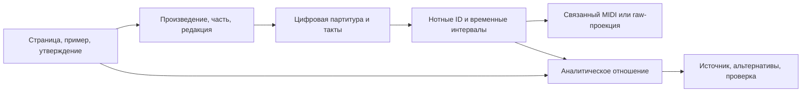

# Данные для многоуровневого музыкального анализа и связывание разборов с партитурами

**Уточнение жанрового охвата:** пользователь требует рок, джаз, поп и классику.
Классические примеры ниже — одна ветка, не общий приоритет всех источников.
Актуальное дополнение: [разборы поверх нотного каркаса во всех четырёх областях](MULTIGENRE_ANALYTIC_ENRICHMENT_20261005_RU.md)
и [специализированный обзор рока/попа](ROCK_POP_ANALYSIS_SOURCES_20261005_RU.md).

Дата проверки: 2026-10-05. Checkout: `287bf856643f9e555352e1661a7bf0563772178a`,
с существующими незакоммиченными изменениями. Этап: исследование источников
и паспорт полей; новая архитектура и training targets не приняты.

Вопрос: какие доступные данные позволяют связать ноты, полные созвучия,
голосоведение, гармонию, фразы, партии, разделы и произведение; можно ли
получить недостающие объяснения из книг и сопоставить их с символической музыкой?

## Вывод для проекта

Да, сопоставление опубликованного разбора с цифровой партитурой выполнимо
как отдельная задача. Уже найдены две конкретные пары произведение/часть/такты.
Однако первым источником следует сделать уже связанные партитуры и анализы,
а книги использовать для дополнительных отношений и объяснений. Это сокращает
число неопределённых переходов между текстом, нотами и случайным MIDI.

Нашим корпусам нужны разные дополнения. Dilemmadata содержит богатую гармонию
и некоторые структурные метки; HookTheory — подробные аккордовые символы и
мелодию; original POP909 — партии; PDMX — масштабируемый нотный материал.
Ни один из проверенных источников не даёт полного экспертного разбора каждого
уровня и всех связей между уровнями. Объединять их следует с масками покрытия
и происхождением каждого утверждения, а не выравнивать до самого грубого класса.

Основа постановки: [все уровни и полные созвучия](../workstreams/2026-10-05/tonal-relations-map/decisions/01-meaning.md),
[обзор теорий](TONAL_TENSION_THEORY_20261005_RU.md).

## Границы проверки

- Прочитаны текущие адаптеры/контракты, зарегистрированные отчёты предыдущих
  аудитов и первичные внешние публикации/репозитории.
- Нового обхода музыкальных payload, обучения, оценки, TEST, импорта корпуса
  или запуска стороннего кода не было. Массовая разметка Astra отложена.
- Числа прежних запусков ниже имеют дату и единицу. Это не новый пересчёт,
  не подтверждение актуального наличия всех полных артефактов и не оценка
  независимой музыкальной правильности аннотаций.
- Внешние размеры — заявления источников на дату просмотра. Ветки `main`
  могут изменяться; фактическое подключение потребует закреплённой версии.
- Пары книга/партитура подтверждены по идентификации произведения и обозначению
  тактов. Нотное выравнивание и перенос аналитических связей ещё не выполнены.

## 1. Паспорт наших корпусов

| Корпус | Наблюдаемый музыкальный материал | Готовые аналитические поля | Главная недостающая часть |
|---|---|---|---|
| Dilemmadata AN/DLC | Полифонические ноты, точное время, написание, исходные голоса/станы, свидетельства лиг | Roman, тональности, бас, обращение; DLC `changes`, `chord_tones`, `added_tones`; местами каденции, педали, границы | Полные участники временных отношений; сохранение исходного scope голосов; непрерывная форма и её функции |
| HookTheory | Изолированная мелодия, построенная из ступеней/октав и ключа | Ступени аккордов, extent, adds/omits/alterations/suspensions, обращения, borrowed | Реально сыгранные голоса сопровождения, voicing и инструментальное взаимодействие |
| POP909-CL | Объединённые ноты channel 0 | Независимые chord blocks channel 1 и производные root/quality/bass/inversion/boundary/no_chord | Исходные роли партий, Roman/function, полная форма, нотные эпизоды разрешений |
| Original POP909 | Отдельные MELODY/BRIDGE/PIANO в основных версиях | Отдельные внешние временные представления аккордов/ключа/долей | Production role adapter и проверенное соответствие исправленному CL; BRIDGE не метка раздела формы |
| PDMX | Ноты нескольких дорожек, время, доступные названия/программы; upstream-партитуры богаче raw-проекции | В текущем adapter нет theory targets | Экспертные функции, разрешения, форма и инструментальные роли; проверка полного локального релиза |

### Dilemmadata: использовать более подробную существующую информацию

Точное время и написание сохраняются из AN `s_offset_frac/s_duration_frac`,
`s_midi/s_step/s_alter` и DLC `quarterbeats_playthrough`, `duration×4`,
`pitch/step/alter`. Canonical объединяет материал в одну source-neutral дорожку;
она не является инструментальной партией. Для голоса нужен исходный scope
AN `(part, voice)` или DLC `(staff, voice)` и привязка строк/лиг/исправлений.
[Адаптер](../../src/music_critic/adapters/dilemmadata.py),
[полевой аудит](../DILEMMADATA_FIELD_AUDIT.md).

Исходные гармонические аннотации остаются targets. Границы фраз/разделов
имеют неполное положительное покрытие: отсутствие метки не означает отсутствие
границы. Их наличие не создаёт иерархию формы автоматически.
[Sidecar-контракт](../DILEMMADATA_TARGET_SIDECARS.md).

Важны две разные потери детализации в существующей supervision:

1. `quality17` не различает все надстройки и sus-типы.
2. DLC `pitch_class_set` строится из `chord_tones`, с явным
   `includes_added_tones=False`. Поэтому этот target нельзя переименовать
   в полный состав реально звучащего созвучия.

Это ограничения выходов; исходные ноты не удаляются по этим правилам.
[Текущая проекция targets](../../src/music_critic/experiments/analysisgnn/multitask_contract.py).

Дополнительные DLC `changes` уже имеют отдельный сохраняющий исходное
обозначение парсер и подготовленную выгрузку. В сохранённом запуске
`EXP-CHANGES-ALIGNMENT-FULLTRAIN-001` от 14 сентября: **1 011 DLC TRAIN записей,
251 038 пригодных аннотаций, 34 055 с непустыми модификаторами, 99 классов**.
45 классов имели лишь 1–9 пригодных аннотаций; число аннотаций не равно
числу независимых произведений или эпизодов задержания. Подготовка targets
не была обучением новой головы.
[Отчёт](../experiments/DLC_CHANGES_FULLTRAIN_RU.md),
[контракт](../DLC_CHANGES_TARGETS.md),
[терминальная запись](../experiments/records/EXP-CHANGES-ALIGNMENT-FULLTRAIN-001.json).

Практический вывод: сначала связать модификатор с конкретными нотами,
его временной областью и гармоническим контекстом. Не требуется заново
просить LLM назвать все исходные аккордовые модификаторы.

Ещё одна граница: точное время нот не гарантирует полной временной сетки
гармонии. В старом DLC merge могут отсутствовать границы между атаками;
их следует восстанавливать по исходной партитуре/аннотации, а не догадкой.

### HookTheory: подробные символы без расположения сопровождения

Текущий adapter имеет 12 семейств source-native targets, включая `extent`
5/7/9/11/13, adds, omits, alterations и suspensions. Они важны для анализа
мелодии относительно гармонии, но не содержат реально сыгранных партий
сопровождения. Canonical melody pitch сам выводится из ступени/ключа;
это учитывать при выборе независимой проверочной задачи.
[Адаптер](../../src/music_critic/adapters/hooktheory.py),
[целевой контракт](../MULTISOURCE_TARGET_CONTRACT.md).

`segment_start/end/duration` источника относятся к секундам аудио; они не
становятся автоматически границами разделов в символическом времени.
Сохранённый supervision EDA подтверждает 17 convertible TRAIN excerpts;
это ограниченная проверка, а не оценка полноты всех классов корпуса.
[EDA](../HOOKTHEORY_EDA.md).

### POP909: сохранить различие original и CL

В CL channel 1 содержит аннотационные блоки, а не сопровождение. Полный
состав блока и неоднозначные кандидаты информативнее одной нормализованной
quality. Применяемая в сравнении C3/C4 проекция маскирует часть native типов,
включая sus2/sus4, вместо превращения их в трезвучия.
[CL-контракт](../POP909_CL_ADAPTER_CONTRACT.md),
[аудит](../POP909_CL_FIELD_AUDIT.md).

У original POP909 документированы основные MIDI с MELODY/BRIDGE/PIANO.
Это источник партии мелодии, дополнительной мелодической партии и
фортепианного сопровождения, но не полная инструментовка оригинальной записи.
Присоединение corrected-гармонии CL к этим партиям требует проверки времени
и изменённых нот. Песня и её версии должны оставаться в одной split-группе.
[Original-аудит](../POP909_ORIGINAL_FIELD_AUDIT.md),
[адаптерный план](../POP909_ORIGINAL_ADAPTER_CONTRACT.md),
[официальный POP909](https://github.com/music-x-lab/POP909-Dataset).

### PDMX: использовать исходную партитуру и метаданные

Наш adapter сохраняет ноты/дорожки/часть метаданных, но игнорирует
notation/lyrics/expressive annotations; staff/voice не извлекает. `chords`
в MusicRender нельзя объявить функциональной гармонией: в ранее проверенном
образце это группы нот. Исторические 254 035 обнаруженных MIDI не доказывают
полной нынешней пригодности MusicRender-релиза.
[Адаптер](../../src/music_critic/adapters/pdmx.py),
[контракт](../PDMX_PIPELINE_CONTRACT.md), [границы EDA](../eda/PDMX_EDA.md).

В официальном релизе PDMX.csv связывает `path`, `metadata`, `mxl`, `pdf`,
`mid` для одной записи; имеются название и авторские метаданные. Это
удобный путь от найденной цифровой партитуры к её MIDI. Поля могут отсутствовать,
а версии/аранжировки одной композиции остаются разными объектами. Релиз
документирует `license_conflict` и рекомендует `no_license_conflict`.
[Описание релиза](https://zenodo.org/records/15571083),
[официальный README](https://github.com/pnlong/PDMX).

## 2. Готовые внешние данные: что они добавляют

Ниже приоритет определяется добавляемым уровнем анализа, а не размером архива.
Повторное произведение с другой разметкой — полезное дополнение слоя,
но не новое независимое произведение для оценки переноса.

| Источник | Добавляемый уровень и формат | Ограничение / доступ |
|---|---|---|
| [DCML Beethoven](https://github.com/DCMLab/beethoven_piano_sonatas), [Mozart](https://github.com/DCMLab/mozart_piano_sonatas) | Партитуры MSCX, notes/measures/harmonies TSV; гармония, каденции, часть фраз | Уже частично входят через DLC в Dilemmadata; полезен возврат к исходным границам/нотам. В README указана CC BY-NC-SA 4.0 |
| [When in Rome](https://github.com/MarkGotham/When-in-Rome) | RomanText и альтернативные анализы; README говорит примерно о 2 000 анализов 1 500 произведений; score.mxl или ссылка на источник | Мета-корпус пересекается с AugmentedNet/Dilemmadata. Score есть не везде; `analysis_automatic.rntxt` не экспертный gold. Новые материалы CC BY-SA, исходные сохраняют свои условия |
| [TAVERN](https://github.com/jcdevaney/TAVERN) | 27 вариационных циклов, 281 вариация, 1 060 фраз; Humdrum score+analysis; гармонические и фразовые функции, аналитики A/B | Уже в lineage AugmentedNet/Dilemmadata; полезны исходные фразовые слои. Вариации одного цикла зависимы. CC BY-SA 4.0 |
| [BPS-FH](https://github.com/Tsung-Ping/functional-harmony) | 32 первые части сонат Бетховена; ноты CSV, гармония/фразы/доли XLSX | Уже представлен через AugmentedNet/Dilemmadata. Это таблицы событий; нельзя обещать универсальный комплект MusicXML. Явная лицензия dataset в просмотренном материале не подтверждена |
| [Taking-Form](https://github.com/MarkGotham/Taking-Form) | Иерархия формы: 103 движения 32 сонат Бетховена и первые движения 17 сонат Моцарта; такт/доля, CSV/TSV и вложенные группировки | Сопоставить со score-редакцией и DLC; слой формы над знакомой музыкой, не независимый новый корпус. MIT репозитория не заменяет проверку происхождения нот |
| [Jazz Harmony Treebank](https://github.com/DCMLab/JazzHarmonyTreebank) | 150 аккордовых последовательностей джазовых стандартов; JSON деревья продления/подготовки и группировки; некоторые альтернативные деревья | Нет полной мелодии и voicing; ряд необязательных расширений и басовых обозначений удалён из представления. Не подходит как готовый эталон надстроек. CC BY-NC-SA 4.0; [статья](https://archives.ismir.net/ismir2020/paper/000080.pdf) |
| [GTTM Database](https://gttm.jp/gttm/wp-content/uploads/2015/12/index.html) | Релиз 2014: 300 восьмитактовых одноголосных фрагментов, MusicXML и XML группировки/метра/time-span/prolongational структур | Фрагменты, не 300 полных полифонических пьес. [Расширение 2018](https://gttm.jp/hamanaka/wp-content/uploads/2019/02/hamanaka_SMC2018.pdf) описывает ещё 50 более длинных мелодий; одинаковое покрытие слоёв не предполагается. Лицензия и работоспособность всех старых ссылок не подтверждены |
| [SchenkerDataset](https://github.com/stephenHahn88/SchenkerDataset) | Публикация 2024: 145 анализов, четыре аналитика; MusicXML/JSON/графический анализ и структурные голоса | Публична лишь часть, полный набор по академическому запросу. Узлы редукции не равны всем сыгранным нотам; общая открытая лицензия корпуса не установлена. [Статья](https://arxiv.org/pdf/2408.07184) |
| [RS200](https://rockcorpus.midside.com/) | Два гармонических разбора каждой из 200 песен, мелодические транскрипции и время; v2.1 исправляет обозначения октав | Не полная многопартийная фактура; сайт указывает CC BY 4.0 для размещённых материалов |
| [CoCoPops](https://github.com/Computational-Cognitive-Musicology-Lab/CoCoPops) | Humdrum, мелодия/гармония/форма/время; README заявляет 414 полных транскрипций 398 уникальных tracks | Включает RS200 и Billboard, их нельзя суммировать как независимые наборы. 214 мелодий Billboard — часть общего числа; условия каждого слоя проверять отдельно |
| [Billboard](https://ddmal.ca/research/The_McGill_Billboard_Project_(Chord_Analysis_Dataset)/) | Аккордовые аннотации и структурные сведения, привязанные к аудио | Сам по себе не даёт MIDI голосов; CoCoPops добавляет мелодии лишь части материала |
| [POP909 phrase/reduction resources](https://github.com/ZZWaang/melody-reduction-algo) | Дополнительные фразовые метки над POP909 и алгоритмические редукции мелодии | Нужен аудит версии и происхождения каждого label-файла; результат алгоритма не становится экспертным деревом |

Для POP есть первичная работа Dai, Zhang и Dannenberg: автоматическое
выделение повторяющихся фраз и более крупных разделов. Она подтверждает
пригодность направления, но не устанавливает, что каждый распространяемый
label-файл полностью создан человеком. Обозначение повторяющейся фразы `A`
также не гарантирует семантическое «куплет».
[Авторская статья 2020](https://www.cs.cmu.edu/afs/cs/Web/People/rbd/papers/dai-mume2020.pdf).

Отдельно важна новая статья Dilemmadata 2026: авторы описывают 84 общих
произведения с сохранением обоих исходных анализов. Это уже существующий
материал для исследования аналитической неоднозначности. Её 1 621 pieces
нельзя подставлять вместо 1 619 записей нашего corrected-профиля или
1 633 исходных записей исторического локального аудита: единицы/версии
различаются. Точное соответствие этих 84 нашему текущему split не установлено.
[Первичная публикация](https://arxiv.org/abs/2606.31595).

Итог по добавляемым слоям: сначала исходные DCML/TAVERN и Taking-Form;
JHT/GTTM/Schenker — отдельные задачи проверки иерархии с разными входами;
CoCoPops/RS200 — необходимое дополнение поп/рока. Для взаимодействия реальных
инструментов эта подборка остаётся неполной: original POP909/PDMX дают ноты
партий, а экспертные роли/оркестровые отношения требуют специализированных
Orchestration/S3 и отдельного согласования, описанного в
[предыдущем обзоре](MUSICAL_RELATIONS_NOVELTY_AND_DATA_20261005_RU.md).

## 3. Книги и реальные пары с цифровыми партитурами

### Два проверенных кандидата

| Опубликованный разбор | Цифровая партитура | Что можно связать | Что ещё не проверено |
|---|---|---|---|
| [Caplin, Example 2.1](https://acf.research.mcgill.ca/example2-1.php): Beethoven Op. 2 No. 1, I, такты 1–8; [Hutchinson §13.2](https://musictheory.pugetsound.edu/mt21c/SentenceStructure.html) разбирает этот же фрагмент | [DCML Beethoven](https://github.com/DCMLab/beethoven_piano_sonatas): `MS3/01-1.mscx`, `notes/01-1.notes.tsv`, `harmonies/01-1.harmonies.tsv` | Мотивные группы, их изменение в гармоническом контексте, функция фразы, кадансовое завершение | Эквивалентность редакций, нумерация затакта, точные IDs нот и совпадение с нашим TRAIN |
| [Open Music Theory, The sentence](https://hybrid-pedagogy.github.io/openmusictheory/sentence.html): Mozart K. 283, I, такты 1–10 | [DCML Mozart](https://github.com/DCMLab/mozart_piano_sonatas): `K283-1` | Локальная опора, развитие материала, изменение ритма и переход к кадансу | Точное нотное выравнивание и границы аналитических групп в конкретной редакции |

Это найденные опубликованные примеры, не выдуманные музыкальные случаи.
В частности, первый пример показывает нужный пользователю переход между
уровнями: изменение мотивного материала обсуждается в связи с гармонией,
затем со строением целой фразы. Перенос авторских утверждений в targets
пока не произведён.

### Как выбирать большие источники

[Companion к Caplin, Analyzing Classical Form](https://acf.research.mcgill.ca/)
содержит ноты/аудио примеров, дополнительные задания и ответы. Он перспективен
для разметки формальных функций и связи фразы с гармонией. Это доступный
companion к книге, а не подтверждённый полный свободный текст всей книги.
Доступ к веб-странице и разрешение переиздать весь её материал — разные сведения;
в каталоге следует хранить фактически найденные условия каждого источника.

Open Music Theory и [Music Theory for the 21st-Century Classroom](https://musictheory.pugetsound.edu/mt21c/)
дают адресуемые разделы, конкретные произведения, такты и учебные объяснения.
Для первоначального извлечения отношений они удобнее больших сканов без
индекса примеров. Книги с графическими редукциями требуют чтения самих
рисунков: обычный OCR текста теряет дуги, уровни и связи нот.

| Дополнительный первичный источник | Конкретный материал и полезный слой | Проверенная граница |
|---|---|---|
| [Goetschius, Lessons in Music Form, гл. XIV–XV](https://www.gutenberg.org/cache/epub/19354/pg19354-images.html) | Полный последовательный разбор Beethoven Op. 49 No. 2, II; формы, возвращения, переходы с номерами тактов | Полный HTML доступен. Gutenberg указывает public domain in USA; цифровой counterpart этого примера отдельно не выровнен |
| [Caplin 2010](https://williamcaplin.com/download/tempest-sonara-mto.pdf) и [Schmalfeldt 2010](https://mtosmt.org/issues/mto.10.16.2/mto.10.16.2.schmalfeldt3.html) | Beethoven Op. 31 No. 2, I, обсуждение функций/пролонгации/каденционных трактовок | Полезны именно разные авторские объяснения; доступность чтения не подтверждает общего права на переиздание фигур |
| [Yust 2015](https://www.mtosmt.org/issues/mto.15.21.4/mto.15.21.4.yust.php) | Beethoven Op. 26, III, т. 1–20; преобразования голосоведения и структурные редукции | Аналитические голоса не совпадают автоматически с MIDI tracks; графические конструкции могут быть гипотетическими |
| [Nobile 2011](https://www.mtosmt.org/issues/mto.11.17.3/mto.11.17.3.nobile.html) | Разборы Beatles: Misery, From Me to You, Eight Days a Week; связь формы и голосоведения | Первичный анализ найден, соответствующий полный MIDI с подтверждённым происхождением не установлен |

Проверенный экземпляр Tovey, *A Companion to Beethoven’s Pianoforte Sonatas*
в [Internet Archive](https://archive.org/details/companiontobeeth0000dona_u1r0)
имеет ограниченный доступ; текст анализа не прочитан. Rosen, Schoenberg
и полный оригинал Schenker не объявляются готовыми источниками пар в этом
обзоре. Их библиографическая известность сама по себе не решает задачу
доступного текста и привязки к конкретному нотному источнику.

Авторскую аналитическую гипотезу следует сохранять с именем аналитика,
теоретической системой, страницей/примером и областью действия. Противоречащие
разборы не сводятся к большинству голосов, пока не проверено, что они вообще
отвечают на один вопрос. Упражнение без опубликованного решения не считается
готовой экспертной аннотацией.

## 4. Предлагаемый путь книга → ноты → MIDI

1. **Сначала идентичность произведения.** Композитор, каталог/opus, номер,
   часть; для попа — исполнитель и конкретная запись/версия. Название служит
   поиску кандидатов, но не доказательству совпадения. Отдельно указать
   редакцию, переложение, транспозицию, пропуски и неполный фрагмент.
2. **Затем такты и ноты.** Сопоставить затакты, повторения/вольты, метры,
   тональность и нотный материал. Анализ может относиться к записанной форме,
   а MIDI — к развёрнутым повторам. Нужны ID в партитуре и индекс вхождения
   при повторе; украшение может соответствовать нескольким исполненным нотам.
3. **Использовать уже связанную музыку.** Для score-based обучения можно
   строить MIDI-совместимую raw-проекцию из той же партитуры, сохраняя обратную
   связь с нотными ID. Необязательно искать другой MIDI. Если нужен MIDI
   исполнения, потребуется отдельное score-to-performance выравнивание.
4. **Переносить утверждения на их собственном масштабе.** Слово «доминанта»
   над всем разделом не становится меткой каждой ноты раздела. Ссылка на
   такт не доказывает, что автор назвал конкретных участников задержания.
   Отсутствующие участники остаются неизвестными или кандидатами модели.
5. **Раздельно проверять соответствие и интерпретацию.** Правильная пара
   произведений, точное выравнивание нот, верное извлечение авторской мысли
   и согласие с этой мыслью — четыре разных статуса.

Для исполнения доступны готовые связки [ASAP/(n)ASAP](https://github.com/CPJKU/asap-dataset):
репозиторий описывает 222 scores и 1 068 performances, а нотные TSV связывают
XML ID с MIDI-нотами и повторными вхождениями. Это инфраструктура выравнивания,
не готовая гармоническая разметка; в документации отмечены неполные исполнения
и проблемы отдельных соответствий.

[Parangonar](https://github.com/sildater/parangonar) предлагает алгоритмы
нотного выравнивания и работы с повторами/частями;
[Partitura tutorial](https://cpjku.github.io/partitura_tutorial/notebooks/02_alignment/Symbolic_Music_Alignment.html)
описывает представление и чтение correspondences. Выбор метода, версия,
ошибка и ручные опоры должны быть воспроизводимы. Инструменты здесь не
устанавливались и не запускались.

### Где уже есть идентификаторы в нашем проекте

| Источник | Поля для поиска кандидатов | Почему недостаточно сами по себе |
|---|---|---|
| Dilemmadata | Исходные composer/title/movement в target provenance; source-component rows и hashes | Canonical title/creators могут быть пусты; нужно вернуться к provenance, а не угадывать по filename |
| HookTheory | Clip ID, `ori_uid`, исходный путь | Клип/песня не идентифицируют исполнение и редакцию партитуры |
| POP | Song ID, `pop909-lineage:<id>`, upstream index | Связывают original/CL, но не удостоверяют точного нотного совпадения |
| PDMX | Title/subtitle/artist/composer и связанные metadata/mxl/pdf/mid пути | Пользовательские названия и группы аранжировок требуют нотной проверки |

Основания: [Dilemmadata target provenance](../../src/music_critic/adapters/dilemmadata_targets.py),
[component metadata](../../src/music_critic/experiments/analysisgnn/multitask_contract.py),
[предыдущий зарегистрированный аудит пяти источников](HARMONIC_ANALYZER_DATA_FEASIBILITY_RU.md).

## 5. Что извлекать и что будет новым результатом

Черновая запись отношения должна содержать источник/версию/страницу/пример,
автора разбора и теоретическую систему, work/movement/edition ID, такты/доли,
нотных участников, тип отношения, масштаб, окружающий контекст, статус
выравнивания, способ извлечения, альтернативы и маски отсутствия.
Уверенность OCR, точность нотного совпадения и согласие аналитиков хранятся
отдельно. LLM-извлечение утверждения из книги не становится новой экспертной
проверкой утверждения.

Если позднее использовать Astra ultra, разумная задача — извлекать кандидаты
из указанного источника и связывать их с предъявленными нотами, сохраняя
ссылку на основание. Пустое место в книге не заполняется придуманным gold.
Массовая обработка сейчас не начата.

Для публикации важен потенциальный продукт: проверенный корпус отношений
между уровнями с точными музыкальными участниками и альтернативными разборами.
Новизна этого продукта ещё требует сопоставления с существующими иерархическими
корпусами и Dilemmadata. Простое объединение файлов или переписывание учебника
через LLM не доказывает научного вклада.

Три систематических риска проверки: учебники выбирают показательные примеры,
классические источники не обеспечивают поп/джазовое покрытие, а разные файлы
одного произведения могут попасть в разные splits. Поэтому все версии,
книжные примеры, анализы и исполнения одной работы должны быть сгруппированы
до отбора оценочного набора. Внешние аннотации не становятся входом raw-MIDI
анализатора; режим с известной гармонией/сегментацией учитывается отдельно.

## 6. Следующий конкретный шаг

Паспорт полей по коду и существующим свидетельствам готов. Следующий этап —
ограниченная проверка реального связывания, с отдельной planned-записью:

- начать с Dilemmadata/DCML и имеющегося `changes`, восстановив поля,
  которые не представлены текущими грубыми targets;
- проверить обе найденные пары учебного разбора и партитуры, включая
  нотные ID, затакты и перенос границ; сначала установить membership
  разрешённого TRAIN, не выбирать TEST ради удобного примера;
- добавить слой формы Taking-Form на совпадающие произведения и сохранить
  самостоятельность анализа каждого автора;
- для поп-направления отдельно проверить CoCoPops/RS200 и соответствие
  original POP909 ↔ CL ↔ внешним phrase labels;
- выбрать реальные примеры для независимой экспертной проверки, зафиксировать
  ошибки привязки и неизвестное покрытие; после этого формировать задание Astra.

Это следующий протокол, а не запущенный эксперимент. Текущий этап не даёт
новых процентов покрытия, готового объединённого датасета или обученной модели.
