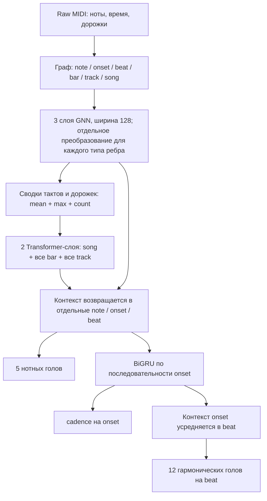

# Графовая архитектура Music Critic V2: ограничения, альтернативы и следующие проверки

Дата: 15 сентября 2026. Запись исследования: `EXP-ARCH-GRAPH-RESEARCH-001`.
Область: текущая corrected V2, локальный код, сохранённые результаты и первичные публикации. Нового обучения на корпусе, загрузки обученных весов, SSH и обращения к TEST не было. Проведены два небольших синтетических теста маршрутизации.

**Главный вывод:** оснований отказываться от графов сейчас нет. Однако в нашей реализации есть конкретные ограничения разрешения предсказаний и передачи контекста, которые стоит проверить раньше очередного усложнения голов. Неудачные fusion/MMoE результаты пока не являются проверкой пригодности графового подхода: большая часть графового энкодера во всех этих вариантах одинакова.

## 1. Что результаты говорят об архитектуре

Исторические C2 / linear fusion / attention fusion на 80k получили `primary_score` **0.489375 / 0.472602 / 0.463385**. Последний переданный пользователем лог MMoE содержит обучение до 21k и validation до 20k: **0.334647**, против исторической C2 **0.395738** на 20k. Это промежуточное отставание MMoE, не его результат на 80k. Источники: [сравнение MMoE](../experiments/MMOE_PROGRESS_002_RU.md), [attention 80k](../experiments/TASK_ATTENTION_80K_FINAL_RU.md), [поправки к интерпретации](../experiments/POSTBREAK_AUDIT_20260915_RU.md).

`primary_score` — средний macro-F1 по восьми основным головам. Он не равен доле правильных аккордов, среднему по всем 18 головам или проценту понимания музыкальной теории. Ни одна из приведённых разниц сама по себе не указывает, на каком уровне теряется информация. Исторические сравнения также не заменяют воспроизведение в полностью одинаковом окружении.

Важно разделить четыре причины ошибок:

1. Нужных сведений нет во входном представлении либо нужные события не различаются на выходе.
2. Сведения доступны, но архитектура плохо передаёт или сохраняет их.
3. Архитектура может решить задачу, но обучение не находит такое решение: конкурирующие задачи, дисбаланс, оптимизация.
4. Данных, согласованности разметки или покрытия редких случаев недостаточно.

Более сложный блок не обязан устранять каждую из этих причин. Само число голов тоже не доказывает разнообразия выученных навыков: несколько гармонических меток могут описывать одно событие и быть сильно связаны.

## 2. Как действительно протекает информация

### Текущий маршрут

Fusion и MMoE добавляют обработку перед/между соответствующими головами. Они не создают новые музыкальные события или новые рёбра между ними. В текущем MMoE note/onset банк **разделяет параметры** между задачами, но не смешивает строки нот и onset между собой.

### Существенные детали

| Узел вычислений | Что есть в коде | Значение для анализа музыки |
|---|---|---|
| Граф | 6 типов узлов, 26 направленных типов рёбер, включая обратные связи | Представлены принадлежность, одновременность, временное соседство и звучание на начале доли |
| GNN | Сумма `W_relation × source`, self-преобразование, residual, LayerNorm, GELU | Тип связи учитывается; сообщение не обусловлено отдельно парой высот/времён и состоянием получателя |
| Короткие пути | `note → track → note`, `note → bar → note` | Даже ранняя GNN не ограничена несколькими соседними нотами во времени; дорожка может передавать сводку всего произведения |
| Pooling | Mean, max, число элементов, доступность и остаточный путь | Это не только среднее. Но множество событий всё равно сводится к ограниченному числу векторов |
| Глобальный контекст | Полный attention между song/bar/track | Дальний контекст предусмотрен; отдельные ноты не являются прямыми токенами этого attention |
| Возврат контекста | Нота получает свою дорожку, такт и song через gated residual | Локальное состояние ноты сохраняется, а не полностью заменяется одним вектором песни |
| Последний BiGRU | Обновляет onset, beat, bar; не обновляет note, track, song | У нот есть предшествующий глобальный контекст, но нет последнего последовательного контекста |
| Readout | Harmonic event привязывается к содержащей его доле | Внутри доли разные гармонические события могут получить одни и те же logits |

Проверенные места: [relations.py](../../src/music_critic/graph/relations.py), [encoder.py](../../src/music_critic/models/encoder.py), [hierarchy.py](../../src/music_critic/models/hierarchy.py), [onset_bigru.py](../../src/music_critic/models/onset_bigru.py), [corrected_model.py](../../src/music_critic/experiments/analysisgnn/corrected_model.py). Ключевые участки на момент исследования: `encoder.py:314–376`, `hierarchy.py:478–570,786–1008`, `onset_bigru.py:113–159,190–232`, `corrected_model.py:119–148`.

**Поэтому картина «всё превращается в один общий вектор и дальше ничего не различается» неверна.** Отдельные нотные состояния и residual-пути остаются. Более точный вопрос: достаточно ли информативны групповые сводки и правильно ли они возвращаются к тем сущностям, на которых требуется решение?

## 3. Конкретные ограничения и степень уверенности

### 3.1. Разные события могут конкурировать за одно предсказание

Гармонические события sidecar различаются по исходной идентичности и точному времени. Но модель выдаёт гармонические logits на `beat`. Alignment разрешает нескольким валидным событиям ссылаться на одну строку logits. Loss выбирает эту строку отдельно для каждой метки.

Синтетический пример с настоящими raw-атаками внутри одной доли:

| Время, в четвертях | Цель root | Индекс выходной строки | Маска |
|---|---|---|---|
| 0 | C | 0 | true |
| 1/2 | D | 0 | true |

Тест подтвердил: строки logits **тождественны**. При обычном выборе одного класса обе цели одновременно угадать нельзя; максимальная accuracy именно на этой паре — 50%. Это свойство отображения событий в выходные позиции, независимо от качества весов.

Это **не измеренный потолок качества на Dilemmadata**. Неизвестно, сколько таких конфликтов есть в корпусе и каких голов они касаются. Найденные ранее 59 долей с разными наборами `changes` не являются подсчётом конфликтов root/quality. Кроме того, этот маршрут общий для C2 и новых fusion-вариантов: он может ограничивать всех, но сам по себе не объясняет, почему MMoE хуже C2.

Первое практическое действие — посчитать по TRAIN для каждой головы: число событий на слот, число различных валидных классов на слот, затронутые события/произведения, частоты конфликтов. Для фиксированных слотов и меток верхняя граница event accuracy:

`sum_slots(max_class count(slot, class)) / sum_slots(count(slot))`.

Это граница **accuracy**, не macro-F1. Для полного joint следует считать частоты полных кортежей на общем валидном наборе. Противоречие может происходить и от разных аннотаций одного времени; такой случай более частая сетка автоматически не разрешит.

Если конфликтов достаточно много, нужен более подробный raw readout: события начала/окончания нот и метрические позиции, либо запрос к представлению по raw-времени. Gold-границы аккордов нельзя превращать в обязательный вход. Надо отдельно проверить покрытие аннотаций новыми кандидатами и сохранять общий набор оцениваемых меток при сравнении. Просто убрать неудобные метки маской — изменение задачи, а не доказанное улучшение модели.

Код: [создание событий и интервалов](../../src/music_critic/experiments/analysisgnn/multitask_contract.py), участки `1575–1611,1647–1667,1902–1951`; [alignment и loss](../../src/music_critic/experiments/analysisgnn/corrected_training.py), `367–425,493–509`.

### 3.2. Последний последовательный контекст не возвращается к нотам

Второй тест сравнил представления до и после BiGRU: изменились onset/beat/bar, остались без изменений note/track/song. Это подтверждает маршрут, но не доказывает ущерб качеству. Ноты уже получили контекст от Transformer ранее.

Проверяемая модификация: небольшой gated residual `note ← own onset after BiGRU`. Она позволит нотным задачам использовать этот дополнительный горизонтальный контекст. Сравнивать нужно прежде всего пять нотных голов, а не только основной гармонический score. Для протяжённых нот потребуется отдельно определить, достаточно ли контекста начала или важны последующие позиции звучания.

### 3.3. Дорожка не является голосом

`next_in_track` связывает ноты согласно каноническому порядку. В полифонической дорожке это не обязательно продолжение одного музыкального голоса. Полезные пути косвенно существуют, но выраженного отношения «эта нота продолжает данную линию» может не быть.

Это хороший аргумент за задачу предсказания продолжения голоса. Целью может быть ребро между нотами; экспертную разметку голосов нельзя одновременно подавать как готовые входные рёбра в том же тесте. Подготовленный у нас контракт пока не равен включённой задаче обучения.

### 3.4. Вертикальный срез должен включать удерживаемые ноты

`note → beat: active_at` отражает звучание на начале доли. Но отдельное отношение «все ноты, звучащие в момент этого onset» сейчас не выполняет такую же роль для каждого onset. Начавшаяся раньше нота может быть гармонически важна для новой атаки, особенно при задержании.

Это не полное отсутствие информации: есть duration, beat/bar и другие пути. Проверяемая гипотеза — прямое сообщение от всех звучащих нот к raw onset упростит нужное сопоставление. Такая связь вычисляется по точному времени без гармонической разметки. Источник: [builder.py](../../src/music_critic/graph/builder.py), участки `273–297,751–756`.

### 3.5. Хабы и сводки могут скрывать различия

У нас сообщение по ребру линейно зависит от источника, а входящие сообщения суммируются без нормирования по степени. Узлы track/bar с большим числом соседей могут получать другой баланс сигналов, чем малые группы. LayerNorm и residual уже частично меняют этот эффект, поэтому утверждать «плотные места заглушают всё» без измерений нельзя.

Следующие кандидаты: нормирование/гейтинг по типам связей; относительные интервалы высот и времени; несколько обучаемых слотов на группу; `track × bar` вместо одной сводки всей дорожки. По одному изменению за сравнение. Добавление attention везде одновременно сделает причину эффекта непонятной.

## 4. Что известно о сильных и слабых сторонах GNN

Музыка подходит графам там, где важны несколько типов отношений одновременно: порядок в голосе, совместное звучание, принадлежность такту, связь партий. Для таких отношений не требуется произвольно сериализовать все одновременные ноты в одну цепочку. Цена — отношения приходится задавать или учить; неудачная топология задаёт неудобные пути рассуждения.

| Механизм | Понятное объяснение | Что надо проверить у нас |
|---|---|---|
| Недостаточная дальность, underreaching | До нужного события нет доступного вычислительного пути | Пути с учётом track/bar/song, Transformer и GRU, а не только число GNN-слоёв |
| Oversquashing | Много разных сообщений приходится переносить через небольшое число каналов | Помогают ли дополнительные групповые слоты/пути при одинаковых задачах и контроле ёмкости |
| Oversmoothing | Представления разных узлов теряют различимость при повторном смешивании | Задачные probes на этапах; сходство векторов само по себе недостаточно |
| Потеря при pooling | Отдельные состояния информативны, но сводка группы хуже сохраняет важное | Одинаковые probes до/после pooling и контроль с более богатой сводкой |
| Ошибка readout | Нужные ответы нельзя различить на выходе | Перепись конфликтов событий на один слот; это не диагноз oversquashing |

Исследования [Alon & Yahav, ICLR 2021](https://arxiv.org/html/2006.05205v4) и [Topping et al., ICLR 2022](https://arxiv.org/pdf/2111.14522) связывают ограничение передачи дальних зависимостей с узкими путями в графе. Перенос их диагноза на нашу гетерогенную модель с глобальными обходными путями требует измерений. Малый градиент от далёкой ноты может означать как архитектурное ограничение, так и выученную нерелевантность конкретной ноты.

[Li et al., 2018](https://arxiv.org/pdf/1801.07606) анализируют сглаживание в GCN. Наши три слоя с residual и отдельным глобальным блоком не позволяют по одной глубине объявить oversmoothing. [Xu et al., ICLR 2019](https://arxiv.org/html/1810.00826v3) показывают важность выразительности агрегации множеств; у нас mean/max дополнены числом элементов и контекстными состояниями, поэтому простые контрпримеры для «чистого среднего» нельзя переносить буквально.

Нужен и честный контроль без передачи сообщений. Общий `feature_only` путь в проекте есть, но текущая corrected-конфигурация требует GNN и не предоставляет готового эквивалентного переключателя. Для сравнения придётся явно сохранить те же raw-признаки, иерархию, Transformer, GRU, 18 голов, loss и данные. Дополнительный вариант с MLP сопоставимой ёмкости поможет отделить вклад сообщений от количества параметров. Старый nearest-centroid контроль отличается и данными, и ёмкостью, поэтому этот вопрос не закрывает.

## 5. Публикации, которые действительно меняют наши приоритеты

| Работа | Что полезно | Ограничение переноса и вывод для проекта |
|---|---|---|
| [GraphMuse, ISMIR 2024](https://arxiv.org/html/2407.12671v1) | Иерархия нот/долей/тактов, музыкально согласованный sampling, гибридная последовательная обработка | В cadence-абляции более полная иерархия не автоматически лучшая. Сохранять одновременные группы; проверять каждый уровень |
| [MusGConv, IJCAI 2024](https://arxiv.org/html/2405.09224v1) | Относительные высотные и временные отношения совместно с абсолютными признаками | Улучшения есть для нескольких задач, но значимого улучшения Roman numeral analysis авторы не установили. Это кандидат для голосоведения, не обещание роста harmonic F1 |
| [GraphGPS, NeurIPS 2022](https://arxiv.org/html/2205.12454v3) | Совместная работа локальных связей, позиционной информации и глобального обмена | У нас эти части уже есть, но соединены преимущественно последовательными этапами. Проверяемая идея — повторять локальный и глобальный обмен, возвращая контекст вниз |
| [Where Did the Gap Go?, 2023](https://arxiv.org/html/2309.00367v2) | Часть преимуществ Transformer на long-range графовых benchmarks сокращается при хорошей настройке GNN | Перед сменой семейства нужен сильный контроль с сопоставимым readout и настройкой; больше сложности не гарантирует преимущество |
| [AllSet, ICLR 2022](https://arxiv.org/pdf/2106.13264) | Обучаемые функции `элементы → группа → элементы`, включая set attention | Наш onset/bar уже служит посредником группы. Можно улучшить оператор обмена без обязательного перехода на новый формат «гиперграфа» |
| [Voice Separation with GNNs, IJCAI 2023](https://www.ijcai.org/proceedings/2023/0430.pdf) | Голос как предсказываемая связь продолжения между нотами | Ограничения входящей/исходящей связи подходят монофоническим голосам. Хоровые аккорды и неоднозначное разделение требуют отдельной политики |
| [AnalysisGNN, 2025](https://arxiv.org/html/2509.06654v1) | Совместное обучение музыкальному анализу; GNN сочетается с последовательным блоком | В Table 4 fusion улучшает три показателя, но phrase F1 снижается с .752 до .742. Не универсальное улучшение; их CSR/F1 нельзя напрямую сравнить с нашим primary score |
| [Graph-Mamba, 2024](https://arxiv.org/html/2402.00789v1) | Альтернативный механизм длинного контекста с ограниченными затратами | Сериализация и порядок узлов критичны. Рассматривать на временной цепочке onset/групп, если подтверждена проблема длинного контекста или стоимости |

Для общей ориентации полезен [survey Le et al., ACM Computing Surveys 2025](https://doi.org/10.1145/3714457): выбор представления и задачи важнее механического переноса NLP-модели. Его охват в основном заканчивается серединой 2024 года; свежие preprints 2026 ниже рассматриваются отдельно. Графы также не единственная рабочая семья для гармонического анализа: существует последовательный [RNBert](https://malcolmsailor.com/assets/RNBERT_ISMIR_Camera_Ready.pdf).

## 6. Стоит ли вместо GNN взять VAE или GNN-VAE

Это разные оси решения:

| Вопрос | Возможные варианты |
|---|---|
| Как представить музыку? | Граф нот/групп; последовательность событий; piano roll |
| Как передавать контекст? | GNN, Transformer, GRU/SSM, сочетание |
| Чему учить представление? | Theory supervision, masked reconstruction, JEPA, VAE, несколько objectives |
| Где выдавать ответ? | Нота, raw onset, доля, окно, пара событий |

GNN может быть энкодером VAE или JEPA. VAE сам по себе не добавляет отсутствующие связи голосов и не исправляет ситуацию, когда двум аккордам выделена одна выходная позиция.

[MusicVAE, ICML 2018](https://proceedings.mlr.press/v80/roberts18a.html) полезен идеей иерархического декодера, который должен использовать латентное представление для последовательностей. [PianoTree VAE, ISMIR 2020](https://archives.ismir.net/ismir2020/paper/000096.pdf) моделирует внутреннюю структуру полифонических событий, а не только плоскую строку нот. Для нас это аргументы за структурированную групповую реконструкцию, но не доказательство пользы вероятностного bottleneck для классификации гармонии.

Классический [VGAE](https://arxiv.org/abs/1611.07308) восстанавливает adjacency через латентные переменные. Значительная часть наших рёбер детерминированно строится по времени и принадлежности. Хорошее восстановление такой adjacency может означать освоение graph builder, не гармонического контекста. Более содержательная цель — скрытые ноты, относительные отношения, продолжение голоса или представление музыкального фрагмента.

VAE заслуживает отдельного теста, если нам нужны генерация, интерполяция или вероятностное моделирование. Риски для критика: сжатие может убирать тонкие редкие различия; сильный декодер может обходить латентный код. Сначала стоит сравнить обычный autoencoder и VAE при одинаковых энкодере, декодере и downstream-оценке. ELBO или вероятность восстановления не тождественны музыкальному качеству.

**Приоритет сейчас: исправно измерить представление и readout. Полный переход на VAE преждевременен.**

## 7. JEPA и иерархические окна: что можно перенести

JEPA учит по видимому контексту предсказывать **представление скрытой области**, сформированное целевой ветвью, а не обязательно каждый MIDI-токен. Это позволяет добавить такую цель поверх графового энкодера.

Свежий [MIDI-RAE-JEPA](https://arxiv.org/html/2607.14537v1) использует иерархию Swin на piano roll. Интересна именно многоуровневая организация задач, а не необходимость превратить наши графы в картинки. Бинарный piano roll в таком виде обедняет сведения о дорожках и исполнении, которые нам нужны.

Нужно учитывать уточнение в последующем [MRJS, август 2026](https://arxiv.org/html/2608.04378v1): автор сообщает о разных splits и повреждённых данных в старом pipeline. Старые цифры там оставлены как историческая справка. В исправленном авторами протоколе добавление chord supervision повышает joint chord probe с .18 до .54 и key probe с .16 до .70; одни SSL-цели не обеспечили такой гармонический результат. Это **другие метрики**, не наши macro-F1. Увеличение Lakh в четыре раза при фиксированном бюджете также не дало устойчивого выигрыша. Оговорка о старом pipeline уже присутствовала в нашем исследовании от 8 сентября; это не новая положительная независимая репликация.

Предлагаемый для нас механизм, пока без реализации:

1. Raw ноты и одновременные/звучащие группы кодируются графом.
2. Несколько групповых векторов описывают окно в музыкальном времени — например, такт или несколько долей. Один слот не обязан вмещать все голоса.
3. Последовательный блок обменивается информацией между окнами. Чередование обычных и сдвинутых окон открывает пути через их границы.
4. По видимому контексту предсказываются латенты скрытого окна/уровня. Отдельная реконструкция нужна только как явно проверяемая дополнительная цель.
5. Theory batches сохраняются; полезность проверяется на фиксированных музыкальных задачах и контекстных случаях.

Малое окно **не означает автоматически «грамматику»**, большое — «семантику». Окно определяет доступные сведения; учебная цель и данные определяют, что модель будет вынуждена извлекать. Одинаковые десять нот занимают очень разное музыкальное время в разных фактурах, поэтому разумнее начинать с exact-time/метрических окон, учитывая смены размера.

[ARIMA, июль 2026](https://arxiv.org/abs/2607.10003) также рассматривает оконные латенты и их временное предсказание. [CoJEPA, 2026](https://arxiv.org/html/2608.30974v2) сочетает локальный и глобальный objectives для аудио; это полезный принцип, но не доказательство для MIDI-графа и нашего batch=2. [Music-JEPA, 2026](https://arxiv.org/abs/2607.22000) использует аудио и действия piano roll; потребность в парных данных делает его менее прямым кандидатом для текущего symbolic-проекта. Все эти свежие работы нужно считать ранними свидетельствами, не установленным стандартом.

### Как не повторить слабый SSL-эксперимент

В коде уже есть GraphMAE2-inspired remasking и latent targets нескольких уровней. Текущая целевая ветвь использует те же веса с detach, **не отдельного EMA teacher**. Это допустимый конкретный вариант, но не точная репликация [GraphMAE2](https://arxiv.org/abs/2304.04779). Источники: [ssl/model.py](../../src/music_critic/ssl/model.py), [ssl/multilevel.py](../../src/music_critic/ssl/multilevel.py), [отчёт пилотов](../experiments/RESEARCH_PILOTS_20260913_REPORT_RU.md).

Предыдущий пилот с 200 mixed updates и 100 theory-recovery updates не дал положительного primary endpoint и не содержал matched theory-only continuation. Он не доказывает, что SSL или JEPA бесполезны.

Новый пилот должен сравнивать одинаковые маски и бюджеты: theory-only continuation; текущий shared/detached target; вариант с EMA target. Менять одновременно encoder, маску, teacher и loss нельзя, если хотим понять причину. Проверки: доступность скрытого содержания через соседние признаки/агрегаты, разнообразие латентов, effective rank, probes по задачам, сохранение редких классов. Малое SSL-loss само по себе ничего из этого не подтверждает.

Batch=2 содержит много узлов, но только два произведения: узлы не являются независимыми музыкальными примерами. Это особенно важно для статистик anticollapse и contrastive negatives. Отдельно определить, по каким единицам и буферу оцениваются статистики; не подменять число независимых примеров числом нот. Перекрывающиеся окна должны наследовать split произведения до нарезки.

## 8. Ревизия отложенных идей

| Идея | Фактический статус | Что проверить следующим |
|---|---|---|
| Многоуровневое masked SSL | Код и короткий real-data пилот есть; положительный transfer не установлен | Matched theory-only контроль, цели и отсутствие обходных путей |
| JEPA с EMA и предсказанием фрагментов | Такой полноценный вариант ещё не проверен | Малый отдельный objective-пилот на имеющемся энкодере |
| CLS/групповые токены для реконструкции | Bar/song латенты есть; реконструкция всей группы только через её токены не реализована как отдельный контракт | Несколько слотов; проверить, не получает ли decoder ответ через другие входы |
| Shifted-window attention | Предложение, не текущий task attention | Окна по музыкальному времени, связь соседних окон, возврат контекста в ноты |
| Продолжение голоса | CPU-код/контракт и тесты есть; полноценного training head/loss/importer нет | Надёжность voice labels, candidate recall, ties, область part/voice |
| Подробные `changes` | TRAIN подготовлен: 1011 произведений, 251038 используемых аннотаций, 34055 непустых; 99 классов | 45 классов имеют <10 примеров, 24 встречаются в одном произведении: проверить факторизацию, а не только плоский classifier |
| Ритмическое SSL | Будущий вариант; текущая pitch-маска оставляет timing/topology | Нельзя объявлять его обучением скрытому ритму без отдельной маски и проверки утечек |
| Контекстные диагностические пары | Прототипы есть; matched causal context-ablation не закрыта | Одинаковое локальное созвучие, разное окружение; музыкальная проверка ожидаемого ответа |
| Балансировка редких классов | Есть статистика; причинный эксперимент не завершён | Frozen-encoder readout probe, precision/recall и перенос между произведениями |
| VAE/VGAE | Не реализованный кандидат | Возвращаться при чёткой цели генерации/сжатия, сравнивать с обычным AE |

Источники статуса: [voices/SSL workstream](../workstreams/2026-09-08/03_VOICES_STRUCTURAL_SSL.md), [voice contract](../workstreams/2026-09-08/VOICE_CONTINUATION_CONTRACT.md), [future targets](../MULTI_ASPECT_TARGETS_FUTURE.md), [полный TRAIN changes](../experiments/DLC_CHANGES_FULLTRAIN_RU.md). `changes` обозначают модификации аккордов; сами по себе они не являются размеченными цепочками «подготовка → задержание → разрешение».

Есть и более специализированные иерархические подходы: [AutoSchA](https://arxiv.org/html/2512.18232v1) моделирует структурную редукцию, но использует дополнительные музыкальные признаки/связи и небольшой корпус фуг. Это интересное направление группировки и редукции, не готовый raw-MIDI анализатор общего назначения для замены нашего backbone.

## 9. Предлагаемый порядок работ

Это предложения для следующего решения, не разрешение на новые длительные запуски.

**Шаг A — локализовать ограничение без нового большого обучения.** TRAIN-only перепись конфликтов readout; проверка raw-путей для удерживаемых нот и голосов; probes представлений до/после ключевых блоков. Последние требуют отдельного протокола и доступа к весам: в этом исследовании они не выполнялись. Сравнивать одинаковые targets, splits и ёмкость probes. Извлекаемость признака не равна доказанному использованию его моделью.

**Шаг B — минимальная архитектурная абляция.** Если конфликты часты, первым проверить более точный raw-event readout. Отдельно — возврат BiGRU-контекста к нотам. Зафиксировать поддержку labels, главный score, результаты всех 18 голов и время. 500 updates достаточно для проверки градиентов/стабильности, но не для окончательного ранжирования архитектур. Бюджет сравнения выбрать заранее по известным кривым и доступному compute; не расширять только проигрывающую модель до победы.

**Шаг C — проверить пользу самого графа.** Сопоставимый вариант без message passing, затем один из вариантов музыкальных рёбер/группового обмена. Если контролируемый вариант без GNN оказывается не хуже на нужных задачах и контекстных проверках, основание для упрощения будет эмпирическим. Если выигрывают относительные рёбра или связи звучания, это основание улучшать граф.

**Шаг D — вернуться к SSL/JEPA на рабочем представлении.** Небольшой заранее определённый пилот с theory retention и matched контролем. Масштабировать PDMX после подтверждения пользы, отдельно различая эффект дополнительных данных, objective и длительности обучения. Не проверять одновременно новую архитектуру, новый SSL и новые targets одним запуском.

Для будущего гармонического критика к этому стоит добавить хотя бы одну задачу, которая действительно требует горизонтального сопоставления: продолжение голоса или контекстную функцию неаккордового тона с подходящей разметкой. Обучение множеству полей аккорда не гарантирует само по себе понимания подготовки и разрешения. Представление, анализ сущностей и последующее оценивание качества — связанные, но разные этапы.

## 10. Проверки и границы этого исследования

- Два source-free теста: **2 passed, 1 dependency deprecation warning, 1.17 s**. Подтверждены общий выходной слот для двух разных subbeat root-целей и неизменность нотных векторов после текущего BiGRU.
- Первый запуск синтетического примера остановился на неправильном формате созданного в нём `note_id`. Исправлен только идентификатор fixture, лог первой попытки сохранён. Это не ошибка production graph builder.
- Тесты работают на случайно инициализированной модели с seed 17. Они показывают структурное свойство вычислений, не измеряют музыкальное качество.
- Не измерялись частоты конфликтов на настоящем TRAIN, oversquashing, oversmoothing, степень использования контекста и выигрыш любой предлагаемой архитектуры.
- Взяты текущие локальные исходники; удалённый процесс и live-состояние MMoE не проверялись. Исторические результаты используются с ограничениями из соответствующих отчётов.
- Исходники обучения, зависимости и архитектурные решения не изменены. Legacy не читался и не использовался. Полные диагностические файлы и manifest хранятся в игнорируемом `outputs/architecture_graph_research_20260915/`; компактные hashes — в записи эксперимента.

Итоговая рабочая гипотеза: **у графового подхода есть смысл для нашей полифонической задачи, но качество зависит от различимости событий, подходящих музыкальных отношений, возврата контекста и учебных целей. Именно эти элементы сейчас проверять полезнее, чем выбирать семейство модели по названию.**
