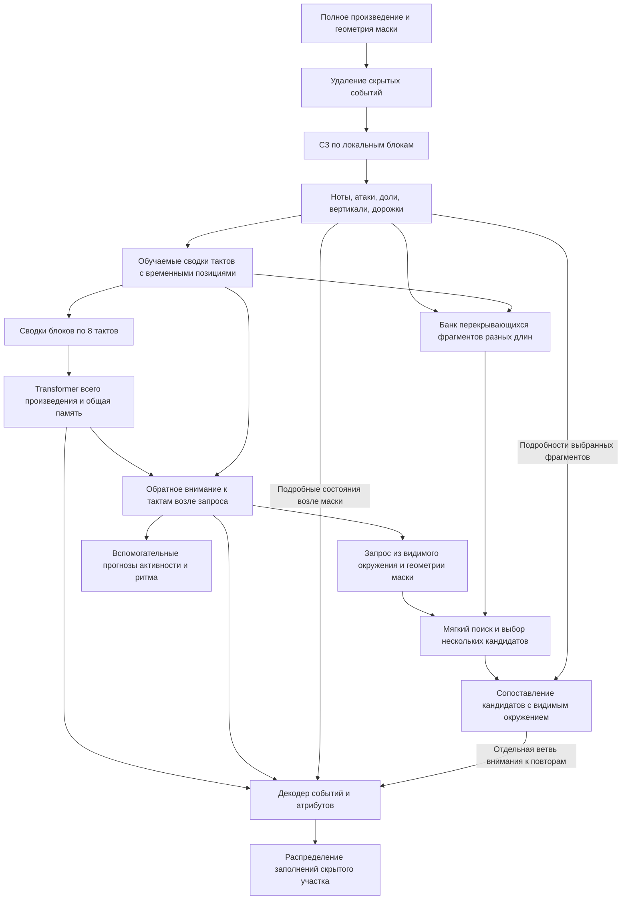

# HCM-1: предлагаемая память всего произведения и повторов

Обновление после следующего решения пользователя: реализован вариант
`WholePieceHCM` с полным контекстом и масштабами **1/2/4/8/16/32 такта**.
Точный состав реализованного варианта, ограничения и последующие проверки —
в [HCM_WHOLE.md](../HCM_WHOLE.md). Ниже сохранён исходный исследовательский
проект; дополнительные идеи, например отдельные головы активности, не следует
считать реализованными. Новая архитектура пока проверена только синтетически.

28 сентября 2026. Продолжение обсуждения
[удалений и полного контекста](HCM1_SILENCE_AND_WHOLE_TRACK_20260928_RU.md).
Пользователь поддержал направление и запросил архитектуру. Ниже — проект
для следующей реализации, а не уже реализованная или проверенная модель.
Текущий checkpoint не имеет этих новых модулей.

Уточнение после обсуждения рефренов: в целевой проект включены банк фрагментов,
поиск нескольких кандидатов и мягкое сопоставление повторов. Для научной
проверки базовая глобальная память и память повторов остаются отключаемыми
по отдельности. Этот документ заменяет прежнюю схему без явного поиска мотивов.

Вопрос: как восстановление скрытого участка может учитывать устойчивые свойства
песни, её повторы и изменения характера? Предлагается двусторонняя иерархическая
память, построенная из видимой части всего произведения. Порядок событий
сохраняется до сжатия. Общие признаки песни дополняют память отдельных фрагментов.

## Поток данных

## 1. Локальное представление: использовать нынешний C3

Сохранить `PLLContextEncoder`: C3 обрабатывает ядро из четырёх тактов
с соседними тактами, возвращая note/onset/beat/slice/bar/track states.
Изменить подготовку наблюдаемого контекста: сейчас `split_masked_piece`
обрезает его до 32 тактов. Нужен отдельный контракт полного наблюдаемого
произведения и ограниченного подробного контекста запроса.

Не строить один граф всех нот длинной песни. Обрабатывать её локальными
блоками; владение основными тактами должно исключать двойной учёт перекрытий.
Протяжённые ноты и пустые такты сохраняют своё значение. Подробные состояния
декодеру нужны возле маски; дальние блоки сначала передают компактные сводки.

Имеющийся C3 можно переиспользовать с текущими весами. Для первого сравнения
разумно зафиксировать весь локальный путь, включая обучаемую сейчас
`boundary_projection`, и обучать новые агрегаторы, дальнюю память и декодер.
Это отдельный предложенный режим, отличный от нынешнего `freeze_policy=frozen`,
который оставляет эту проекцию обучаемой. Затем можно проверить размораживание
верхних уровней C3 отдельным опытом.

## 2. Такт: сохранить расположение атак и различия дорожек

Добавить `BarMemoryEncoder`. Он принимает состояния событий/долей/вертикалей
и известную метрическую геометрию. Временные признаки включают номер доли,
положение внутри доли, расстояния между атаками и принадлежность дорожке.
Исходные рациональные времена сохраняются; преобразования для нейросетевых
признаков не меняют канонические события и правила сравнения времени.

Сначала внимание внутри дорожки и такта, затем обмен между дорожками через
вертикали и общие представления долей. Несколько обучаемых запросов сжимают
эти состояния в небольшое число векторов. Начальный вариант — четыре вектора
ширины 256 на такт. Направления их специализации: ритм, активность/фактура,
вертикаль, мелодическое движение. Раздельные входы и вспомогательные задачи
могут направлять специализацию, но названия векторов сами по себе не доказывают
их музыкальный смысл. Сохраняется общий обмен информацией между направлениями.

В отличие от простого среднего, внимание получает позиции и взаимодействия
до сжатия. Это создаёт возможность различать порядок и фазу атак; сохранность
этой информации необходимо проверить декодированием ритмических признаков
из сводок и контролями с переставленными атаками.

## 3. Всё произведение: несколько масштабов памяти

Добавить `PieceMemoryEncoder` с двумя уровнями:

- Внутри группы из восьми тактов два небольших Transformer-слоя обрабатывают
  последовательность тактовых представлений и создают четыре сводных вектора.
- Два двусторонних слоя обрабатывают сводки всех групп и, как стартовый размер,
  восемь общих обучаемых элементов памяти песни. Позиции групп сохраняются.

Это начальные инженерные размеры для проверки, не оптимальные гиперпараметры.
Группа из восьми тактов — вычислительный блок, не размеченная музыкальная фраза
и не обязательная граница куплета. Память всего произведения позволяет связывать
группы через такие границы. При необходимости более крупных масштабов можно
добавить следующий уровень, сохраняя полный охват и явно ограничивая профиль.

Память хранит одновременно общие свойства и их изменение во времени.
Гипотетический пример: общий рисунок песни синкопированный, но перед возвратом
припева предусмотрен разреженный переход. Модель должна иметь доступ и к
повторяющимся припевам, и к положению данного перехода; одной постоянной
характеристики «песня синкопированная» недостаточно.

Далее такты возле маски через cross-attention получают контекст от сводок
всей песни. Базовый вариант сохраняет подробные состояния только рядом
с запросом; целевой вариант дополнительно раскрывает выбранные дальние
фрагменты через модуль повторов, описанный ниже.

Схожий принцип подробного и сжатого внимания использует
[Museformer, §3](https://papers.nips.cc/paper_files/paper/2022/file/092c2d45005ea2db40fc24c470663416-Paper-Conference.pdf).
Там подробные связи выбираются по статистике расстояний между тактами.
В нашем предложении подробные дальние связи выбирает отдельный модуль поиска
по видимой музыке; это отличие от описанной в статье схемы. Результаты авторегрессионной генерации
из статьи не доказывают качество предлагаемого двустороннего восстановления.

## 4. Память повторов: поиск, сопоставление, обращение к подробностям

Добавить `MotifMemory` из трёх частей. Поиск выполняется внутри наблюдаемой
части текущего произведения. Внешняя база песен этому варианту не требуется.

**Банк фрагментов (`FragmentBank`).** Из локальных состояний и тактовых
представлений до их глобального смешивания строятся перекрывающиеся фрагменты.
Начальный набор масштабов — 1–2 метрические доли и 1/2/4/8 тактов. Короткие
окна сдвигаются по долям и видимым атакам, длинные — по тактам. Выбор окон
не использует события, удалённые маской. Границы вычислительных блоков C3
не должны становиться границами возможных мотивов.

У фрагмента есть несколько ключей поиска: расположение атак, относительные
высотные отношения, вертикаль и фактура. Сохраняются и абсолютные высоты,
реальные длительности, дорожки и позиция. Относительные ключи позволяют
искать кандидатов для транспонированного или изменённого повтора; они
не объявляют такие варианты одинаковыми по музыкальному смыслу. В полифонии
дорожка не равна голосу: интервалы последовательных нот произвольной сортировки
не должны выдавать себя за мелодический контур.

**Поиск (`MotifRetriever`).** Запрос получается из видимых фрагментов слева
и справа от маски, незамаскированных дорожек, геометрии запроса и общей памяти
песни. Содержимое скрытой цели не используется. Если фраза почти целиком скрыта,
поиск заведомо менее определён; допускаются несколько гипотез или отсутствие
полезного повтора. Далёкое наблюдаемое повторение может служить законным
контекстом, даже если оно совпадает с правильным заполнением.

Первая версия раскрывает подробности максимум четырёх кандидатов.
Перекрывающиеся окна одного и того же места объединяются или разрежаются
по геометрии, чтобы не занять все четыре позиции почти одинаковыми копиями.
Для начала кандидаты должны целиком лежать вне маски; расширение на частично
видимые кандидаты требует отдельного контракта покрытия. Поддерживается
обучаемая ветвь «не использовать повтор».

Поиск имеет дифференцируемый путь: мягкие веса по компактным сводкам всех
кандидатов формируют дополнительный контекст. Жёсткий top-k определяет лишь,
какие подробные состояния прочитать. Через сам выбор индексов градиент не идёт;
обучение нельзя обосновывать наличием одного top-k. Мягкий путь остаётся
в обучении, выбранные подробности и их веса обучаются через декодер. Получение
осмысленного поиска из loss восстановления — проверяемая гипотеза. Ручные
метки «это припев» не требуются; достаточность такого обучения заранее неизвестна.

**Сопоставление (`MotifAligner`).** Небольшой блок cross-attention сопоставляет
видимые части запроса и выбранный фрагмент с относительными позициями.
Он допускает мягкие соответствия между атаками, различия темпа рисунка,
высотного сдвига и дорожек. Гипотезы преобразования не применяются жёстко
к исходной музыке. Если видимого материала мало, остаётся распределённое
внимание без утверждения, что найдено точное соответствие.

Результат — отдельная память деталей кандидатов, их координат и соответствий.
Начальный бюджет — до 64 подробных векторов на кандидат, до 256 суммарно;
при сжатии используются временные позиции и явное покрытие. Это предложенные
ресурсные пределы, не измеренная оптимальная ёмкость. Короткие мотивы и длинные
разделы могут иметь разные веса. Повтор баса не доказывает возвращение рефрена:
связь крупных разделов должна учитывать длительность и несколько слоёв музыки.
Отдельная семантическая метка «припев» в этот проект не входит.

Банк, запрос, кандидаты и сопоставление вычисляются из наблюдаемой музыки
до teacher-forced декодирования. Для двух заполнений с одинаковым видимым
контекстом они должны совпадать. Сам декодер вправе по-разному обращать внимание
к общей памяти при разных уже предсказанных/предъявленных префиксах ответа;
он не должен заново подбирать кандидатов по ещё скрытой правильной цели.

## 5. Запрос и декодер: мягкое уточнение на каждом уровне

Для скрытого места `QueryContext` строится из позиции маски, выбранных дорожек,
соседних тактов и памяти всей песни. Декодер получает четыре источника:

1. Подробные состояния видимой музыки возле запроса.
2. Состояния близких тактов, уже уточнённые контекстом всей песни.
3. Дальние групповые сводки и общие элементы памяти песни.
4. Мягкий контекст поиска и подробные состояния выбранных повторов.

Добавить отдельные attention-ветви с обучаемыми весами вклада источников,
чтобы большой объём дальних сводок не вытеснил локальные ноты простым числом
элементов. Такой gate не является объяснением решения модели и требует проверки
фактической чувствительности к дальнему контексту.

Нынешний декодер событий 6×256 и вложенный декодер полей 1×128 можно сохранить
как основу. Семейства отношений `activity/rhythm/vertical/melodic` получают
соответствующие представления разных масштабов. TransR-like модуль продолжает
мягко уточнять логиты. Сначала жёстко выбирать единственный стиль, функцию
или ритм и удалять несовместимые ноты из кандидатов не предлагается:
неопределённость и отклонения от повторяющегося рисунка должны оставаться допустимыми.
Для каждого нового вклада нужна возможность отключения в сравнительном опыте.

Таким образом, иерархия действует в обе стороны: локальные события образуют
память тактов и песни, а песня и найденные повторения уточняют предсказание
в конкретной позиции. Детали повтора не копируются напрямую в ответ: их
учитывает нормированный декодер совместно с местным контекстом.

Контекст запроса можно дополнительно обучать предсказывать активность
дорожек/долей, количество атак и их фазовое распределение. Эти головы получают
только видимый контекст; истинные значения скрытого участка служат целями loss.
В декодер поступает вычисленное контекстное состояние и, при необходимости,
предсказанное распределение — не правильные ответы вспомогательных голов.
Это вспомогательные задачи для представления ритма/фактуры, а не готовая
формула качества. Двойной учёт вероятностей в итоговом score недопустим;
контракт отдельной оценки удалений предстоит определить независимо.

## Маскирование, обучение и ресурсы

Скрытые события удаляются до всех графов, сводок, общей памяти и выбора
дальних фрагментов. Ровно одинаковая видимая музыка в парном сравнении обязана
давать одинаковый контекст. Признак неизвестного участка отличается от
наблюдаемой паузы. Нельзя предварительно вычислить «характер» по полной песне
со скрытым ответом и затем передать его модели.

В [FIGARO, §3](https://arxiv.org/pdf/2201.10936) последовательность описаний
тактов содержит разные свойства музыки, но извлекается из самого целевого
материала. Это другая задача; готовые описания целевого фрагмента у нас были бы
утечкой. Семантические аннотации, имя песни или жанр не требуются на входе.

Обучающий пример должен сохранять идентичность целого произведения и позиции
его окон. Каждая маска относится к полному наблюдаемому произведению; нынешних
разрозненных окон по 16 тактов для этого недостаточно. Где источник содержит
только отрывок, покрытие остаётся отрывком и не называется полным треком.
Разделение TRAIN/VALIDATION выполняется по произведению до нарезки.
Длины скрываемых ответов можно сначала оставить 1/2/4 такта, меняя только
видимый контекст. Длинные маски — следующая независимая ось проверки.

Начальное обучение: восстановление скрытых событий; вспомогательные задачи
ритма/активности — отдельная объявленная добавка с собственным сравнением.
Мягкий поиск обучается через задачу восстановления, а подробный путь можно
подключать после начального обучения представлений. Не задавать всем фрагментам песни
одинаковый вектор стиля как обязательную цель: это может стереть различия частей.
Динамика и микротайминг требуют аудита источников. Нынешний target HCM-1
не содержит velocity. [Learning to Groove](https://proceedings.mlr.press/v97/gillick19a/gillick19a.pdf)
разделяет атаки, динамику и временные отклонения, но работает с короткими
ударными фразами; это основание проверить представление, а не доказательство
понимания свинга нашей моделью.

Геометрический пример бюджета: у песни из 128 тактов будет 16 групп,
то есть 64 дальних вектора плюс восемь общих. Это не измерение расхода GPU:
отдельно стоят локальные графы всей песни, тактовое сжатие, декодер и backward.
Последовательная обработка блоков сама по себе не ограничит память обучения,
если сохраняются графы градиентов всех блоков. Полностью замороженный локальный
энкодер допускает отдельную стратегию кэша/выгрузки; текущий frozen-режим с
обучаемой boundary_projection не позволяет без изменений кэшировать конечные
C3 embeddings. Ключи кэша должны учитывать веса и фактическую маскированную
геометрию; затронутые блоки и перекрытия пересчитываются. Первый ресурсный
тест на 3090 нужен до обещаний по скорости и вместимости.
Кроме того, отдельно учитываются хранение банка фрагментов, поиск и до четырёх
подробных кандидатов. Эти затраты не входят в пример из 72 дальних векторов.

## Минимальный опыт, который проверит идею

Сравнить локальную модель, вариант с дальней памятью и вариант с дальней
памятью плюс поиском повторов на одинаковых произведениях, масках и сопоставимом
бюджете; новые модули требуют обучения.
Затем при неизменных локальных соседях проверить правильную, выключенную
и подменённую дальнюю память. Подмена — диагностический контроль, она сама
по себе не доказывает музыкальную полезность. Нужны восстановление ритма,
активности, повторяющихся фраз и отдельное слепое прослушивание.
Для повторов дополнительно нужны случаи точного повторения, транспозиции,
ритмического изменения и отсутствия подходящего повтора. Они не являются
автоматическими метками хорошей/плохой музыки. Проверить случайные кандидаты,
отключённую память повторов и вклад подробного сопоставления. Простое усиление
копирования не должно приниматься за успех на осмысленных вариациях.
Вспомогательные головы добавлять отдельным сравнением.
Улучшение человеческих оценок, расход памяти и время
работы пока неизвестны. Ни один из этих опытов в данной задаче не запущен.

## Связь с текущим кодом и завершение проектирования

Проверены [encoder.py](../../src/music_critic/pll/encoder.py),
[memory.py](../../src/music_critic/pll/memory.py),
[decoder.py](../../src/music_critic/pll/decoder.py),
[relations.py](../../src/music_critic/pll/relations.py),
[masking.py](../../src/music_critic/pll/masking.py).
HEAD `287bf856643f9e555352e1661a7bf0563772178a`, рабочее дерево с ранее
существовавшими изменениями. Изменены только этот проект и STATUS.
Legacy не использовался. Реализация, новые зависимости, веса, данные и реестр
экспериментов не менялись; новые тесты поведения не запускались, поскольку
поведение программы не менялось. Следующий этап — спецификация контрактов
полного наблюдаемого произведения и памяти, затем реализация с тестами утечки,
временных позиций, покрытия и градиентов. Для поиска дополнительно проверить
идентичность кандидатов при замене скрытой цели, корректность пустого банка,
недопущение перекрытия с маской, различение unknown/rest и сохранение градиента
мягкого пути при ограничении подробного top-k. Результаты прежних 84 тестов относятся
к предыдущей задаче и не проверяют предлагаемую архитектуру.
