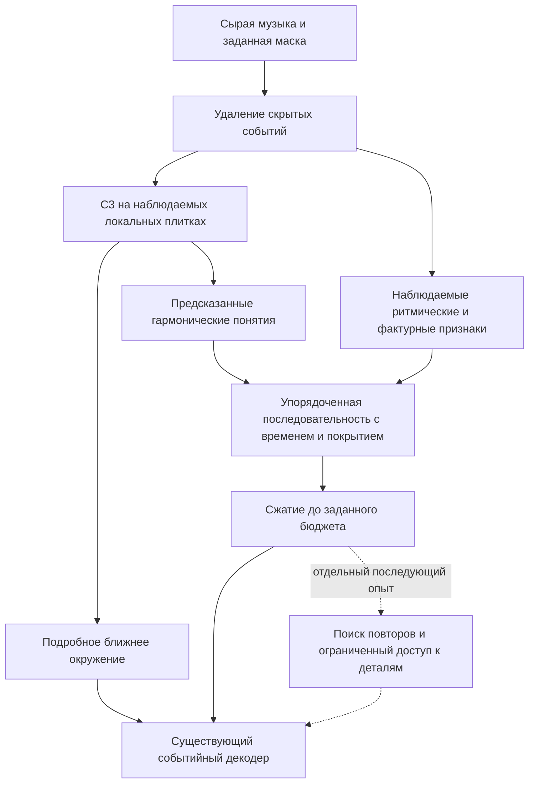

# Музыкальная абстракция дальнего контекста для C3 и HCM-2

30 сентября 2026. Исследование и предложение к проверке. Пользователь выбрал
центральный тезис «абстракция дальнего контекста улучшает музыкальное предсказание»
и сравнение строгой и гибридной памяти без заранее выбранного победителя.
Конкретная архитектура не принята и не реализована. Код, данные, веса и
серверные процессы не менялись.

## 1. Вывод и центральный вопрос

**Предлагаем проверять, помогает ли музыкальное описание дальних фрагментов
лучше использовать ограниченную память HCM.** Это более узкий и проверяемый
тезис, чем «модель понимает всю песню». Возможный механизм — представить
гармоническое движение, рисунок атак и фактуру в форме, доступной небольшому
предсказателю, сохранив подробные ноты около скрытого участка.

Польза не установлена. Уже существуют иерархическая генерация, сжатая дальняя
память, сочетание музыкальных признаков со свободными векторами и награда
через вероятность скрытых нот. Научный результат должен показать, **какую
проверяемую проблему решает наша память при сопоставимых ресурсах**.

С учётом ответа пользователя основное сравнение включает нынешнее обучаемое
сжатие, явно заданное музыкальное описание и описание с небольшим дополнительным
каналом. Короткую проверку mechanics можно начать с пары, но окончательное
сравнение не должно исключать гибрид заранее. Поиск подробных повторов проверять
отдельно. Не начинать с
одновременного увеличения C3, нового сегментатора формы, обучения на четырёх
корпусах и RL: такой опыт не позволит объяснить результат.

Центральный возможный итог для статьи: при фиксированном бюджете дальнего
контекста структурированная память лучше использует возвращения музыкального
материала и предсказывает скрытые фрагменты новых произведений. Перенос этого
выигрыша на человеческие оценки и оптимизацию генератора остаётся последующим
направлением; пользователь не выбрал его обязательным итогом первого месяца.

## 2. Что исследовано и насколько этому можно доверять

- Локальный checkout: `/Users/aavalsamakin/Projects/music-critic-v2`.
- Git HEAD: `287bf856643f9e555352e1661a7bf0563772178a`. Дерево заранее содержит
  много изменённых и незарегистрированных в Git файлов, включая PLL; HEAD
  сам по себе не идентифицирует прочитанный код. Хеши ключевых файлов — ниже.
- Прочитаны соответствующие разделы IMPLEMENTATION_PLAN, ARCHITECTURE,
  DATA_CONTRACT, EXPERIMENT_LOGGING, ROADMAP, STATUS, LEGACY_REFERENCE,
  DECISIONS, контракты HCM и гармонической разметки, исходники и сохранённые
  компактные отчёты. Полные веса и экспериментальные архивы заново не проверены.
- Внешние источники — статьи и страницы авторов/издателей; ключевые механизмы
  FIGARO, Museformer, RL-Duet и ограничений concept bottleneck сверены с
  полным текстом. Поиск проведён на 30 сентября 2026; он не доказывает
  исчерпывающую новизну во всей литературе.
- Новых forward, обучения, чтения реальных музыкальных payload, TEST,
  импорта экспериментальных результатов или SSH-подключений не было.
  Отдельная запись опыта для обзора литературы и исходников не создавалась.
- Существующие результаты ниже — сведения сохранённых отчётов, не новый
  эксперимент и не свежая проверка живых запусков.

## 3. Ближайшие исследования

| Работа | Что в ней есть | Следствие для нашего проекта |
|---|---|---|
| [Museformer, NeurIPS 2022](https://proceedings.neurips.cc/paper_files/paper/2022/file/092c2d45005ea2db40fc24c470663416-Paper-Conference.pdf) | Подробное внимание к структурно важным тактам и сжатые представления остальных. Важные расстояния выбираются по статистике повторов; есть оценка генерации и абляции. | Ближние детали плюс дальние сводки уже известны. Обязателен конкурент со свободным сжатием, которому доступен такой же контекст. Теоретические понятия не являются условием подхода. |
| [FIGARO, ICLR 2023](https://arxiv.org/pdf/2201.10936) | Последовательность описаний тактов: экспертные признаки и обученные VQ-представления. Совместный вариант полезнее отдельных описаний в их постановке управляемой генерации. | «Понятия плюс остаточная информация» уже существует. Важное отличие: описание целевого произведения доступно FIGARO. При нашей PLL анализировать скрытый ответ и передавать его описание модели нельзя. |
| [MusicFrameworks, 2021](https://arxiv.org/pdf/2109.00663) | Иерархия формы, фраз, повторов, гармонии, укрупнённой мелодии и ритма. | Обоснование нескольких аспектов памяти. Но ограниченная мелодическая постановка и заданная структура не доказывают автоматический анализ произвольной полифонии. |
| [Chord–texture disentanglement, ISMIR 2020](https://arxiv.org/pdf/2008.07122) | Раздельные представления аккордов и фактуры для коротких полифонических фрагментов. | Гармонии недостаточно для характера музыки. Результат о коротких фрагментах не является доказательством полезности памяти всей песни. |
| [AccoMontage, ISMIR 2021](https://arxiv.org/pdf/2108.11213) | Выбор фраз по ритму мелодии, гармонии и совместимости фактур, затем адаптация сопровождения. | Полезно разделять ключ поиска и извлекаемые подробности. Их вход с фразовой структурой нельзя молча заменить требованием ручной сегментации у нас. |
| [Compose with Me / CMI, AAAI 2025](https://ojs.aaai.org/index.php/AAAI/article/view/32122/34277) | Контекстный encoder, предсказание представления скрытой части и авторегрессионное восстановление нот; JEP-AGA. | Предсказание абстрактного представления до нот тоже известно. Свободные представления скрытого участка отличаются от нашего вопроса о музыкальных понятиях в дальней памяти при равном бюджете. |
| [Structural Temporal Graph, IJCAI 2025](https://www.ijcai.org/proceedings/2025/1128.pdf) | Иерархия сегментов, мотивов, относительных тональностей, функций аккордов и мелодического контура; структурное расстояние и обобщение корпуса. Ритмический контур предусмотрен, но исключён из экспериментов из-за отсутствия анализатора. | Многоаспектная музыкальная иерархия сама по себе не нова. Работа не устанавливает её пользу для нашего infilling/PLL; это подходящий структурный ориентир, не готовый decoder. |
| [RL-Duet, AAAI 2020](https://arxiv.org/pdf/2002.03082) | Предсказание диапазона нот по контексту до и после него, модели горизонтальной и вертикальной согласованности, награда для RL. | «Маскирование → вероятность → награда» не новая идея. Наша возможная разница — использование полного контекста, устройство памяти и устойчивость награды; каждую нужно доказать. |
| [CAST, Scientific Reports 2026](https://www.nature.com/articles/s41598-026-46750-0) | Каскад музыкального скелета и подробной генерации с cross-attention; сравнения качества скелета и способов conditioning. | Близкий prior art, но осторожная интерпретация: в анализе одинаковая функция фактически определяется через одинаковое качество аккорда; внимание не доказывает причинную роль. Код по заявленной ссылке не проверен; убедительной слуховой оценки в просмотренном тексте не найдено. |
| [Concept Bottleneck Models, ICML 2020](https://proceedings.mlr.press/v119/koh20a.html) | Промежуточные понятия, через которые принимается решение; возможность исправлять понятия и исследовать результат. | Основа проверяемого интерфейса. Их результат на изображениях не устанавливает пользу музыкальных функций. |
| [Concept Embedding Models, NeurIPS 2022](https://arxiv.org/html/2209.09056) | Зависящие от входа векторы понятий сохраняют дополнительные детали. | Практический вариант при неполном словаре, но такой вектор нельзя приравнять к чистому символическому анализу. |
| [Promises and Pitfalls of Black-Box Concept Learning Models, 2021](https://arxiv.org/pdf/2106.13314) | Мягкие предсказания понятий способны передавать информацию сверх заявленной семантики. | Хорошая точность голов и их заморозка не гарантируют, что дальнейшая модель опирается именно на музыкальную теорию. Нужны вмешательства и проверки обходных каналов. |
| [Compressive Transformers, ICLR 2020](https://arxiv.org/pdf/1911.05507) | Подробная ближняя и сжатая дальняя память, обучаемые способы сжатия. | Ещё один сильный принцип для базового метода: сохранять полезную предсказателю информацию без требования именованных понятий. Результаты вне музыки не переносятся автоматически. |

Не сравниваем опубликованные perplexity разных статей как общий рейтинг:
токенизация, цели, корпуса и доступное conditioning различаются. Также нельзя
объявлять новый механизм первым лишь потому, что не найдено точного названия HCM.

### Главное различие с описанием целевого произведения

Для окна W нам нужен контекстный прогноз `p(X_W | X_outside_W)`.
Музыкальное описание должно иметь вид `C = f(X_outside_W, mask_geometry)`.
В условной генерации допустима задача `p(X | F(X))`, когда описание X задано
пользователем. Это другая задача. Если в нашей оценке передать аккорд, плотность
или границы фразы, извлечённые из скрытого ответа, хорошая реконструкция не
покажет полезность дальнего контекста.

При сравнении двух заполнений одного окна с одинаковым внешним контекстом
вся контекстная память должна совпадать. Различаться могут только оцениваемые
целевые последовательности. Это центральный проверяемый инвариант.

## 4. Почему абстракция может помочь — и почему может не помочь

Пусть X_L — ближайшее окружение, X_R — дальнее, Y — скрытый фрагмент,
а Z = f(X_R) — детерминированное сжатие. Для идеального предсказателя
`H(Y | X_L, Z) >= H(Y | X_L, X_R)`: обработка доступного контекста не создаёт
новую информацию об ответе. Реальная надежда — облегчить обучение и обращение
к полезным зависимостям при ограниченных данных, размере модели и вычислениях.

Проверяемые механизмы:

1. **Повтор через преобразование.** Относительное гармоническое движение и
   контур могут связать фразы в разных тональностях. Абсолютную тональную
   привязку нужно сохранить отдельно, иначе восстановление точных высот теряет опору.
2. **Сохранение порядка.** Последовательность с длительностями различает
   движения из одного набора аккордов. Гистограмма функций этого не умеет.
3. **Отделение аспектов.** Ритм и фактура не обязаны конкурировать с высотой
   в одном неструктурированном векторе. Это гипотеза о пользе индуктивного
   смещения, а не гарантия разделения.
4. **Поиск по структуре.** Описание выбирает потенциально связанный фрагмент;
   подробные ноты возвращаются лишь для ограниченного числа кандидатов.
5. **Меньше несущественных различий.** Перестановка голосов, транспозиция и
   украшения иногда сохраняют нужную дальнюю связь. Но иногда именно они
   определяют качество; обязательная инвариантность может повредить.

Гипотетический пример: в конце повторной фразы две реализации одинаково
согласованы с соседними тактами, но одна возвращает знакомый ритмический мотив,
а другая его заменяет. Это хороший тип проверки дальнего контекста. Само
соответствие раннему мотиву ещё не делает вариант музыкально предпочтительным:
удачная вариация может нравиться людям больше повторения.

## 5. Чем C3 подходит, а чем не подходит

| Свойство | Проверенный факт | Практическое следствие |
|---|---|---|
| Много уровней | Экспортируются состояния note/onset/beat/slice/bar/track/song. | Подходит для построения раздельных локальных признаков. Уровни имеют разную историю обновлений; не применять одну голову ко всем произвольно. |
| Теоретические головы | 18 исторических классификаторов остаются в объекте, но в PLL заморожены и не вызываются. | Нужен новый явный экспорт понятий. Нынешние global-векторы нельзя называть выходами теоретических голов. |
| Локальный контекст | C3 в HCM работает плитками: 4 основных такта плюс по одному соседнему в стандартном профиле. | Его `song` относится к плитке. Анализ тонального движения всей песни требует последующего последовательного слоя; локальные функции могут быть неоднозначны. |
| Ритм | `harmonic_rhythm` обучен на boolean `a_isOnset`. | Это не готовый анализатор свинга, грува или ломаной пульсации. |
| Форма | `phrase` и `section` отложены из-за `missing_negative_supervision`. | Нельзя исходить из наличия обученного детектора припева или семантических границ. |
| Неопределённость | Обучение классификаторов использует взвешенную CE. | Softmax и энтропия требуют калибровки; это не готовые вероятности истинности анализа. |
| Случайный облачный C3 | Его старые головы не обучаются вместе с HCM. | Этот checkpoint не даёт готовый музыкальный анализатор. Даже у предобученного C3 совместное обучение ствола без теоретической loss может нарушить смысл старых голов. |

Код: [encoder.py](../../src/music_critic/pll/encoder.py),
[исторический маршрут классификации](../../src/music_critic/experiments/analysisgnn/temporal_slices/model.py),
[реестр задач](../../src/music_critic/experiments/analysisgnn/multitask_contract.py),
[роль задач](../../src/music_critic/experiments/analysisgnn/training_policy.py).
Опорные строки на момент обзора: encoder 35–41, 74–122; temporal model 86–94;
multitask contract 383–402; training policy 87–109.

Сохранённый [отчёт C3](../experiments/C3_THREEPASS_FINAL_RU.md) показывает
неоднородное качество: у relation-gate варианта macro-F1 local_key ≈0,529,
primary_degree ≈0,368, roman_numeral ≈0,161. Последнее — конкретный
184-классовый словарь, не вся теория гармонии. Это результаты исходной оценки,
а не проверка на POP909-CL в маскированных плитках. **Жёстко переписывать всю
дальнюю память в единственную римскую метку сейчас рискованно.**

Начинать разумнее с факторизованных признаков: классы высот/корень/качество,
тональная привязка и признак смены гармонии. Функции добавлять как отдельный
неуверенный канал, проверяемый против варианта без него. Нельзя независимо
предсказать тональность и ступень, перемножить их вероятности и объявить это
согласованным совместным гармоническим анализом.

## 6. Чем HCM-2 подходит, а что необходимо изменить

Сильные стороны: маска применяется до графа; есть точные времена и явное
различение скрытого материала и наблюдаемой паузы; C3 отделён от сборки памяти;
декодер уже принимает несколько ветвей. Событийный decoder/codec и контракт
условной вероятности можно сохранить.

Ограничения, обнаруженные в коде:

1. **Сжатие уже есть.** Global содержит `4 * ceil(B/8) + 8` токенов: при
   128 тактах — 72. Это глобальная ветвь, не вся память модели. Схема «один
   токен на каждый beat» может оказаться дороже. Правильный baseline —
   нынешняя сжатая память при том же бюджете, а не внимание ко всем нотам.
2. **Локальная ветвь получает global до декодера.** В `whole_memory.py`
   278–280 работает `near_attention`. Выключение только global-attention
   декодера не уберёт дальнюю информацию.
3. **Есть другие пути.** Global/motif попадают в семейства relation-модуля;
   global участвует в retrieval-query; motif возвращает дальние нотные состояния.
   Строгая память понятий должна исключать все эти обходы либо пропускать через
   них только явно выбранное представление.
4. **32-тактовый кандидат не хранит точную последовательность.** Его learned
   summary усредняется в четыре упорядоченные корзины; для 32 тактов каждая
   охватывает восемь тактов. Само существование масштаба 32 не гарантирует
   сохранения порядка функций внутри него.
5. **Ключи motif пока не функциональные.** Используются статистики атак,
   длительностей, абсолютных и относительных высот, фактуры; это не последовательность
   аккордовых функций и не надёжно выделенная мелодия.
6. **Стоимость C3 остаётся.** Все плитки кодируются для каждой маски. Новый
   формат дальней памяти сам по себе не устраняет эту работу. Даже отключённая
   global-ветвь в текущем коде не устраняет вычисление её Transformer.

Опорные места: [whole_memory.py](../../src/music_critic/pll/whole_memory.py)
224–297; [whole_model.py](../../src/music_critic/pll/whole_model.py) 103–159;
[whole_decoder.py](../../src/music_critic/pll/whole_decoder.py) 29–67;
[motifs.py](../../src/music_critic/pll/motifs.py) 120–174, 206–214, 236–355;
[relations.py](../../src/music_critic/pll/relations.py) 34–107.

Старый пилот с пустыми ответами не описывает автоматически поздний checkpoint.
В сохранённой [development-валидации](../experiments/HCM2_VALIDATION_CURVE_20260929_RU.md)
на 6 произведениях/12 масках P(первого EOS) снизилась с 0,9014 на шаге 1000
до 0,0253 на 10000, NLL/event — с 8,10536 до 6,83330. Null поиска стал почти
нулевым. Польза содержания найденных повторов и качество свободной генерации
этим не установлены. Преимущество пустых кандидатов по суммарному NLL также
не считается исправленным одним изменением P(EOS).

## 7. Предлагаемая конструкция: смысловая память как сменный модуль

### 7.1 Сначала явный интерфейс, затем новые большие модели

Новый `ObservedConceptSequence` должен хранить:

- точные начало/конец, метрическую позицию, владельца плитки;
- тип канала и его словарь/версию;
- значения/распределения гармонических понятий;
- отдельно признаки ритма и фактуры, вычисленные по наблюдаемым нотам;
- наблюдаемое покрытие, unsupported/unknown/rest и доступность поля;
- источник предсказания, веса, правила нормировки/калибровки;
- optional дополнительный вектор с явно ограниченной размерностью.

Доступность эталонной метки при обучении и неопределённость предсказания — разные
поля. Отсутствующая функция не означает «нет аккорда», скрытая дорожка не означает
тишину. Описание плотности скрытого окна не вычисляется по его исходным нотам.

Начальная сетка — фиксированные метрические позиции и доступные raw-кандидаты;
семантическую сегментацию по фразам пока не требуем. Время и длительности
храним независимо от уверенности в аккорде. Раннее объединение одинаковых
argmax-меток в длинные сегменты может стереть смены и размножить ошибки.

### 7.2 Каналы первого варианта

| Канал | Минимальное содержание | Чего нельзя обещать |
|---|---|---|
| Гармония | Поддержанные root/quality/pcset, local key, вероятность изменения; degree как отдельная абляция | Универсальная функция T/S/D, безошибочная римская запись |
| Ритм | Позиции атак относительно доли, распределения длительностей, интервалы между атаками, метрическое покрытие | Свинг или исполнительский микротайминг, если исходный score их не содержит |
| Фактура | Занятость регистров, полифония, плотность и активность доступных дорожек | Семантическая роль голоса или «характер песни» по одному числу плотности |
| Контур/повтор | Относительные движения по надёжно определённым партиям либо явно названный полифонический proxy | Называть среднюю высоту аккорда мелодией |

Для первого опыта не нужна отдельная метка «припев». Нужна последовательность,
по которой можно обнаружить возвращение материала и проверить, помогает ли
оно целевому предсказанию. Настоящие роли разделов — последующая задача.

### 7.3 Сжатие и бюджет

Сравнивать разные входные описания для **одного и того же небольшого
последовательного компрессора**. Его порядок, позиции, width и число выходных
слотов должны совпадать. Начальная точка — текущий бюджет 4 слота на 8 тактов
и 8 общих слотов. Музыкальные каналы можно объединять внутри слота; не нужно
умножать длину памяти на число аспектов. Этот вариант не делает все выходные
векторы читаемыми словами: проверяемым остаётся входной интерфейс понятий.

Сравнения: свободные состояния C3; только предсказанные понятия и заданные
raw-признаки; затем понятия плюс небольшой дополнительный вектор. Размер
последнего вычитается из общего бюджета, а не добавляется бесплатно. Отдельно
фиксируем размер входа компрессора `d`: в гибриде `d = d_C + d_R`, а не
`d + d_R`. У U/C остаётся тот же `d`. Учитываем дополнительные параметры и
FLOPs всех проекций и адаптеров: совпадение конечных слотов само по себе не
уравнивает вместимость предшествующей обработки. Отдельно
нужен дешёвый baseline только на raw-описаниях: если C3 не даёт пользы сверх
них, его вычисление на дальних фрагментах может быть избыточным. Ближний
энкодер в этом сравнении остаётся C3; вывод о ненужности всей архитектуры
из такого результата не следует.

В первой обучаемой паре motif выключен в обеих ветвях. Иначе доступ к дальним
нотам может компенсировать плохое сжатие и скрыть результат. Позже сравнить
ключи поиска при одинаковых кандидатах, top-k, деталях и decoder. Сам банк
1/2/4/8/16/32 можно сохранить, заменив его описание, а не расширять вновь.

### 7.4 Мягкие понятия и пределы объяснимости

Практический вариант — калиброванные распределения и общий обучаемый словарь
классов, не индивидуальный вектор «аккорда», непосредственно вычисленный из всех
нот. Непрерывные вероятности всё равно могут передавать побочную информацию.
Не называть такую память строго символической или полностью объяснимой.

Для проверки семантической роли: подмена одного канала, перестановка порядка,
сравнение с дискретизацией/квантизацией вероятностей и удалением остатка.
Дискретизация тоже теряет полезную неопределённость; это диагностический
вариант, а не обязательный выбор для рабочей модели. Исправление понятий
оценивается на согласованных допустимых комбинациях; произвольная несовместимая
пара key/degree может создать невалидное вмешательство.

### 7.5 Обучение

Сначала фиксированный предобученный анализатор, predicted-входы в обеих фазах
TRAIN и inference, одинаковый новый decoder у сравниваемых ветвей. Старый
decoder HCM-1 не давать только одной ветви. Для latent-контроля использовать
тот же C3, чтобы изолировать форму памяти.

Если разрешаем менять C3, добавить ограниченную теоретическую loss на реально
доступных targets и контроль **latent + та же loss**. Иначе нельзя отличить
пользу интерфейса от дополнительной супервизии. Выбор весов loss и режима
разморозки делается на development, не на финальном TEST.

Эталонные понятия допустимы как targets и отдельная диагностическая подстановка
на видимом дальнем участке. Это не deployable-вход. Такая подстановка —
ориентир потенциала анализатора, не математически гарантированная верхняя
граница NLL. Аннотация, интерпретация которой зависит от скрытого участка,
не допускается в честную оценку контекстного предсказания.

Скрытый гармонический план сейчас не добавляем. Если позже вводить его, он
должен предсказываться только из наблюдаемого контекста. Подстановка правильного
плана скрытого ответа меняет задачу; для вероятностной модели со скрытым планом
понадобится явно определить совместное распределение и способ суммирования по
планам. Одного наиболее вероятного плана недостаточно, чтобы объявить результат
точной маргинальной вероятностью.

## 8. Данные: что действительно можно использовать

Основание — существующие [гармонический контракт](../HARMONIC_SUPERVISION.md)
и [аудит доступных музыкальных полей](HARMONIC_ANALYZER_DATA_FEASIBILITY_RU.md).
Их наблюдения не заменяют новую проверку покрытия конкретного экспериментального манифеста.

| Источник | Полезен для | Ограничения |
|---|---|---|
| Dilemmadata | Обучение/проверка гармонических понятий, ступеней, тональности и доступных каденций | Словари и аналитические соглашения не универсальны; не все задуманные ритмические/формальные понятия размечены |
| POP909-CL | Полные score-песни для текущего HCM; часть гармонических targets для проверки переноса | Аннотационный channel 1 запрещён во входе; роли объединённых партий потеряны; нет готовых функциональных римских targets |
| HookTheory | Отдельная мелодико-гармоническая супервизия | Мелодия с аннотированной гармонизацией, не записанное полифоническое сопровождение; клипы не считать полными песнями |
| PDMX | Масштабирование маскированного моделирования после проверки метода | Не готовый корпус функций и формальных ролей. Предсказания C3 остаются pseudo labels, не независимым подтверждением их качества |

Практический порядок: сохранить POP для первой сопоставимой проверки памяти;
использовать Dilemmadata для семантической валидности анализатора, потом
проверить перенос на поддержанных POP-полях. PDMX подключать после сигнала
пользы. Оригинальный POP909 с реальными партиями может быть полезен позднее,
но это отдельная адаптация; CL и оригинал одной песни обязаны иметь один split.

Все варианты одного произведения и источники предобучения анализатора нужно
учесть до объявления произведения новым для модели. Новизна для decoder не
означает новизну для C3. Неизвестное межкорпусное пересечение явно сохраняется.

## 9. Минимальная последовательность экспериментов

Это предложение; записи опытов, GPU-бюджет и реальные запуски ещё не созданы.

### Этап A. Проверить необходимость дальнего контекста

На фиксированном checkpoint и заранее выбранных development-масках сохранить
цель и ближайшее окружение; сравнить настоящий дальний контекст, отсутствие,
перестановку временного порядка и подстановку согласованного чужого контекста.
Сохранять локальные зависимости C3, включая halo и продолжающиеся ноты.

Группы выбирать до просмотра score: возвращение материала, преобразованный
повтор, переход раздела, отсутствие явного повтора. Включить равные локально
правдоподобные варианты, по которым именно дальний материал даёт информацию.
Автоматический поиск повторов может выбрать кандидатов, но не назначает
предпочтение и не доказывает музыкальную роль. Нужна ручная проверка реальных случаев.

Предложение для дешёвого скрининга: 24–40 новых development-произведений,
2–4 маски на произведение, если разрешённый split имеет такое покрытие.
Это стартовый размер для поиска механизма, не расчёт мощности конечной статьи.
Прежние шесть VAL-песен оставить как известную диагностику, а не выдавать за
независимый новый benchmark.

Вмешательства в готовую модель могут быть вне распределения. Нулевой эффект
не доказывает, что дальний контекст бесполезен; он останавливает немедленный
переход к большому модулю и требует проверить цели, обходы и обучение.
Сильное ухудшение от любого шума тоже не доказывает понимание музыкальной структуры.

### Этап B. Проверить качество понятий в нашем режиме

Оценить реально загруженные головы C3 при плиточном observed-only входе на
поддержанных понятиях и новых произведениях. Раздельно полные видимые области
и области у маски, покрытие классов/targets, macro-F1, proper scoring и
калибровку, ошибки функциональных интерпретаций. Не использовать средний F1
всех задач как достаточное доказательство пригодности всех каналов.

Если предполагаемые функции ненадёжны, основной опыт ограничить более
поддержанными полями, а функции оставить самостоятельным сравнением.

### Этап C. Обучить небольшую контролируемую пару

| Вариант | Дальний вход | Назначение |
|---|---|---|
| L | Нет, все дальние пути отключены | Опциональный обученный local-only контроль |
| U | Свободные состояния того же C3 | Основной baseline компрессии |
| C | Предсказанные понятия + одинаково определённые raw-описания | Проверка формы представления |
| C+R | C + небольшой свободный остаток в том же бюджете | Основное сравнение гибридного варианта без заранее выбранного победителя |
| R0 | Только дешёвые raw-описания | Проверка вклада C3 сверх простых музыкальных статистик |

Основное сравнение после технического pilot: U/C/C+R, как выбрал пользователь.
L желательно добавить, если укладывается бюджет. R0 нужен прежде чем утверждать
незаменимость C3, но не является обязательным для узкого тезиса о форме памяти.
В U следует дать те же дополнительные raw-признаки,
которые доступны C, иначе сравнение смешает семантику и новые входные сведения.

Общее: новые одинаково инициализированные decoder; один pretrained C3;
совпадающие TRAIN-произведения, draws, маски, event-цели, schedule, local-radius,
remote-span, количество/ширина слотов, отсутствие motif; сопоставимые параметры.
Число токенов само по себе не уравнивает compute: измерить весь preprocessing,
анализатор, компрессор, decoding и cache-policy. Если имеется семантическая
loss, она одинакова у U/C и входит в compute.

Короткий одно-seed pilot — только проверка работоспособности и направления
кривых. По нему не объявлять отсутствие пользы при недообучении. Положительный
сигнал повторить с парными seed, достаточным обучением и заранее зафиксированным
правилом выбора checkpoint. Если бюджет не позволяет независимые повторы,
вывод останется предварительным.

### Метрики и критерии перехода

- Fixed-target NLL: одинаковая нормировка, EOS, codec и покрытие. Публиковать
  per-event и среднее по произведениям; нельзя сравнивать разные знаменатели.
- Разложение по длине маски, расстоянию до связанного фрагмента, типу повтора
  и доступности понятий. Окна одной песни зависимы; интервалы неопределённости
  строить с группировкой по произведениям.
- Пустые/непустые цели: отдельно P(EOS), активность и свободная генерация.
  Исключение пустых целей из основной NLL не решает задачу их оценки.
- Время полного шага/оценки, peak VRAM, число токенов и затраты предобучения
  анализатора. Отдельно качество при равном обучающем exposure и при равном GPU-времени.
- Сравнить правильные концепты, перестановку порядка, удаление отдельных
  аспектов и ограничение остатка; считать полезность содержания, не вес gate.

Точный минимальный практически значимый эффект фиксируется до основных
прогонов после оценки вариативности pilot и доступного бюджета; в этом обзоре
произвольный порог успеха не придумывается. **Основной тезис подтверждает
воспроизводимое улучшение предсказания на новых произведениях при сопоставимом
бюджете**, с проверкой использования дальних сведений. Сопоставимое качество
с измеримой экономией — возможный отдельный результат об эффективности;
его нельзя автоматически засчитать как улучшение предсказания. Отсутствие
статистически убедимой разницы также не является доказанной эквивалентностью.

### Этап D. Дальнейшее направление — музыкальная награда

Это не обязательный этап до демо или в пределах первого месяца при выбранном
пользователем центральном тезисе о предсказании. Для утверждения о пользе
награды он остаётся необходимой отдельной проверкой.

На независимых реальных генерациях проверить выбор best-of-n и слепые оценки
нескольких слушателей: предпочтение, структура, допустимые вариации, паузы,
однообразие и разнообразие. Положительные и нейтральные изменения сохраняются;
оригинал не назначается победителем автоматически. Известные пользовательские
оценки относятся к разработке. Одинаковые MIDI-renderer и условия прослушивания
нужны, чтобы не смешать символическую структуру со звуком инструмента.

Рост награды при отсутствии человеческого выигрыша — основание не запускать
следом большой RL. Даже best-of-n способен эксплуатировать прокси: это
мотивировано [Gao et al., ICML 2023](https://proceedings.mlr.press/v202/gao23h.html),
но наличие эффекта у HCM нужно измерить. Если переход успешен, ограниченный RL
с независимой оценкой нарастающей силы оптимизации и сравнением с базовыми
наградами проверяет исходную цель проекта.

## 10. Что нужно реализовать после выбора протокола

1. `concept_contracts.py`: типизированные поля, словари, времена, masks,
   происхождение и отдельный fingerprint профиля. Название файла предварительное.
2. `concept_encoder.py`: восстановить **правильные** маршруты обученных C3-heads
   (harmonic_event: slice+beat; onset: slice; note: note) и согласовать их
   наблюдаемые позиции с сеткой памяти. Не применять головы напрямую к bar-slots.
3. `concept_memory.py`: одинаковый интерфейс U/C/C+R, сохранение порядка и
   общего бюджета. Строгий режим не допускает дальние свободные значения через
   near-attention, relation-families или retrieval.
4. Интеграция в `whole_model.encode_from`, отдельный контракт нового профиля;
   нынешние whole-модель и strict resume сохраняются. Архитектурный переход —
   новый опыт с явным weight-only переносом, не изменение старого checkpoint.
5. Доступ к теоретическим targets только через отдельный supervision sidecar.
   Существующий whole TRAIN-пакет очищен от annotations, поэтому их нельзя
   считать уже доступными в runtime. Добавление targets требует своего binding.
6. Расширить диагностический отчёт: стоимость ветвей, зависимости, покрытие,
   поаспектные вмешательства, одинаковый порядок парных примеров.

Тесты до реальных запусков: замена/удаление скрытого ответа не меняет concept
memory; ни один дальний обход не остаётся в строгом режиме; перестановка
времени различима; unknown/rest раздельны; метки без targets не превращаются
в отрицательные; абсолютные/относительные признаки правильно ведут себя при
транспозиции; маршруты голов совпадают с историческим forward; deterministic
save/resume; общий budget; корректность кэша только при доказанной независимости.

Внедрение сегментатора фраз, дообучение C3, расширение модели и новый механизм
награды не объединять в эту первую реализацию.

## 11. Ресурсы и кэш

Сейчас нет свежего профилирования предложенного варианта, поэтому обещать
конкретное число часов или экономию нельзя. Начальный ресурсный допуск должен
замерить чтение/граф, C3, concept-export, memory, decoder и backward на типичных,
длинных и плотных разрешённых примерах.

Замороженный C3 позволяет повторно использовать одинаковый observed-view с
одинаковыми весами. Это не означает возможность один раз посчитать анализ
целой немаскированной песни для всех окон. Для нового окна инвалидируются
все признаки, зависящие от удалённых нот, включая halos и продолжающиеся
события; глобально обусловленный анализ может потребовать полного пересчёта.
Веса и маска входят в идентичность кэша. Кэшировать до маскирования опасно.

Пользователь указал 28 000 ₽ в месяц на Яндекс Облако, непостоянно доступную
RTX 3090 и возможный доступ к суперкомпьютеру для финальных опытов. Это месячный
лимит, не подтверждённый остаток на новые опыты; текущий расход и цены здесь
не проверены. Новый платный запуск требует конкретного согласованного бюджета,
свежей проверки ресурсов и зарегистрированного протокола. От суперкомпьютера
не зависит минимальный план. Все длинные опыты должны сохранять полный resume
и иметь supervisor с пределом времени/стоимости.

Минимальная дополнительная архитектура сохраняет текущий небольшой decoder
и размер C3. Реалистичный первый этап — проверить качество представления,
а не масштабировать до 160M. Большой размер имеет смысл обсуждать после
локализации недостатка; сложность проекта сама по себе не аргумент за параметры.

## 12. Сроки, выбранный тезис и нерешённые вопросы

Получены три ответа пользователя:

1. Центральный результат: **абстракция дальнего контекста улучшает музыкальное
   предсказание**. Это теперь главный критерий плана, а не перенос C3 или RL.
2. К выходным **3–4 октября** желательно paper-like демо руководителю:
   связная история сделанного и экспериментов; новое открытие не обязательно.
   На полноценное исследование ориентир — примерно месяц, без фиксированного
   submission deadline. GPU-ресурсы приведены выше.
3. **Сравнить строгую и гибридную память без заранее выбранного победителя.**

Ещё ожидаются ответы: готовность убрать обязательность C3 при отрицательном
результате и выбор первой дальней зависимости. Рекомендация до ответа —
возвращение материала/вариация на реальных произведениях с проверяемой
временной привязкой. Эта рекомендация не выдаётся за выбор пользователя.

### Что показывать руководителю в ближайшие выходные

Не строить рассказ как «доказали теорию → теперь делаем приложение».
Честная линия: попытка учить критика на искажениях → проблема неоднозначности
предпочтений → условное восстановление HCM-1 → полная память HCM-2 → наблюдаемая
динамика NLL/EOS → нерешённая роль C3 и дальнего контекста → новая проверяемая
гипотеза об абстракции. Причину ограничений первого критика не объявлять
доказанным шумом labels без контролируемой проверки.

Демо: две архитектурные схемы (реализованная/предлагаемая), таблица реальных
опытов с split и ограничениями, development-кривая HCM-2, несколько существующих
аудиопар с реальными пользовательскими оценками и известными проблемами,
одна таблица будущих контролей. Свои оценки пользователя не выдавать за
независимое исследование слушателей. Новое аудио требует отдельного
зарегистрированного прогона; отсутствие такого прогона не мешает демо.

### Рабочий месячный план, зависящий от результатов

| Период | Результат, который нужен для следующего этапа |
|---|---|
| До 3–4 октября | Paper-like рассказ по имеющимся доказательствам; выбор пары гипотез и bounded-протокол диагностики |
| Первая неделя | Проверка зависимости от дальнего контекста и качества понятий; решение, какие каналы стоит реализовывать |
| Вторая неделя | Протестированный модуль памяти и короткий U/C/C+R pilot с измерением стоимости |
| Третья неделя | Достаточно обученные сопоставимые варианты, независимые seed/произведения в пределах бюджета |
| Четвёртая неделя | Анализ зависимостей и ошибок, проверки переноса при готовности корпуса, текст и воспроизводимые артефакты |

Это последовательность этапов, не обещание получить положительный результат
за месяц. Если первый этап не подтверждает пригодность задачи/анализатора,
следующий этап меняется, а не автоматически получает больше GPU.

Дополнительные ограничения, уже согласованные в разговоре: маловероятный
фрагмент — сигнал для проверки, а не автоматически плохая музыка; понятия не
должны сводиться только к гармонии; inference должен работать на raw MIDI.

Если U≈C и исправление/перестановка понятий ничего не меняет — не утверждать
пользу теории. Если помогает только C+R, выяснить вклад остатка. Если помогают
только эталонные концепты — заниматься анализатором, не объявлять deployable
победу. Если улучшается NLL, но не предпочтения — возможна статья о моделировании
контекста, но результат о музыкальной награде остаётся неподтверждённым.

## 13. Состояние выводов

| Утверждение | Статус |
|---|---|
| HCM-2 уже имеет обучаемое сжатие дальнего контекста | Подтверждено исходниками |
| Теоретические головы C3 сейчас не используются HCM | Подтверждено исходниками и существующим тестом; тест заново не запускался |
| Структурированная память имеет близкие опубликованные аналоги | Подтверждено первичными источниками |
| C3 готов как надёжный глобальный функциональный анализатор POP | Не установлено |
| Новый формат даст выигрыш памяти/скорости/PLL | Непроверенная гипотеза |
| Улучшение PLL даст лучшую награду для генератора | Отдельная непроверенная гипотеза |
| Предложенного набора модулей достаточно для A* | Не следует из имеющихся данных; нужен новый убедительный результат |

Следующий этап — оформить bounded-протокол проверки использования дальнего
контекста и качества concept-interface под выбранный научный тезис; уточнить
остаток месячного бюджета и предел конкретного нового опыта.
Новые GPU-опыты и реализация этой запиской не запускаются.

## Приложение. Идентичность прочитанного кода

SHA-256 вычислены по локальным байтам 30 сентября 2026. Это фиксирует
прочитанные файлы и не означает идентичность коду какого-либо серверного запуска.

| Файл | SHA-256 | Байты |
|---|---|---:|
| `src/music_critic/pll/encoder.py` | `ee88e9d992629110f9acdbd3aec53c63fe61c334a75295f2a56e7233034fe7ec` | 6412 |
| `src/music_critic/pll/whole_memory.py` | `e32d77fa3c18210e8ffbce88078e6c68cb4eadddc6ff4bf24a50911f8409b373` | 18110 |
| `src/music_critic/pll/whole_model.py` | `eacde4b7c69bf5eef77b0b33ec1093b68f185945f1d7c1cd1e42ca27de22707b` | 8089 |
| `src/music_critic/pll/motifs.py` | `30a20225ea6611d92fdb458b613c07d75028f7d7be7b0aab82f4d03f341f66a3` | 18466 |
| `src/music_critic/pll/whole_decoder.py` | `d0034bb4b0ba33dc1da8d0b8940f05a877740707080fede740d3ef92e029723f` | 3068 |
| `src/music_critic/pll/relations.py` | `942bd501545a222100ba1691241190549b1ceeb6af174ac6567b4d194b11ec24` | 5950 |
| `src/music_critic/experiments/analysisgnn/multitask_contract.py` | `3dc071cecae868d7b0f65311a112ab7258ffc2bd6aa19b51b17c15c88989d036` | 85342 |
| `src/music_critic/experiments/analysisgnn/temporal_slices/model.py` | `2b4c55fe19172b924990c5d70fc6b09910d981769091eb45fa53bf7d6be632e8` | 4645 |
