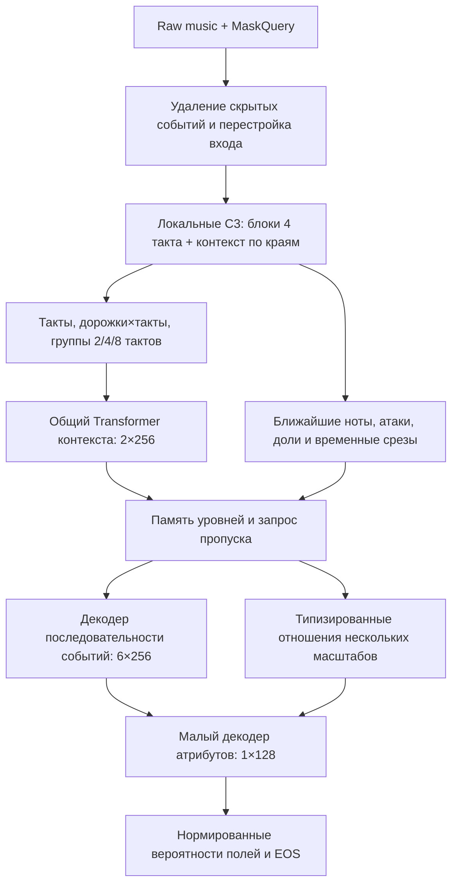

# Иерархическая модель восстановления музыки: проект рабочей архитектуры

Дата: 28 сентября 2026. Статус: исследованное **предложение к реализации**;
качество, скорость и память новой модели ещё не измерены. Это консолидированная
рекомендация после обсуждения PLL, TransE и иерархического уточнения кандидатов.
Она заменяет разрозненные варианты в [предыдущем исследовании](PLL_GENERATIVE_FEASIBILITY_20260927_RU.md).

## 1. Рекомендация

Строить **одну условную модель скрытого музыкального фрагмента**:

**локальные блоки C3 → общая иерархия контекста → декодер событий → малый
декодер атрибутов, уточняемый типизированными отношениями.**

Предлагаемое рабочее имя — `Hierarchical Conditional Music Model`, HCM-1.
Это имя нашего проекта, не существующая опубликованная модель.

Вместо независимых голов «высота / длительность / время» модель предсказывает
совместимое сочетание атрибутов и неизвестное заранее количество событий.
Крупные уровни помогают выбирать активность партий и временную организацию;
такт и вертикаль — созвучия; локальная история партии — регистр и движение.
При этом декодер видит ближайшие реальные ноты напрямую: крупный прогноз
не становится единственным каналом информации.

Основной проект включает явную ветвь отношений, близкую к **TransR**.
Она проверяется против обычного типизированного MLP/bilinear scorer.
Если трансляционная геометрия не помогает, меняется scorer, а иерархия,
предсказание событий и интерфейс отношений сохраняются. Полезность системы
не должна зависеть от успеха одного спорного ограничения на embeddings.

Предварительный размер — **14–17 млн параметров**. RTX 3090/24 ГБ — разумный
кандидат для профилирования такой модели. Это ещё не подтверждение, что
выбранные графы и последовательности поместятся или быстро обучатся.

## 2. На чём основано решение

Проверены текущие контракты и исходники рабочего дерева
`/Users/aavalsamakin/Projects/music-critic-v2`, HEAD
`287bf856643f9e555352e1661a7bf0563772178a`. Дерево содержит незакоммиченные
изменения; приведённый commit не фиксирует весь просмотренный код.
Использованы первичные статьи и сохранённые отчёты проекта. Нового чтения
корпусов, checkpoint, TEST или сервера, обучения и оценки качества не было.
Для идентичности незакоммиченных исходников сохранены SHA256:

| Файл | SHA256 |
|---|---|
| `critic/c3_backbone.py` | `f88732d3585c1ba99f6f70aa1ac8caf65fbcb92fc6ff367b446b6ec6d1ddcae5` |
| `critic/features.py` | `56c21b7b7510d81cda7ed7a9b0faf87f5ac270fdc22829b3299c21b43b4e2e4e` |
| `models/hierarchy.py` | `99fd9155dc5cdde9e2743d158094619258d5dded77684aae6a691aa20c276881` |
| `data/timing.py` | `c718ec8475ebd060452cbea2b22d215f0501319ed1a5574f7952231eb6654c6f` |
| `graph/builder.py` | `ccf423169631d4bb12295b92b4403625902eb1ded9478165f2ebc23d836fab65` |

Пути в этой таблице относительно `src/music_critic/`.

В таблице «берём» означает проектное решение на основе источника, а не
доказанную прибавку на наших данных.

| Источник | Что полезно для проекта | Что нельзя автоматически переносить |
|---|---|---|
| [Nested Music Transformer, ISMIR 2024; arXiv v2, 2026](https://arxiv.org/html/2408.01180v2) | Один токен на событие; небольшой внутренний декодер учитывает зависимость его атрибутов | Их время квантуется, выразительное исполнение фильтруется. Их модель и измерения скорости не описывают наш графовый энкодер |
| [PianoBART, 2024](https://arxiv.org/html/2407.03361v1) | Восстановление удалённых событий и фрагментов через encoder–decoder | Одновременные независимые головы восьми атрибутов не решают нашу задачу зависимостей внутри события |
| [MusicBERT, 2021](https://aclanthology.org/2021.findings-acl.70.pdf) | Компактные события; маскирование повторяющейся информации затрудняет копирование | Их bar-level masking не является совместным восстановлением неизвестного числа нот целого такта |
| [Variable-Length Music Score Infilling, 2021](https://archives.ismir.net/ismir2021/paper/000011.pdf) | Условие на прошлое и будущее, переменная длина пропуска, моделирование позиции события | Фортепианная постановка, ограниченная длина и временная сетка |
| [Anticipatory Music Transformer, 2024](https://arxiv.org/abs/2306.08620) | Генерация с частично известным будущим; важен порядок раскрытия условий | Большой вычислительный бюджет и другая сериализация; скорость не переносится |
| [FIGARO, 2023](https://arxiv.org/abs/2201.10936) | Структурированные музыкальные условия на уровне такта | Настоящие описания скрытого фрагмента нельзя подавать в PLL: это подсказка ответа |
| [MusicVAE, 2018](https://proceedings.mlr.press/v80/roberts18a.html) | Разделение крупного плана и локальной реализации | VAE и ELBO не дают автоматически нужную точную условную вероятность |
| [TransE, 2013](https://papers.nips.cc/paper/5071-translating-embeddings-for-modeling-multi-relational-data.pdf) | Явные контекст, отношение и кандидат | Ранжирование троек не является музыкальным likelihood; одно отношение может допускать много нот |
| [TransH, 2014](https://ojs.aaai.org/index.php/AAAI/article/download/8870/8729), [TransR/CTransR, 2015](https://ojs.aaai.org/index.php/AAAI/article/view/9491) | Разные пространства отношений и несколько подтипов | Это модели knowledge graph completion, а не проверенный музыкальный декодер |
| [Yang et al., 2015](https://arxiv.org/abs/1412.6575) | Простые билинейные отношения — необходимое сравнение | Победа над вариантом без отношений ещё не доказывает пользу именно TransE-подобной геометрии |
| [RotatE, 2019](https://arxiv.org/abs/1902.10197) | Циклические отношения естественно выражаются вращениями | Полную RotatE-модель вводить необязательно; для классов высот сначала достаточно модульных признаков |
| [Masked Language Model Scoring, 2020](https://aclanthology.org/2020.acl-main.240/) | Сумма условных log-probabilities при маскировании | Оценка перекрывающихся музыкальных блоков — composite score, не совместная вероятность всего произведения |
| [When Noise Lowers Loss, 2026](https://arxiv.org/abs/2602.02738) | В аудиомузыкальных генераторах искажения могут снижать loss; одного likelihood недостаточно для вывода о качестве | Это не прямое доказательство такого же эффекта у нашего символического PLL; проверять отдельно |

Все источники выше первичные. Точные музыкальные роли латентных компонент,
выигрыш TransR и перенос предобученного C3 на новое маскирование остаются
нашими проверяемыми гипотезами.

## 3. Что уже есть в C3, а что придётся сделать

| Проверенный факт текущего кода | Следствие для HCM-1 |
|---|---|
| [C3](../../src/music_critic/critic/c3_backbone.py): width128, локальный GNN, coarse hierarchy, top-down, onset BiGRU, три temporal прохода | Используем обученные веса как инициализацию; это содержательная основа энкодера |
| [Экспорт признаков](../../src/music_critic/critic/features.py): восемь уровней; track/song относятся к более ранней стадии, чем note/beat/slice | Нужен новый согласованный экспорт с идентификаторами уровня и стадии; нельзя назвать все состояния одной финальной синхронной иерархией |
| Там же: `requires_grad_(False)`, `no_grad`, `detach().clone()` | Нужен отдельный обучаемый `PLLContextEncoder`; исторический frozen adapter сохраняется |
| [Иерархия](../../src/music_critic/models/hierarchy.py) смешивает весь переданный контекст и возвращает его в ноты | Нельзя использовать embeddings немаскированного оригинала, даже только дальних тактов |
| [SSL objective](../../src/music_critic/ssl/objective.py) восстанавливает embeddings через cosine loss | Это не готовый вероятностный декодер |
| [Текущий leakage audit](../../src/music_critic/ssl/hierarchy_leakage.py) допускает сведения о pitch rank в топологии | Сохранение полного графа с занулёнными признаками не подходит для чистого block infill |
| [RationalTime](../../src/music_critic/data/timing.py) хранит точные сокращённые дроби | Нельзя незаметно заменить время сеткой шестнадцатых |

Повторно используем веса и вычислительные блоки V2. Legacy в этой задаче
не читался, его код не переносится. Старые ranking heads не становятся
PLL-головами; теория остаётся вспомогательной supervision.

## 4. Вход и объект предсказания

Основная задача: восстановить **все события, начавшиеся в интервале
`[start, end)` выбранных дорожек**, по оставшейся музыке и известной геометрии
пропуска. Время и дорожки запроса известны; количество нот, их атаки,
высоты и длительности заранее не известны.

Это двустороннее восстановление: доступен и левый, и правый контекст.
Причинное предсказание следующего события — отдельный режим: будущая музыка
должна быть удалена из всех уровней encoder, включая общие агрегаты.
Причинной маски только в decoder недостаточно при двунаправленном C3.
Результат infill не является метрикой next-event prediction.

Маска выбирается по заранее определённым метрическим границам, а не по
списку истинных атак. Поэтому возможен пустой ответ. Предсказание высот при
известных атаках — отдельная более лёгкая задача и отдельная метрика.

Контракт первого выхода — символические события
`(onset, track, kind, pitch, duration)`. `kind` различает обычную/форшлаговую
ноту и pitched/percussion; для percussion используется MIDI note/key number
ударного звука, не program ID или гармонический класс высоты. Длительность обычной ноты положительна;
нулевая допустима только в явно разрешённом grace-профиле.
Velocity, pedal, tempo changes и нотная орфография пока не восстанавливаются.
Их отсутствие ограничивает оценку исполнения и выразительности. Это
вероятность выбранной проекции нотной структуры, не всей MIDI-записи.

Известные метр, инструментальные метаданные и состав дорожек — условия
задачи, с availability masks. Новые дорожки и метр модель в первом варианте
не создаёт. Не требуется настоящая разметка голосов, формы или гармонии.
Идентификаторы файлов, авторов, датасетов и provenance в encoder не входят.

**Границы:** событие с onset внутри маски удаляется целиком, включая хвост
за её пределами. Начавшаяся до маски нота остаётся видимым условием вместе
с длительностью. Режим «скрыть всё звучащее внутри» будет другой задачей.
Границы контекста нельзя вычислять из конца последней скрытой ноты.

Сначала удаляются скрытые raw events, потом пересчитываются граф, временные
срезы, onset inventory, степени, счётчики, статистики дорожек и относительные
признаки оставшихся нот. В частности, это затрагивает
[graph builder](../../src/music_critic/graph/builder.py),
[readout slots](../../src/music_critic/data/raw_time_readout_slots.py) и
[temporal graph](../../src/music_critic/experiments/analysisgnn/temporal_slices/graph.py).
Неизвестный участок отличим от наблюдаемой паузы через coverage/query tokens.

Ключевая проверка: **разные скрытые заполнения при одинаковом видимом
контексте и запросе дают одинаковый вход энкодера**, включая topology,
агрегаты, slots и входные IDs. Target живёт в отдельном объекте и доступен
только loss и корректно сдвинутому teacher forcing.

## 5. Архитектура энкодера и памяти

### Локальный C3 и общий контекст

Конечный предлагаемый runtime делит контекст на фиксированные блоки по
**4 такта с halo по 1 такту** с каждой стороны. C3 применяется к каждому
блоку независимо, с общими весами. Его собственный coarse/top-down обмен
ограничен этим блоком. Глобальные статистики полного оригинала не подаются.
Это изменение области вычислений, а не обещание точного совпадения со
старым full-piece C3; перенос весов потребует проверки и дообучения.

Основные такты принадлежат одному блоку. Halo помогает видеть соседство,
но его события не должны повторно учитываться в глобальных counts/pools.
Длительности crossing notes сохраняются точно; временное разбиение и правило
включения пересекающих нот фиксируются до маскирования. Включение длинного
sustain может затрагивать несколько блоков; это учитывается в dependencies.

Нужен отдельный `ObservedTile`: carry-in/out, точная глобальная геометрия
и признаки left/right censoring. Техническая граница crop не превращается
в настоящую атаку или окончание ноты. Нельзя расширять tile до начала каждой
длинной ноты и тем самым потерять предел контекста. Старый canonical crop
с прежним graph builder не реализует этот контракт. Новые boundary/missingness
embeddings и builder требуют собственных тестов; совместимые веса C3 загружаются.

Из локальных состояний строятся bar tokens и track×bar tokens. Пустая
ячейка сохраняется с признаком observed/unknown; она не исчезает. Новые
группы 2/4/8 тактов — детерминированные неперекрывающиеся внутри каждого
масштаба окна (16+8+4 группы для32тактов), а не
якобы найденные фразы. Track axis пересекается с временной иерархией:
получается сеть связанных групп, а не единственная цепочка родителей.
Track×bar pooling читает события соответствующей пары; копирование одного
track embedding во все такты не заменяет этот уровень. Локальный SONG C3
обозначает контекст tile; summary всего выбранного окна создаётся позже.

Общий Transformer `2 layers / d256 / 8 heads / FF1024` связывает эти
представления. Перед ним pooling/projection агрегирует только разрешённые
локальные states; после него query получает крупный контекст. Decoder
дополнительно читает близкие note/onset/beat/slice states. Нет единственного
«вектора всей музыки», через который обязана пройти вся информация.

### Первый ограниченный профиль

Это **предлагаемые пределы для ресурсной проверки**, не измеренный fit:

| Ограничение | Начальное значение |
|---|---:|
| Контекст вокруг запроса | до 32 тактов, включая до 4 скрываемых |
| Дорожки | до 16, без молчаливого удаления лишних |
| Локальный блок | 4 основных + до 2 halo-тактов |
| Видимые ноты в одном блоке | до 2048; дополнительно обязательны edge/slice budgets |
| Глобальная память | до 589 tokens: 32 bar + 512 track×bar + 16 track + 28 групп + 1 context |
| Детальная память рядом с запросом | до 512 tokens через фиксированный по времени отбор и ограниченное pooling |
| Всего cross-attention memory | до 1152 с query/служебными tokens |
| События ответа | до 512 + EOS |
| Microbatch | 1–2; accumulation задаётся после профилирования |

32 такта — контекст окна. Для длинной пьесы его summary нельзя называть
представлением всего произведения. PLL длинной пьесы считается по запросам
с такими окнами; дальние связи за пределами окна пока не видны. Увеличение
до 64/128 тактов либо второй уровень сжатия блоков — следующее масштабирование
той же схемы, с отдельным профилем и сравнением качества. Не обещаем полный
глобальный контекст бесплатно.

Превышения лимитов явно отражаются в coverage/support. Нельзя тихо обрезать
ноты или target. Изменение размера запроса создаёт другую условную задачу;
его нельзя незаметно подставить вместо score исходного блока.

### Кэш и градиенты

Можно кэшировать raw structures и, при frozen C3, **строго локальные**
выходы незатронутых блоков до нового глобального обмена. Ключ включает
веса, код входных признаков, профиль, context/halo и маску. Все затронутые
блоки пересчитываются. Полный старый C3-cache оригинала непригоден.
Frozen cached C3 работает в eval mode без dropout; cache/recompute equivalence
проверяется отдельно. Обучаемые global/decoder модули остаются в train mode.

При размораживании локального энкодера кэш его embeddings больше не годится.
Для каждого примера заново обрабатываются все выбранные блоки, включая
дальние. Последовательная обработка блоков и activation checkpointing могут
снизить память, но не устраняют вычисления. Разные режимы freeze имеют
разные измеряемые throughput и checkpoint contracts.

Для первого инженерного smoke допустим существующий полный C3 на небольшом
маскированном окне. Он проверяет контракт декодера, но не доказывает свойства
описанного блочного runtime.

## 6. Декодер событий и точная вероятность

Основной декодер: **6 pre-norm Transformer decoder layers, d256, 8 heads,
FF1024, dropout0.1**, causal self-attention и cross-attention к памяти.
Один основной токен соответствует одному полному предыдущему событию.
Перед первым событием используется BOS. Истинные атрибуты текущего события
не попадают в его main hidden state.

Внутренний декодер: **1 слой cross-attention + FFN, d128, 4 heads, FF512**.
Его запрос зависит от main state и типа/позиции следующего поля; keys/values
содержат BOS и только предыдущие поля текущего события. Без дополнительного
Embedding Enricher в первом варианте. Это наша компактная адаптация идеи
NMT, с новым условным энкодером и новым временным кодеком.

Порядок: `NOTE/EOS → onset → track → kind → pitch class → octave → duration`.
Для percussion вместо class/octave используется drum ID. Pitch class и
octave совместно дают MIDI pitch0…127; недопустимые сочетания исключает
грамматика. В абляции сравнить с одним pitch128: сам порядок атрибутов тоже
является проектной гипотезой.

Для видимого контекста C и N событий ответа:

\[
P(Y\mid C)=\left[\prod_{i=1}^{N}P(\mathrm{NOTE}\mid C,e_{<i})
\prod_j P(a_{ij}\mid C,e_{<i},a_{i,<j})\right]
P(\mathrm{EOS}\mid C,e_{1:N}).
\]

EOS входит в loss, задаёт распределение количества событий и разрешает
пустой ответ. Отдельно умножать на предсказанную плотность/count нельзя:
это другое распределение с возможным двойным учётом. Достигнув лимита
событий, грамматика разрешает только EOS; переполненные targets не обрезаются.

Длины внутренних записей, тип следующего поля, допустимые продолжения и
видимость padding определяются только уже раскрытым префиксом. При teacher
forcing настоящие kind, denominator и длина numerator не сообщаются раньше
своего шага. Изменение будущих полей и длины их кодирования не должно менять
предыдущие logits — это отдельный тест причинности вложенного decoder.

При обучении и оценке известного фрагмента используется teacher forcing:
main states считаются параллельно с causal mask, а цепочки полей — параллельно
по событиям. Последовательное сэмплирование требуется для генерации, не для
расчёта NLL. Это важное различие для времени работы PLL.

### Время и канонизация

Предложенный точный профиль: onset как неотрицательное рациональное смещение
от начала запроса, duration как рациональная длина; числитель uint64,
знаменатель 1…65535, сокращённая дробь, единственный ноль 0/1. Эти пределы
не являются свойством CanonicalPiece: покрытие надо измерить на TRAIN.
Значения вне профиля — `unsupported`, а не округление или плохая музыка.

Кодирование: сначала denominator, затем numerator; каждое целое — минимальная
длина в байтах и big-endian base256 bytes. Numerator: `LEN(1…8)`, denominator:
`LEN(1…2)`; положительные числа без ведущих нулей, ноль — `LEN(1), BYTE(0)`.
Предсказываются длины и байты внутри
малого декодера. Это не раздувает основную последовательность событий, но
увеличивает внутреннюю работу и может усложнить обучение ритма.

Grammar разрешает только префиксы с хотя бы одним допустимым завершением.
Для выбранного d точные границы времени задают интервал числителей [L,U].
Проверка наличия взаимно простого с d числа в пересечении этого интервала
с интервалом байтового префикса делается включениями–исключениями по простым
делителям d. Для d≤65535 их не более шести. Ноль обрабатывается отдельно.
Допустимость префиксов знаменателя также проверяется по существованию
завершения; одного post-hoc `gcd`/rejection недостаточно.

Для onset допустимо `0 ≤ onset < end-start`, плюс канонический порядок.
Duration не ограничена концом маски: хвост может выходить за неё. Для duration
действуют положительность/grace-профиль и пределы представления; при равных
остальных полях — нижняя граница предыдущей duration. Все сравнения,
cross-products и промежуточные границы вычисляются точными целыми без
переполнения uint64; 64 бита ограничивают запись числителя, не арифметику.

Это конкретный кандидат кодека, **не готовая быстрая реализация**. Время
feasibility masks, частота длинных дробей и доля unsupported — обязательный
инженерный gate. Частые рациональные значения можно позднее кодировать одним
токеном, но escape тогда обязан исключать эти же значения: два кодирования
одной дроби нарушат однозначность.

Все события сортируются по полному ключу сохраняемых атрибутов:
`(onset, track, kind, pitch, duration)`. Полные дубликаты остаются повторами;
note IDs не входят в выход. Track IDs обозначают известный входной порядок.
Grammar допускает только неубывающие ключи, включая промежуточные проверки
допустимости полей. EOS разрешён только между полными событиями.
Сравниваются декодированные значения, а не порядок внутренних tokens.
Для pitch class проверяется наличие допустимой octave: например, B4→C5
не запрещается из-за уменьшения класса11→0. Это иллюстрация правила,
не наблюдение из корпуса.

При однозначном кодеке и такой грамматике canonical serialization задаёт
биекцию с мультимножествами событий поддерживаемого профиля, поэтому формула
даёт нормированную вероятность этих объектов. Простого обучения на
отсортированных targets недостаточно. Это не инвариантность к транспозиции,
перестановке инструментальных партий или альтернативной записи нот.

## 7. Где именно находятся иерархические отношения

У каждого семейства есть свой источник контекста, пространство сравнения
и список решений, которые оно может уточнять. Иерархия задаёт масштаб
наблюдения; тип связи — способ сопоставить контекст и кандидат.

| Семейство | Контекст | Выходы, на которые влияет |
|---|---|---|
| Активность и повторяемость | Группы тактов, дорожки, общий контекст | NOTE/EOS, выбор дорожки; признаки для временного декодера |
| Метр и ритмическое продолжение | Beat/bar, соседние рисунки, ранее восстановленные события | Представление для предсказания onset/duration |
| Вертикальная совместимость | Одновременный контекст, такт, мягкий прогноз гармонических свойств | Pitch class |
| Регистр и мелодическое движение | Дорожка, соседние ноты, текущий префикс | Octave или pitch128 |

Не называем ненаблюдаемый голос дорожкой и не называем свободную latent
компоненту «тоникой». Тональность, функция аккорда и роль ноты — разные
величины. Семантическое имя закрепляется только доступной валидной целью.

Начальная ветвь: 4 семейства, relation space64, по 4 компоненты смеси
плюс uniform/null. Проекции разделены по семействам, а компоненты используют
малые добавки, а не отдельный большой decoder. Число компонент — гипотеза.

Для следующего дискретного кандидата c и семейства ℓ:

Доступный префикс для поля j события i:
`u_ij = (C, e_<i, a_i,<j)`, включая предыдущие байты текущего поля.
Все relation queries, mixture weights и gates используют только его.
При прогнозе pitch уже доступны onset/track/kind текущего события;
следующие поля недоступны. Крупные planning states зависят от C,
а запрос к ним может уточняться допустимым префиксом.

\[
s_{\ell k}(c)=-\|A_\ell h_{\ell,t}+r_{\ell k}-B_\ell e_f(c)\|^2/\tau_{\ell k},
\quad q_{\ell k}(c)=\operatorname{softmax}_{c\in V_{f,t}}s_{\ell k}(c),
\]
\[
q_\ell(c)=\sum_k\pi_{\ell k}(C,y_{<t})q_{\ell k}(c),\qquad
P_t(c)=\operatorname{softmax}_c\left[z_t(c)+\sum_{\ell\in\mathcal E_f}\alpha_{\ell,t}\log q_\ell(c)\right].
\]

Здесь V — синтаксически допустимые продолжения; τ>0; α ограничены в [0,1]
и инициализированы малыми положительными значениями. Счёт ведётся через
log-softmax/logsumexp. Нормы, температуры и градиенты контролируются.
Гейты могут уменьшить вклад бесполезного семейства.
Множество E_f включает только семейства со scorer данного поля;
для length/byte tokens времени оно пусто. Null-компонента равномерна:
`q_null(c) = 1 / |V_f,t|`.

Эквивалентно, каждый уровень мягко обновляет
`p_new(c) ∝ p_old(c) × q_level(c)^alpha`.
Это и есть предложенное уточнение кандидатов: несовместимые варианты
теряют вес, но не исчезают по причине музыкального «запрета». Жёстко
маскируется только грамматика и диапазон представления.

Для рационального времени нельзя притворяться, что очередной байт является
музыкальным интервалом. В HCM-1 ритмическое семейство даёт мягкий контекст
внутреннему временному decoder; прямой energy scorer применяется к
NOTE/EOS, track, pitch class и octave/drum ID по релевантным семействам.
Оценивание целых рациональных длительностей relation energy потребует
отдельного нормируемого конечного словаря/разбиения и остаётся расширением.

Смесь считается над кандидатами очередного поля. Мы не перебираем
декартово произведение всех гармонических, ритмических и формальных планов.
Это также **не** точное маргинализирование одного скрытого плана, общего
для всего такта. Согласованность между событиями поддерживает AR decoder.
В HCM-1 крупные planning states — детерминированные функции видимого входа.

### Почему одного «h + r» недостаточно

Один свободный вектор r легко поглотить bias проекции. Кроме того,
`-||a-b||² = 2aᵀb - ||b||² - ||a||²`; последний член исчезает при softmax
по кандидатам. Такая энергия близка к dot-product scorer. Предполагаемая
польза — в разделении типов, пространств и supervision, а не в самом плюсе.

Единственная точка `h+r` также плохо описывает много допустимых реализаций.
Смеси смягчают это ограничение. Для циклической транспозиции pitch class
используются интервалы modulo12/круговые признаки: обычная трансляция с
условием `12r=0` вырождается. Полная RotatE-ветвь в первый вариант не нужна.
Семейства уже обмениваются информацией, поэтому их факторы нельзя считать
независимыми свидетельствами или трактовать веса gate как объяснение причины.

## 8. Данные и обучение

Основной сигнал — восстановление обычной музыки, без предположения, что
каждое искусственное изменение ухудшает её. 45 произведений кампании —
материал отдельной оценки вмешательств, а не весь обучающий корпус.

| Источник | Подтверждённая роль и ограничения |
|---|---|
| Dilemmadata | Нотная структура и доступные теоретические цели. В сохранённом corrected inventory 1295 TRAIN records; это другой путь, чем старые 577 common-projection TRAIN records |
| HookTheory | Мелодические фрагменты: сохранено 20 993 TRAIN records; 19 143 — прежний SSL-фильтр, не новое PLL admission. Аннотированные аккорды не являются услышанным/записанным аккомпанементом |
| POP909-CL | 701 TRAIN record по сохранённому отчёту; channel0 — score input, channel1 — target-only. Текущая сведённая партия не даёт исходные независимые инструментальные партии |
| PDMX | Нужен для расширения объёма и фактур, после production admission, дедупликации и проверки split. Исторические 254 035 MIDI-кандидатов нельзя называть готовыми независимыми TRAIN-произведениями |

Числа — сверка сохранённых документов, не свежий scan. Основания:
[предыдущая сводка источников](PLL_GENERATIVE_FEASIBILITY_20260927_RU.md),
[Dilemmadata EDA](../eda/DILEMMADATA_EDA.md),
[PDMX contract](../PDMX_PIPELINE_CONTRACT.md),
[multi-source targets](../MULTISOURCE_TARGET_CONTRACT.md) и
[harmonic supervision](../HARMONIC_SUPERVISION.md).
Нынешние PDMX windows клипуют crossing notes и исключают пустые окна:
их нельзя незаметно принять за новый контракт infill. Для PLL требуется
отдельное окно контекста с сохранённым владением/длительностью событий.

Разделение — по исходному произведению/связанной группе дублей **до** окон,
масок и транспозиций. Cross-corpus пересечения проверяются отдельно.
Неизвестный overlap не выдаётся за независимый тест. Старые TRAIN-индексы
переиспользуются только после сверки provenance, доступности и контрактов.
TEST остаётся закрыт; выбор модели — по фиксированной VALIDATION.

Sampler: источник → произведение → допустимый запрос. Длинные пьесы и
большой PDMX не должны автоматически занимать почти все updates. Начальный
вариант после admission: Dilemmadata30%, HookTheory15%, POP909-CL15%, PDMX40%.
Без PDMX — 45/25/30; это предложенные веса, не найденный оптимум. Отдельно
публикуются coverage и effective draws/tokens каждого корпуса.

Маски первого обучения: 40% один такт одной дорожки; 30% один такт всех
дорожек; 20% два такта; 10% четыре такта, при достаточном контексте. Для
однотрековых источников совпадающие режимы не считаются разными задачами.
Маски допускают реальные паузы. Многодорожечные задания доступны только
там, где есть соответствующие raw партии. Для коротких клипов используется
явно заданный меньший метрический интервал с отдельной метрикой покрытия.

Первые 10% лимита обучения можно дать в основном однотактовым пропускам,
затем перейти к смеси. Это curriculum по размеру скрытого контекста; он
не связан с прежним числом искусственных искажений 3–4 → 2–1 → 1.

Обучение в две стадии одного протокола:

1. Frozen local C3: обучаются общий контекст, decoder и relation modules.
   Первоначальный ориентир — 10–20% бюджета; фиксируется заранее. Локальные
   блоки всё равно строятся из правильного маскированного входа.
2. Разморозить upper C3: coarse/top-down/onset/temporal blocks, оставив
   input projections/local GNN сначала замороженными. Для старых весов LR
   ниже. Полное размораживание — отдельный проверяемый вариант при достаточном
   объёме данных, не автоматический следующий шаг.

Стартовые гиперпараметры-кандидаты: AdamW, LR новых весов2e-4, верхнего C3
2e-5, weight decay0.01, grad clip1, warmup5% и cosine schedule. Это настройка
для проверки, не воспроизведение статьи и не утверждённая конфигурация run.

Основной loss — полный NLL событий, полей и EOS; разные поля не получают
произвольные веса внутри публикуемого log-probability. Для оптимизации
можно заранее определить work/block weighting; оно не меняет формулу score.
Aux losses: доступные chord/key/role targets в исходных namespaces,
ритм/активность/регистр, выведенные из raw target. Их истинные значения
никогда не становятся входом. Пропуски supervision маскируются, а старые
ошибочные target versions и несовместимые heads не импортируются молча.
Влияние aux на генеративный NLL проверяется отдельно.

## 9. Как модель будет оценивать произведение

Для фиксированного запроса B считаем
`ell_B = log P(events_B | visible music, query_B)`.
Восстановление нот, вертикали, дорожки и последовательности тактов получается
разными областями одного нормированного decoder, а не независимыми
«правильностями» отдельных нот.

Для каждого типа маски отдельно публикуются:

- NLL целого блока, включая EOS; nats/event и nats/quarter-note.
- Ошибка/калибровка завершения, ошибки времени, высот и длительностей.
- Coverage, число unsupported и распределение длины targets.
- Метрики по источникам, плотности и размерам пропуска; confidence intervals
  через bootstrap по произведениям, а не по зависимым маскам.

Для пустого target NLL блока/EOS и nats/quarter-note остаются определены;
nats/event для него отдельно не вычисляется. Сначала сравниваются одинаковые
блоки и кодеки. «Средний loss на внутренний byte token» не подходит для
сравнения музыкальных моделей с разными кодеками.

Вектор оценок по типам масок — основной результат. Сводный показатель
можно получить фиксированным усреднением по расписанию масок, например
16 запросов на произведение для пилота и последующей проверкой устойчивости.
Перекрывающиеся block conditionals дают composite PLL-like score, а не
`P(всего произведения)`. Он требует нескольких masked encoder passes;
стоимость оценки измеряется отдельно от train step и свободной генерации.

Для A/B исходник и изменение получают согласованные запросы по времени и
дорожкам, насколько это допускает вмешательство. Нельзя выбирать маски
только по известным координатам испорченных нот и выдавать это за обычный
scorer: это отдельная локализованная диагностика. При изменении длины/метра
протокол выравнивания фиксируется отдельно.

Низкая вероятность означает неожиданность в данном контексте. Чтобы получить
оценку человеческого предпочтения, нужен blind better/worse/tie набор.
На нём сравниваются PLL, нынешний ranking critic и выбранные эстетические
модели; для audio-моделей renderer и звук фиксируются. Метрики preference,
восстановления и теории не смешиваются. В будущем поверх вектора PLL можно
обучить отдельный небольшой калибратор предпочтений по человеческим данным.

## 10. Ресурсы: расчёт и неизвестные

CPU-конструкторы PyTorch, без checkpoint и данных, дали:

| Компонент | Параметры |
|---|---:|
| C3 без старых theory heads, повторно проверено CPU-конструктором | 4 510 369 |
| Основной decoder6×256 + final norm | 6 321 152 |
| Общий encoder2×256 + final norm | 1 580 032 |
| Малый field cross-attention + FFN + две norms | 198 272 |
| Восемь проекций128→256 | 264 192 |
| Main-to-field projection256→128 | 32 896 |
| **Подытог** | **12 906 913** |

Embeddings, pooling/query modules, relation banks, output/aux heads добавятся
сверх этого. Рабочий ориентир14–17M надо пересчитать после фиксации словарей.
Для15M FP32 parameters+gradients+двух Adam moments — около240MB; активации,
графовые сообщения, padding, optimizer temporaries и allocator сюда не входят.

По [старому matched profile](../experiments/HARDWARE_PROFILE_T4_3090_RU.md)
3090 давала0.6124s/update, T4 —1.3040s; это другой temporal model/runtime.
В том профиле ожидание workers и unpack занимали вместе около59% шага3090.
В [итоговом C3 отчёте](../experiments/C3_THREEPASS_FINAL_RU.md) другие
batch/model/hardware дали другие часы и memory. Эти числа не прогноз HCM-1.

Первое native измерение должно отдельно показать graph build/queue, H2D,
local C3, global encoder, main/field decoder, grammar masks, backward,
VRAM allocated/reserved, RAM/swap, median/p95 wall time и events/s.
Сравнить frozen/partial C3; AMP допускается после проверки finite gradients
и согласованности с FP32. C3 содержит принудительно FP32 участки.

Предлагаемый ресурсный gate: фиксированный TRAIN-only набор разных размеров,
50–100 warmup и200 измеряемых microbatches на режим. До него — синтетические
контрактные тесты. Это будущий существенный эксперимент: нужен отдельный
planned record, затем terminal record; сейчас он не запущен.

Честная арифметика: 10 000 microbatches при2/5/10s займут5.56/13.89/27.78h
чистого потока. Если accumulation8, один optimizer update содержит8 таких
microbatches; нельзя назвать оба числа «шагами» и получить разницу в8 раз.
Полный wall budget дополнительно включает validation, preparation и I/O.
Начальный предел24–48GPU-часов для одного пилота — предложение бюджета,
не прогноз времени до хорошей модели и не разрешение занять сервер/облако.

## 11. Проверки, которые решат судьбу архитектуры

Проверки упорядочены, чтобы не запускать сразу дорогую сетку вариантов.

| Этап | Проверка | Условие продолжения |
|---|---|---|
| Контракты | Hidden-fill invariance; точный codec roundtrip и unique encoding; grammar normalization на исчерпываемом малом пространстве; EOS/empty/crossing events; отсутствие будущих target fields; градиенты; batching/resume | Все механические проверки проходят; это не доказательство музыкального качества |
| Ресурсы | Frozen/partial modes, sparse/dense/long examples, graph/grammar costs, VRAM и throughput | Достигнут приемлемый envelope и измерено покрытие; иначе уменьшить профиль/исправить bottleneck до длительного обучения |
| Умение восстанавливать | Один основной пилот с фиксированными VALIDATION masks; сравнение с эмпирической частотой событий/простым conditional baseline | Обучение улучшает held-out joint NLL, а не только TRAIN; auxiliary цели не скрывают деградацию основного loss |
| Вклад отношений | Один и тот же decoder: без relation branch; typed bilinear/MLP; предложенный TransR-like | Польза геометрии сверх сопоставимого scorer оправдывает её стоимость; при отсутствии пользы заменить scorer |
| Вклад иерархии | Обучение с локальным контекстом против полной памяти; сопоставимый бюджет. Контрольное выключение/перемешивание уровней — дополнительная диагностика | Выигрыш на масках, требующих соответствующего контекста, а не только большие attention/gate weights |
| Музыкальная применимость | Blind human better/worse/tie; benign controls; редкие, но приемлемые фрагменты; фиксированный renderer для audio baselines | Определена реальная связь с предпочтением и область ошибок; PLL не объявляется эстетическим баллом по одному NLL |

На первых сравнениях одинаковые work IDs, masks, decoder/codec, seed,
effective draws/tokens и validation access. Для fixed-compute сравнения
дополнительно фиксируется wall/GPU budget; если throughput разный, обе
оси отчётности сохраняются. Один seed годится для отбора явно неудачного
варианта; окончательный вывод о небольшом выигрыше требует повторов.
Размер эффекта, CI и цена важнее заранее придуманного процента улучшения.

Необязательные дальнейшие абляции: pitch128 против class→octave; общая
relation bank против отдельных уровней; независимые поля против вложенного
decoder; aux on/off; C3 initialization против scratch при одинаковом бюджете.
Это не список разрешённых одновременных запусков.
Если основной pilot не учится, сначала проверяются вход, leakage, targets
и optimization; модель не увеличивается автоматически.

## 12. Границы модулей и следующий этап

Предлагаемые новые модули под `src/music_critic/pll/`:

| Модуль | Ответственность |
|---|---|
| `observed_view.py`, `masking.py` | Raw projection, query geometry, hidden/visible ownership, отдельный target |
| `graph.py` | Перестройка всех зависимых признаков, блоки/halo, coverage и budgets |
| `encoder.py` | Обучаемый экспорт C3; явная freeze policy и стадии states |
| `memory.py` | Bar/track×bar/groups, общий контекст, query и детальная память |
| `codec.py` | Точное время, grammar, canonical event order, support report |
| `decoder.py`, `relations.py` | Main/field AR probabilities, typed conditional factors |
| `scoring.py` | Фиксированные mask schedules, block scores, нормировки и provenance |

Сначала спецификация входа и кодека, затем маскирование с тестами, затем
дифференцируемый encoder/decoder, затем native resource gate, затем pilot.
Это обычные этапы реализации, не дополнительные исследовательские модели.

Нерешённые вопросы с конкретной проверкой: покрытие точного временного
профиля; CPU-цена grammar masks; перенос C3 на локальные блоки; память и
throughput при дообучении; выигрыш typed relations; достаточность32-тактового
контекста; связь likelihood с human preference. До этих проверок архитектура
является обоснованным кандидатом на рабочую модель, а не готовым результатом.

В этой задаче изменены только исследование, ссылка из предыдущего отчёта
и STATUS. Реализация, обучение, checkpoints, TEST и legacy не менялись.
Unit tests модели для документации не запускались. CPU-конструкторы и
арифметика завершились с exit0; 1792 синтетических проверки подсчёта взаимно
простых числителей совпали с перебором; сумма вероятностей игрушечной
отсортированной последовательности с EOS равна1. Это проверки формул,
не реализация или тест production codec. Проверены32 локальные ссылки
нового и предыдущего исследований, битых нет; whitespace check — exit0.
Независимые проверки источников/архитектуры и вероятностной схемы не нашли
блокирующих противоречий; их уточнения префиксов, времени и grammar внесены.
