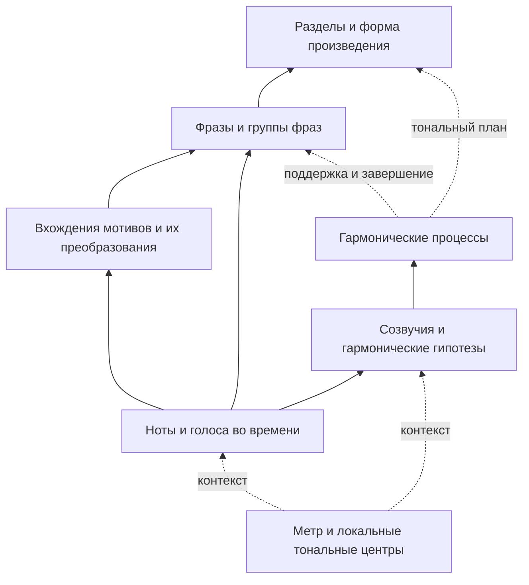

# Многоуровневый анализ MIDI: схема, предшественники и корпус 4 × 1 000

7 октября 2026. Исследование для следующего этапа Music Critic V2.
Проверен рабочий checkout `main`, HEAD
`287bf856643f9e555352e1661a7bf0563772178a`, с существующими изменениями.
Основания: текущий код, сохранённый выпуск T07, первичные статьи и репозитории
авторов. Новый корпус не загружался, музыкальные данные heldout не открывались,
обучение и новые диагностические прогоны не выполнялись.

## 1. Цель и основной вывод

Пользователь задаёт новый целевой масштаб: не менее **1 000 полных MIDI-записей
каждого из четырёх жанров: классика, джаз, рок, поп**. У каждого произведения
нужны ноты, гармония, процессы подготовки/разрешения, мотивные связи, фразы,
крупная форма и взаимодействие партий. Полнота означает анализ предоставленной
полной музыкальной версии, а не несколько выбранных выразительных эпизодов.

Это содержательная исследовательская задача. Однако строгая лестница
«нота → аккорд → прогрессия → мотив → фраза» музыкально неверна.
Предлагаются связанные структуры: гармоническая, мотивно-фразовая,
метрическая и фактурная. Их общая опора — адресуемые нотные события и время.
Каденция является процессом/функцией завершения, а не обязательным этажом
над любой последовательностью аккордов. Разрешение ноты и завершение фразы
сохраняют разные типы и масштабы.

Иерархическая музыкальная теория, GNN-анализ гармонии, графовые редукции,
распознавание каденций и многослойные наборы данных уже существуют.
В проверенных работах не найден готовый корпус, удовлетворяющий одновременно
всем требованиям 4 × 1 000. Это ограниченный обзор, не доказательство
отсутствия аналога и не подтверждение доступности нужной квоты исходных работ.

## 2. Уточнение музыкальных объектов

| Объект | Предлагаемые поля и связи |
|---|---|
| Нота в конкретном контексте времени | Исходный note ID; голос/партия; ступень локальной тональности с альтерацией; интервальная ступень аккорда; основной/добавленный/неаккордовый звук; проходящая, вспомогательная, задержание, предъём, педаль и другие применимые роли; участники подготовки и разрешения |
| Звучащее созвучие и гармоническая интерпретация | Реальные высоты и написания, распределение по голосам, бас, корень, качество, обращение, надстройки и изменения; римское обозначение относительно указанного центра; функция относительно цели и масштаба |
| Гармонический процесс | Продление опоры, секвенция, тонизация, модуляция, каденционный оборот, петля; границы, внутренняя организация, опорные гармонии, подготовка/отклонение/приход к цели |
| Вхождение мотива | Конкретные ноты и голос, ритмическая/интервальная фигура; связи с другими вхождениями: повтор, транспозиция, ритмическая вариация, расширение/сокращение, передача другой партии |
| Фраза и группы фраз | Границы, начальная/продолжающая/завершающая функция, способ завершения; отношения предшествующей/последующей фразы, повторения и контраста там, где такая трактовка применима |
| Крупная форма | Разделы и связи повторения/контраста/возвращения; стилевые имена: куплет, припев, bridge, тема, вариация, экспозиция и другие; сопоставление разделов между повторениями |

Мотив обычно меньше фразы; он не обязан иметь завершение, подобное каденции.
Фраза может содержать несколько мотивов, а мотив — звучать при разных
гармонизациях. Связь «вопрос—ответ» следует уточнять: antecedent/consequent
в периоде, тематический ответ в другой партии и ожидание гармонической цели
не являются одним универсальным классом. Основания:
[Open Music Theory: мотивы и группировка](https://viva.pressbooks.pub/openmusictheory/chapter/foundational-concepts/),
[Caplin, Classical Form](https://academic.oup.com/book/49159).

Для пользовательского уровня 2 рабочее название — **гармонический процесс**.
Термин «прогрессия» описывает последовательность гармоний, но её функция
требует контекста. Оборот ii–V–I может осуществлять каденционное завершение
или местное движение внутри более крупной фразы. «Логическая завершённость»
сама должна быть предметом анализа, а не предпосылкой сегментации.
DCML отдельно кодирует гармонию, фразы и каденции; его фразовые скобки
пока не задают многоуровневую форму. Структурное окончание может предшествовать
фактическому окончанию фразы с дополнением.
[Первичный стандарт DCML](https://dcmlab.github.io/standards/build/html/reference/reference.html).

Стрелки схемы описывают проектируемый анализ, а не уже внедрённые слои сети.
Мотивные вхождения и фразы могут пересекать гармонические границы; контрапункт
допускает несовпадение фразовых границ разных голосов. Уровни редукции
структурной опоры тоже не следует отождествлять с размером группы нот.
GTTM уже различает группировку, метр и два вида редукции.
[Lerdahl–Jackendoff, 1983](https://direct.mit.edu/books/monograph/4673/A-Generative-Theory-of-Tonal-Music).

## 3. Что необходимо добавить к исходному предложению

**Голос, метр, написание и тональный контекст.** MIDI-дорожка может содержать
несколько голосов; одно исполнение мелодии может переходить между инструментами.
Нужны раздельные идентичности дорожки, партии и голоса. Для ступеней нужны
глобальная/локальная тональность, модальный контекст и тонизация с областью
действия. Энгармоническое написание в голом MIDI неизвестно: восстановленное
написание — отдельное предсказание. Сильная доля, синкопа, паузы, артикуляция
и смены метра дают контекст группировки; сведения об исполнении не выдаются
за точную информацию, если исходный файл её не содержит.

**Роль меняется во время удержания.** Единица роли — note × time × context,
с сохранением исходной атаки. Удержанный звук может сначала принадлежать
аккорду, затем стать задержанием на новой гармонии и разрешиться позже.
Аккордовая септима может участвовать в тяготении; неаккордовость не означает
высокое напряжение. Название `sus4` не доказывает подготовленное задержание.
[Hutchinson: задержание](https://musictheory.pugetsound.edu/mt21c/Suspension.html),
[sus-аккорды](https://musictheory.pugetsound.edu/mt21c/SimpleSusChords.html).

**Созвучие не равно его гармонической гипотезе.** Фиксируем и реально звучащие
ноты, и трактовку основного аккорда с украшениями. Это позволяет одновременно
описать F в составе Csus4 и его разрешение в E, если временной контекст
поддерживает такой анализ. Этот пример условный, не наблюдение корпуса.
Полное распределение надстроек по голосам сохраняется и при анализе фразы.
Римское обозначение, качество и функция — разные поля; функция IV не
вычисляется универсально из номера ступени.

**Направленные отношения вместо одной краски на объект.** У отношения нужны
участники, тип, точный интервал, адрес цели, аналитический масштаб и источник.
Рабочие типы: готовит, продлевает, разрешается в, завершает, повторяет,
варьирует, отвечает, поддерживает басом, удваивает. Некоторые процессы
объединяют несколько нот/гармоний: один объект эпизода с участниками лучше,
чем потеря смысла в независимых бинарных флагах. Аналитическая зависимость
может ссылаться и назад; весь граф не обязан быть одним деревом.

**Несколько аспектов напряжения.** Предлагается различать диссонантность,
тональную неустойчивость, направленность к цели, задержку ожидаемого завершения,
ритмическую активность и фактурное нарастание. Поля «создаёт/удерживает/разрешает»
не взаимоисключающие и требуют указания того, что именно разрешается.
Численная сила ощущаемого напряжения не следует из этих полей автоматически.
Lerdahl–Krumhansl уже соединяли гармоническую иерархию, tonal pitch space,
диссонантность и голосоведческие тяготения с проверкой по оценкам слушателей.
[Modeling Tonal Tension](https://www.researchgate.net/publication/249979723_Modeling_Tonal_Tension).

**Стилевая применимость.** Для рок/поп-петель возможна устойчивая опора
на уровне всего оборота; приход припева может быть одновременно целью
и новым началом. Не требуется разрешение каждой джазовой надстройки по
классическому образцу. Анализ должен сохранять альтернативы, неоднозначный
центр и применимость теоретического языка.
[Nobile, 2022](https://www.mtosmt.org/issues/mto.22.28.3/mto.22.28.3.nobile.html),
[Temperley, 2011](https://mtosmt.org/issues/mto.11.17.1/mto.11.17.1.temperley.html),
[Jazz Voicings](https://viva.pressbooks.pub/openmusictheory/chapter/jazz-voicings/).

## 4. Горизонталь, вертикаль и текущая модель

Горизонтальные связи описывают время: продолжение голоса, подготовку и
разрешение, мотивные повторения, возвращение раздела. Они могут пересекать
дорожки: вопрос у саксофона и ответ у фортепиано — межпартийная связь во времени.
Вертикаль описывает совместное звучание: общий аккорд, его бас, мелодию над
сопровождением, интервалы, удвоения, пересечения голосов. Есть также фактурные
роли на интервалах: мелодия, бас, гармоническое/ритмическое сопровождение.
Изолированная партия не обязана содержать полный аккорд; ансамблевая гармония
собирается из разных участников. Символьные ноты не определяют полностью
акустическое взаимодействие тембров.

В текущем коде уже доступны состояния нот, onset/beat/slice, тактов, дорожек
и глобального контекста. Но [PLLContextEncoder](../../src/music_critic/pll/encoder.py)
прямо оставляет старые theory heads замороженными и неиспользуемыми;
[PLLTrainer.step](../../src/music_critic/pll/runtime.py) выполняет backward
только по `result.nll`. [Банк мотивов](../../src/music_critic/pll/motifs.py)
строит метрические окна-кандидаты и прямо не утверждает, что это настоящие
мотивы. Это проверенные свойства кода, не измерение его музыкальных способностей.

Предложение: общий encoder и глобальный контекст, поверх них отдельные выходы
границ, интерпретаций и связей на нескольких масштабах. T07 остаётся источником
вспомогательных целей. Эталонные границы/гармонии/голоса не становятся
обязательными входами; их предсказание и случаи с эталонными входами оцениваются
раздельно. Потери нормируются по объектам/источникам/слоям, чтобы повторение
одной каденции на многих нотах не превращалось в сотни независимых примеров.
Это вариант архитектуры для последующей спецификации, не принятая новая
реализация. См. [предыдущий разбор подключения](ANALYSIS_DATA_INTEGRATION_20261007_RU.md).

## 5. Что уже сделали другие

Уточнение: таблица ниже показывает разные виды предшественников, а не
утверждает, что каждая работа уже решает нашу полную задачу. Подробно
разделены архитектуры, реальные выходы, данные и публикационный вклад в
[последующем разборе](RELATED_WORK_DEPTH_AND_PUBLICATION_20261007_RU.md).

| Работа | Проверенное перекрытие | Ограничение относительно нашей цели |
|---|---|---|
| [AnalysisGNN, 2025](https://arxiv.org/html/2509.06654v1) | Совместный графовый анализ около 20 свойств, включая гармонию, принадлежность нот аккордам, каденции и границы; объединение частично размеченных корпусов | Мотивные преобразования и адресуемые эпизоды подготовки/разрешения на всех масштабах не показаны как полный совместный выход |
| [From Prediction to Collaboration / RNHybrid, препринт 2026](https://arxiv.org/html/2607.13587v1) | MusicBERT и AnalysisGNN, несколько гранулярностей, заполнение частичного анализа, исправления и альтернативы | Основная проверка — RN-анализ и связанные поля, не полный граф процессов всех четырёх жанров |
| [AutoSchA, AAAI 2026](https://arxiv.org/html/2512.18232v1) и [SchA representation, 2024](https://arxiv.org/abs/2408.07184) | Семантическая иерархия структурных нот, шенкеровская редукция и голоса через GNN; гетерогенное представление разборов | AutoSchA проверена на 88 темах фуг, 3 807 нотах; это не полные многожанровые произведения со всеми нашими выходами |
| [Predicting Music Hierarchies, ISMIR 2023](https://archives.ismir.net/ismir2023/paper/000050.pdf) | Нейронный разбор деревьев зависимостей нот и гармоний; time-span и Jazz Harmony Treebank | Мелодические и аккордовые задачи рассматриваются отдельно; полного совместного полифонического разбора нет |
| [MIDI-PHOR, 2026](https://aclanthology.org/2026.nlp4musa-1.6/) | Представления MIDI, граф партий/разделов, гармонические и структурные признаки, объяснения с основаниями | Авторы отмечают отсутствие независимого большого human gold структурных отношений; привязка объяснения не устанавливает правильность каждого процесса |
| [S3, 2024](https://github.com/iis-mctl/mctl-symphony-dataset) | Ноты инструментов, аккорды, каденции с временными границами, phrase/theme/section и оркестровые роли в одних партитурах | Четыре симфонии, 16 частей; нет заявленной сплошной разметки мотивных преобразований и индивидуальных разрешений каждой ноты |
| [Dai, Zhang, Dannenberg, 2021](https://github.com/Dsqvival/hierarchical-structure-analysis) | Иерархическая структура POP909, связи структуры с мелодией/гармонией/ритмом, два допустимых варианта разметки | Повторные фразы и крупные группы не равны всем нашим функциям и мотивам; координаты изменены относительно исходного MIDI |
| [McLeod–Rohrmeier, 2024](https://apmcleod.github.io/pdf/chord-sus-jnmr.pdf); [Uehara–Tojo, 2025](https://www.apsipa.org/proceedings/2025/papers/APSIPA2025_P319.pdf) | Обогащение аккордовых меток задержаниями/изменениями; GNN-классификация аккордовых и неаккордовых нот | Отдельные роли не равны полной многоуровневой системе отношений; у последней работы target определяется гармонией на атаке ноты |

[GraphMuse](https://arxiv.org/abs/2407.12671) и
[MusGConv](https://www.ijcai.org/proceedings/2024/0850.pdf) дополнительно
покрывают музыкальные графы, относительные высотные/временные связи и задачи
голосов, гармонии и каденций. Простое добавление этих рёбер не является
самостоятельной новизной. AutoSchA нельзя описывать как исключительно
технический pooling: её иерархия имеет аналитический смысл.

Рабочая гипотеза научного вклада: **совместное восстановление функций и
типизированных отношений с точными участниками на нескольких временных
масштабах и между партиями**, с проверкой изменения трактовки при изменении
контекста. Отдельный возможный вклад — корпус полных работ четырёх жанров
с такой разметкой, источниками и альтернативами. Ни число 4 000, ни
использование Astra, ни сама комбинация известных модулей не доказывают
новизну и музыкальную точность.

## 6. Где взять материал для четырёх тысяч

Сейчас подтверждены 737 DLC TRAIN-записей с одновременными нотами, аккордами,
фразовыми метками и каденциями; 553 TAVERN-записи являются фразами/вариантами.
Полного слоя мотивов нет. 16 000 нотных записей T07 с доступной теорией
не являются 16 000 полными глубокими разборами.
[Текущий выпуск](../experiments/MULTIGENRE_THEORY_ENRICHMENT_20261007_RU.md),
[проверенные пересечения](../STATUS.md).

| Жанр | Реалистичный исходный материал | Что ещё отсутствует или неизвестно |
|---|---|---|
| Классика | [DLC: 1 283 партитуры в публикации](https://www.nature.com/articles/s41597-025-04976-z.pdf), дополнительный отбор PDMX | В файлах могут быть отдельные части; нужна вся недостающая мотивная/формальная и событийная интерпретация; 1 000 полных независимых допущенных работ не пересчитаны |
| Поп | [POP909: 909 песен](https://arxiv.org/abs/2008.07142); [Pop1K7: 1 747 транскрибированных фортепианных исполнений](https://zenodo.org/records/13167761); PDMX | Объединение требует дедупликации; транскрипция не экспертный анализ; сольное фортепиано не восстанавливает исходные инструменты песни |
| Джаз | [PiJAMA: 2 777 исполнений](https://zenodo.org/records/8354955), более 200 часов; отбор PDMX | Автоматическая транскрипция сольного фортепиано, а не 2 777 независимых стандартов/ансамблевых партитур; теория и голоса требуют работы |
| Рок | PDMX/Lakh; [DadaGP: 26 181 GuitarPro-запись](https://arxiv.org/abs/2107.14653) как дополнительный источник | Это общий объём с пересекающимися жанровыми тегами, не готовая рок-квота; доступ DadaGP [по запросу](https://github.com/dada-bots/dadaGP); полная теория отсутствует |

[PDMX](https://arxiv.org/abs/2409.10831) и
[Lakh](https://colinraffel.com/projects/lmd/) дают большой резерв файлов.
Количество файлов не гарантирует полноту партитуры, наличие всех партий,
независимость произведений или точность жанра. В данной задаче их новые
музыкальные payload не открывались и итоговая квота не измерялась.

Ближайшее практически полезное обогащение — исходная структурная разметка
POP909 из работы Dai et al. Авторы публикуют альтернативные human labels и
предупреждают об исправленных смещениях времени. Сначала требуется точная
привязка к нашим допущенным версиям; совпадение song ID или такта недостаточно.
S3 полезен как небольшой образец всех партий и нескольких аналитических слоёв.

Для джаза [WJD](https://jazzomat.hfm-weimar.de/dbformat/dbformat.html) даёт
ноты соло, гармонию и структурные поля, а
[JHT](https://github.com/DCMLab/JazzHarmonyTreebank) — деревья 150 аккордовых
последовательностей. [Rock Corpus](https://rockcorpus.midside.com/) даёт
200 песен с гармоническими разборами. Они помогают проверять интерпретации,
но не создают отсутствующие ноты сопровождения и не заменяют совпадение
конкретной версии. Не суммируем чужие анализы как уже связанные MIDI-цели.

## 7. Как считать «полную разметку» и не подменить цель

Предлагаемая единица квоты — отдельная полная аранжировка произведения
с идентифицированной work family; консервативный основной счётчик считает
не более одной версии семейства. Файлы, исполнения, части и версии также
учитываются отдельно. По четыре жанровые квоты один экземпляр не дублируется:
фиксируется основной жанр, дополнительные теги сохраняются. Полная часть
многочастного сочинения должна быть явно названа частью; клипы и обрезки
не становятся полными произведениями. Эти правила — предложение к приёмке,
окончательная единица для многочастных сочинений требует фиксации в spec.

Отдельный счётчик обязателен для полных версий с несколькими реальными
инструментальными партиями. Сольное фортепиано полезно для многоголосия,
но не подтверждает способность анализировать взаимодействие инструментов.
Квота 1 000 на жанр сама не гарантирует такое покрытие. Минимальная доля
ансамблевых записей должна быть задана в спецификации; сейчас она неизвестна.

Каждый слой имеет точные интервалы и статус: проверено источником,
интерпретация Astra, проверено независимо, не применимо, неизвестно.
Для всех нот и всего времени должно быть известно, что именно рассмотрено.
Фраза «обработано полностью» не равна «все ответы известны и верны».
Запись с неизвестным обязательным слоем не засчитывается как полностью
размеченная; она остаётся полезной в отдельном частично размеченном наборе.
«Не применимо» требует содержательного основания, например ударным не
приписывается ступень тональности. Обычная опорная нота не обязана иметь
специальный эпизод задержания. Подтверждённое отсутствие отношения отделяется
от отсутствия анализа; модель не получает ложные отрицания.

Три этапа должны быть видны в статистике: полный нотный источник,
полный предложенный анализ, полный принятый анализ. Квота 4 × 1 000
относится к последнему выбранному уровню приёмки; автоматически предложенные
метки не называются экспертным эталоном. Человеческая проверка каждого
объекта не обещается и не вводится как обязательное условие текущей работы,
но для публикации нужна независимая оценка качества на фиксированной выборке.

Предлагаемый процесс разметки:

1. Отобрать полные источники, проверить партии/голоса, идентичность версий,
   жанр, права использования и разделение по семействам. Сохранить собственные
   разбиения источников; нынешний frozen TEST не открывать для обогащения TRAIN.
2. Перенести существующие человеческие слои только через проверенную привязку.
   Подсчитать отдельно покрытие каждого слоя и их пересечение.
3. Astra получает полный обзор произведения, нотные окна с контекстом и
   исходные разборы. Отдельными проходами строятся форма/повторы, гармонические
   процессы, мотивные соответствия и роли нот; заключительный проход проверяет
   согласованность целого. Это предлагаемый процесс, его точность не измерена.
4. Каждая интерпретация ссылается на ID реальных нот/интервалов и источник.
   Механическая проверка ловит несуществующих участников и неверное время;
   она не заменяет музыкальную проверку. Независимый проверяющий не видит
   авторство меток; разбираются и спорные случаи, и случайные уверенные ответы.
   Проверки учитывают аналитическую систему: наличие каденционной схемы
   внутри продолжающегося участка не объявляется противоречием автоматически.
5. Выпускать версии с измеренным покрытием и качеством по жанрам/типам ролей.
   Не выдавать повторный проход той же LLM за независимый human gold.

Первый контрольный объём можно сделать 20 полных работ на жанр (80 всего),
чтобы проверить границы/словарь и стоимость полного анализа, после чего
масштабировать до целевых 1 000. Это промежуточный этап к запросу пользователя,
а не замена цели маленьким пилотом. Часы, токены и срок 4 000 нельзя достоверно
оценить без измерения этой единицы работы.

## 8. Проверка научного результата и следующий шаг

Нужны раздельные оценки:

- локальных гармонических/нотных полей;
- временных границ фраз и разделов, мотивных соответствий;
- типа, участников и временного охвата направленных отношений;
- согласованности связанных слоёв с учётом допустимых альтернатив;
- изменения решения при сохранённых нотах и изменённом контексте;
- полезности для PLL на независимо проверенных допустимых и искажённых версиях.

Предлагаемые сравнения: доступные специализированные методы для их реальных
выходов; последовательностная модель и плоский GNN при одинаковых входах;
затем наша модель с/без межмасштабных и межпартийных связей. Нельзя записывать
нулевую accuracy baseline на выход, которого у него вообще нет.
Для PLL сравниваются event NLL; NLL + локальная теория; предыдущее + процессы;
предыдущее + мотивы/фразы/форма. Данные, параметры, бюджет и маски контролируются;
теоретические ответы не подмешиваются во вход или итоговый PLL. Правки MIDI
не объявляются плохими только потому, что отличаются от оригинала.

Возможные отрицательные результаты также содержательны: роли не размечаются
с приемлемой воспроизводимостью; граф не превосходит последовательностный
baseline; теория распознаётся лучше, но PLL не выигрывает; выигрыш обусловлен
жанровым prior или дополнительными параметрами. Эти исходы требуют разных
выводов и не исключаются размером корпуса.

Следующий выполнимый этап — спецификация разметки и приёмки с конкретными
примерами, затем зарегистрированная проверка соответствия POP909 structural
labels нашим TRAIN-версиям и доступности нужного материала по жанрам.
Новая широкая нейронная архитектура пока не выбрана. Обновлены только этот
отчёт, карта работ и STATUS; прежние experiment records, данные и код неизменны.
