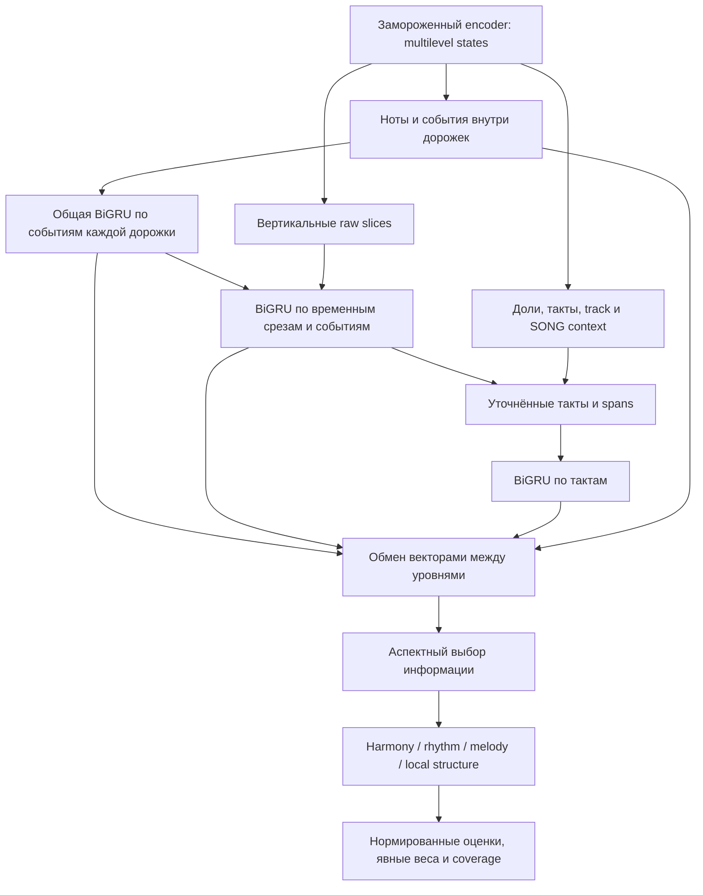

# Многомасштабный аспектный критик поверх музыкального энкодера

22 сентября 2026. **Исследовательское обоснование конструкции.** Последующая
[реализация v1 и synthetic проверки](../workstreams/2026-09-21/critic-wayfinder/implementation.md)
завершены; real-data обучение и проверка музыкального качества не проводились.
Последующее уточнение: пользователь согласился добавить локализацию;
[спецификация v1](../workstreams/2026-09-21/critic-wayfinder/spec.md) теперь
фиксирует инженерные контракты. Локальные intervention targets добавлены
отдельно от aspect ranking; валидированная карта музыкальных ошибок unavailable.
Ниже сохранены исследовательская аргументация и границы гипотез.
Main HEAD `287bf856643f9e555352e1661a7bf0563772178a`; checkout содержит
предсуществующие WIP и исправленный target materializer v2. Проверены текущие
main-файлы и изолированный C3 source; checkpoints/модели/корпуса не исполнялись.

## Задача и изменение направления

Пользователь отверг beat→scalar как основной критик и запросил совместное
рассмотрение нот, вертикальных срезов, долей и более крупных уровней,
двунаправленную последовательную обработку, rhythm/harmony/melody/structure
выходы и взвешенную общую оценку. Простая голова остаётся только контрольным
baseline. Нынешняя цель — определить интерфейс и подходящий первый вариант
более содержательного readout, сохранив замороженный pretrained backbone.

Существующая [ARCHITECTURE](../ARCHITECTURE.md) уже содержит путь
hierarchical features → aspect heads → preference/reward head. Предложение
ниже конкретизирует этот путь. Оно не требует переобучить backbone с нуля,
не удаляет18theory heads и не объявляет их качество качеством критика.

## Установлено кодом: какие состояния есть

| Уровень | Текущий источник | Граница |
|---|---|---|
| Нота | Local GNN, hierarchical fused и temporal note states | Note не равна семантическому голосу |
| Onset | Узел общей атаки; contextual state и onset-BiGRU | Это общая последовательность произведения, не последовательность каждой партии |
| Вертикальный slice | Raw onset/offset/beat-boundary times, starts/holds/ends relations, temporal state | Beat не заменяет все смены звучащего состава; release-note не звучит после конца |
| Доля | Метрический узел, hierarchy/BiGRU/temporal context | Это контекстная сводка, не гарантированно один аккорд |
| Такт | Hierarchical pooling, coarse Transformer, BiGRU pool, temporal state | Main temporal обновляет bar только в первом из двух rounds |
| Дорожка | Один global track vector, полученный из notes и coarse Transformer | Нет готовой track×event или track×bar последовательности |
| Произведение | SONG vector после coarse Transformer/fusion | Он не пересобран после последующего BiGRU/temporal refinement |

Primary code: [ContextualEncoderOutput](../../src/music_critic/models/hierarchy.py),
строки1018–1105, содержит local_encoder/pooling/coarse/fused;
[corrected encode](../../src/music_critic/experiments/analysisgnn/corrected_model.py),
197–224, заменяет fused результатом onset-BiGRU;
[onset BiGRU](../../src/music_critic/models/onset_bigru.py),114–159,190–243,
обрабатывает общую onset sequence и обновляет onset/beat/bar, не track/song.
[Temporal model](../../src/music_critic/experiments/analysisgnn/temporal_slices/model.py),
64–85, возвращает note/onset/beat/bar/slice, не богатый base output.
[Temporal graph](../../src/music_critic/experiments/analysisgnn/temporal_slices/graph.py),
25–39,145–175, задаёт raw отношения; [raw slots](../../src/music_critic/data/raw_time_readout_slots.py),
112–133, не используют gold boundaries.

`return_layers=True` сохраняет промежуточные local GNN states, но не историю
Transformer/BiGRU/temporal layers: [encoder](../../src/music_critic/models/encoder.py),
450–493. В проверенном C3 worktree
`outputs/worktrees/c3-relationgate-changes-3090-20260919` temporal forward также
не возвращает base track/song; threepass bar/onset имеют два refinement rounds,
note/beat/slice — три. Это разные стадии одного encoder, не взаимозаменяемые
«последние embeddings». Track ordinal уже влияет на coarse Transformer;
добавление invariant pooling не делает весь старый backbone track-invariant.

## Рекомендуемая модель: векторы, три последовательных пути и обмен контекстом

### 1. Export adapter сохраняет уровни и их происхождение

Предлагаемый `CriticFeaturePyramid` возвращает embeddings каждого типа,
sample ownership, exact times/durations, raw ownership/incidence,
starts/holds/ends и binding стадии/checkpoint/source. Note→bar — владелец атаки;
note→beat active_at — начала долей в `[onset,end)`, не один beat owner.
Метрическая принадлежность атаки определяется через onset. Для held-note
pooling по тактам/spans нужна точная overlap incidence, отличная от attack
ownership; [builder](../../src/music_critic/graph/builder.py),273–278,709–731,758–761.
Сохраняем
раздельно local note state и последний contextual/temporal state; learnable
projection/gate может сочетать их. Не экспортируем все слои «на всякий случай».
В temporal пути adapter удерживает уже вычисленный base output в одном pass;
не выполняет `base.encode` повторно. Старые output/checkpoint schemas сохраняются.

При C2 fallback pretrained slice state отсутствует: новый critic строит raw
slice token из note states и времени. Это другая версия adapter, не имитация
готового C3 embedding. После encoder features можно кешировать в eval/no-grad;
обучение critic не меняет encoder или его18heads.

### 2. Горизонтальный путь: развитие каждой партии

Внутри каждой raw дорожки объединяем **одновременно атакующие ноты как
множество**, получая event vector из их embeddings, длительностей и raw timing.
Исходные note vectors сохраняем отдельным потоком; set pooling их не заменяет.
Общая BiGRU проходит event vectors каждой дорожки независимо по точному времени.
Так возникает контекст развития партии до/после события, отсутствующий в одном
global track vector. Polyphonic track не объявляется одним голосом; не подаём
произвольный pitch-sorted порядок одновременных нот как временную мелодию.
Raw track может быть технической объединённой дорожкой, как в части
Dilemmadata/CL: тогда этот путь обрабатывает общую полифоническую sequence,
а не восстанавливает партии или голоса. Отдельные партии используем там, где
они наблюдаемы в raw input; gold voices/roles не становятся требованием.

### 3. Вертикальный путь: взаимодействие одновременно звучащих партий

На raw slice формируем token из note states и горизонтальных event states
принадлежащих им атак. Sounding set использует `[onset,end)`; starts/holds
отдельны от releases. При окончании ноты её release features можно сохранить,
но не включать её в post-boundary sounding set. Для grace/zero-duration событий
нужен отдельный event channel, не фиктивный sounding interval.
Добавляем existing slice/onset/beat context при наличии и относительное точное
время. Вторая BiGRU проходит **raw temporal-event slots с sounding/event
channels**: onset, offset и метрические границы. Не сливаем повторные PC-sets
или одинаковый sounding set: между ними могут различаться атаки и метрическая
позиция. Это вертикальное взаимодействие с контекстом горизонтального пути.

### 4. Крупный путь: такты, развитие фрагмента и повторяемость

Duration/mask-aware pooling refined slices/events формирует новый bar vector;
existing bar/coarse track/song states входят как контекст с указанной стадией.
Третья BiGRU работает по последовательности тактов. Из её выходов строятся
скользящие spans2/4/8тактов и предварительный global context. Это raw metric spans,
не gold фразы/секции. Для будущей формы полезны связи между удалёнными
повторяющимися/контрастирующими spans; их полноценная оценка требует длинного
контекста и отдельной поддержки, которой30-секундный suite не даёт.

### 5. Обмен контекстом и aspect readout

Один ограниченный блок выполняет последовательные residual vector messages
по raw membership: сначала bar/span context → slices, затем **обновлённые**
slices → note/track events; после этого пересобирает агрегаты вверх и final
global pooling. Это направленная последовательность операций, не обещание
двухшагового переноса за один синхронный GNN round.
Gate зависит от receiving vector, message и relation type; маски и нормировка
не дают пустой дорожке или частому событию неявно менять масштаб. В первой
версии это gated fusion по заданным связям. Sparse cross-scale attention —
следующая взаимозаменяемая реализация **на тех же связях**; добавление дальних
связей считается отдельной осью. Уже существующие GNN/Transformer не повторяем
целиком: новые операции обрабатывают новые track-time sequences и пересобирают
верхние уровни из уточнённых states под critic objective.

Аспект получает свой learned query для лёгкого attention pooling внутри
каждого уровня, затем gated fusion нескольких level vectors и финальный score.
Это небольшое аспектное внимание уже в первой версии; большого all-to-all
Transformer над всеми notes не требуется. Attention weights — коэффициенты
сборки, не причинное объяснение ошибки. До финальных readouts все потоки
передают vectors; не сворачиваем каждую ноту/долю в quality scalar заранее.

| Выход | Основные пути, остальные доступны как контекст |
|---|---|
| Harmony | Sounding slices, их горизонтальная последовательность, note/track взаимодействие |
| Rhythm | Attacks/releases/gaps, metric beat/bar context, синхронизация партий |
| Melody | Notes и per-track event sequence с вертикальным/тактовым контекстом |
| Structure | Порядок bar/span states, стыки, повтор/контраст на объявленном горизонте |
| Опционально: arrangement | Взаимодействие и полнота партий; готового надёжного quality target пока нет |

Начальные четыре выхода соответствуют запросу. Arrangement предусмотрен как
отдельный extension/output, но удаление партии само по себе не доказывает
плохую аранжировку: первые20таких вариантов оставляем диагностикой, не размечаем
все остальные аспекты плохими. На текущем наборе structure называем
`local_order/transition_compatibility`; whole-form score остаётся unavailable.
Оценки по участкам требуют отдельного readout после общего контекста; одним
clip ranking loss их правильная локализация не доказана.

### Размер и контракты модулей

Первый размер для спецификации: общая ширина128, BiGRU hidden64 на направление,
один слой для каждого из трёх путей. Одна стандартная BiGRU содержит
`2*(3*64*128 + 3*64*64 + 6*64)=74496` параметров; три —223488, без adapters,
fusion и readouts. Это аналитический счёт предлагаемой конфигурации, не размер
готового critic и не замер скорости/стоимости. Весь extractor остаётся frozen.

Seams: `BackboneFeatureAdapter` owns source/stage/identity; `CriticContext`
owns новые sequences/fusion; `AspectReadout` owns local/global outputs;
`AspectScorePolicy` owns reference scales/weights/common support. Они не должны
читать training labels из graph input. Отдельный training sidecar хранит
weak pair directions, masks, intervention support и происхождение targets.

## Обучение по имеющимся искажениям

Сохранённый [suite](../experiments/GENRE_INTERVENTION_SUITE_RU.md):20works,
46harmonic/35rhythmic/34melodic/20arrangement/14bar-order variants,
28–32секунды. Генератор явно пишет `quality_preference='unreviewed'` и
`primary_aspect_is_hypothesis=True`:
[genre_interventions.py](../../src/music_critic/experiments/genre_interventions.py),471–473.
Это настоящий набор изменений, но не готовая матрица музыкальных оценок.

Первый loss — сумма masked aspect pair rankings:
`L = mean_available(work,aspect)[softplus(s_a(edited)-s_a(original))]`.
H→harmony, R→rhythm, M→melody, bar swap→local-order — явно слабые учебные
направления. Для остальных аспектов этой пары target **unknown**, не negative
и не требование score invariance: shift партии меняет гармонические пересечения,
melody flattening меняет PCs, bar swap меняет сразу несколько переходов.
Не учим family-classification вместо quality rank и не подаём family ID модели.

Sampling сначала по work/component, затем аспекту и паре. Разделяем work groups,
сохраняем все sibling variants вместе.20works/149variants годятся для механики,
просмотра и малого feasibility screen; не для надёжного обучения всей более
богатой модели. Следующий proposed data step — перенести валидированные операторы
на больше разрешённых TRAIN works, сохраняя отдельные произведения/семейства
для оценки. Это автоматическая генерация пар, без обязательной ручной разметки
для старта; новые pairs одного work не заменяют новые works. Она не запускалась
и требует своего bound data/evaluation protocol. Рендер training MIDI не обязателен.
Отложенные works из backbone TRAIN — **head-held-out**, не novel-to-backbone;
пять classical suite clips уже взяты из TRAIN, весь просмотренный suite остаётся
development. Отдельно учитывать known-component closure, pretraining overlap
или unknown и held-out operator families. Перенос на новые для backbone
произведения требует нового независимого cohort, без открытия корпусного TEST.

Известный patch support может входить в training-only mask; на inference его
нет. Delay support — union старого/нового времени, deletion оценивается на
сохранившемся raw metric grid, bar swap — на соседних переходах. Нетронутые
позиции не становятся gold correct из-за отсутствия patch. Сохранённые theory
targets оригинала нельзя переносить на изменённый MIDI. Электронный audio-only
drum bed исключается из оценки того, чего символическая модель не наблюдает.

## Процесс обучения — уточнение22сентября

До выполнения фиксируем checkpoint/source, список work/components и head
train/dev/evaluation split, семейства правок, weak aspect masks и stop/selection
rule. Сначала делим исходные произведения, затем генерируем варианты внутри
их разделов. Существующий просмотренный suite остаётся development. Уровень
силы оператора не задаёт доказанный порядок perceived severity.

Frozen encoder один раз обрабатывает **каждый отдельный original/variant**;
кеш хранит multilevel vectors, exact raw geometry и source/stage bindings.
Изменённый MIDI проходит свой encoder forward: original features не подходят
его изменённым нотам/связям. Объём фиксированного variant bank ограничен бюджетом;
новые варианты требуют нового извлечения features. Кеш не содержит обучаемые
новые GRU/fusion outputs и не используется для будущего masked PLL.

Один шаг optimizer:

1. Сбалансированно выбрать works, доступные аспекты и пары; случайно менять
   стороны вместе с направлением target. Один и тот же critic оценивает обе
   стороны независимо, без pair/reference input на inference.
2. Для обоих элементов выполнить все обучаемые projections, три recurrent
   пути, fusion и четыре readouts поверх frozen features.
3. Для подписанного аспекта считать `softplus(s_edited-s_original)`; усреднять
   по доступным work/aspect группам. Остальные аспекты не получают прямого
   loss этой пары. Их выходы всё же могут измениться через общие параметры.
4. Один backward/optimizer step обновляет **всю новую надстройку совместно**:
   adapters/projections, GRU, gates, aspect attention и score heads. Параметры
   encoder и старых theory heads не входят в optimizer; encoder в eval mode.

Это относительное обучение: не назначаем original=100/edited=0 и не учим
общий overall вместо аспектов. Первый loss относится к clip-level scores;
локальная карта ошибок требует дополнительного обоснованного supervision.
Все новые части инициализируются отдельно, pretrained backbone сохраняется.
Regularization/early stopping не заменяют достаточное число независимых works.

После фиксированных интервалов проверяем per-aspect pair accuracy/loss на
head-dev, усредняя по works, и raw/beat/multilevel-pooling controls. Checkpoint
выбирается заранее заданным macro-aspect правилом, а не train loss или личным
просмотром каждого evaluation примера. Небольшой предварительный pilot проверяет
механику/скорость; только затем расширяем обучение в зафиксированном конверте.
После выбора замораживаем critic и reference scales; отдельная evaluation
выборка не участвует в настройке. Human check с пользователем и1–2слушателями
проверяет направление слабых targets; данные для последующей human adaptation
отделяются от final human evaluation. Changes, optional backbone unfreezing
и PLL не входят автоматически в этот первый optimizer/run.

## Взвешенная общая оценка

Для каждого аспекта возвращаем raw score, относительную нормированную оценку,
coverage, temporal scope и model/reference version. Не складываем arbitrary
ranking logits: pair loss не задаёт общий offset/scale четырёх голов.
Первое прозрачное преобразование — percentile по одному versioned TRAIN
reference bank, сбалансированному по works. Это относительная шкала reference
distribution, не калибровка человеческого качества или вероятности предпочтения.
Reference bank не содержит evaluation works, bins/scales фиксируются до оценки.
Bank оценивается на том же горизонте и с теми же aggregation/support правилами;
percentile30-секундных clips не переносится молча на целые произведения.

`overall = sum_a(w_a*m_a*q_a) / sum_a(w_a*m_a)`;
`coverage = sum_a(w_a*m_a) / sum_a(w_a)`.
`w_a>=0` — явные пользовательские веса; сначала равные для четырёх поддержанных
выходов, не автоматически выученные из частоты семейств. При нулевом знаменателе
overall unavailable. `m_a` — доступность оговорённого aspect/scope, не наличие
intervention label у данного MIDI. Сравниваем варианты на общем наборе аспектов
и общем горизонте; отсутствие structure нельзя замаскировать незаметной сменой
весов. Whole-form и local-order — разные режимы. На UI раскрываем вклад каждого
аспекта. Позже human overall preferences могут определить другие веса и
проверить, достаточно ли аддитивной суммы.

## Changes и PLL в этой конструкции

Changes — отдельный99-output auxiliary decoder на соответствующих contextual
states, со своими masks/support. Его predictions или hidden features можно
позже подать harmonic readout через явную ablation; это не99 quality scores
и не основание штрафовать насыщенные аккорды. Сначала fixed backbone/readout,
затем matched изменения backbone с/без changes, обе ветви с одним pcsetv2
режимом. Разморозка invalidates frozen feature cache.

PLL остаётся отдельным conditional branch на тех же **типах** уровней. Для
каждого скрываемого блока заново вычисляются encoder и critic context с masked
input; нельзя подмешивать full-view note/track/song/span embeddings. Скрытые
pitch/derivatives/sustain copies должны исчезнуть до encoder. Первый decoder
восстанавливает raw PC-set при известном rhythm skeleton; он не оценивает
качество ритма/формы. Rhythm/whole-content PLL требуют своих targets/масок и
нормировки. Сначала per-aspect score и PLL показываются отдельно; сочетание
допускается после проверки добавочной пользы и общего support, не произвольным
суммированием NLL разных размерностей. [Полный контракт](../workstreams/2026-09-21/critic-wayfinder/decisions/02-objects-masks.md).

## На что опирается идея и что ещё не доказано

- [HAN, Yang et al.2016](https://aclanthology.org/N16-1174.pdf) сочетает
  двунаправленные GRU на уровнях слов/предложений и внимание при их агрегации.
  Здесь это инженерный аналог для построения иерархического readout; результаты
  классификации текста не доказывают эффективность музыкального критика.
- [Learning Multi-Level Representations for Hierarchical Music Structure Analysis,
  ISMIR2022](https://ismir2022program.ismir.net/poster_237.html) отдельно ставит
  проблему нескольких допустимых уровней структуры в музыкальном аудио.
  Это мотивация различать горизонты, не готовый symbolic quality target.
- [MusicBERT](https://arxiv.org/abs/2106.05630) исследует pretrained symbolic
  representations и bar-level masking. Его результаты не подтверждают нашу
  frozen multiscale head или PLL; существующий backbone не заменяем этой моделью.

Supported: нужные базовые representations есть; отдельные track-time/span
уровни и richer temporal export отсутствуют; suite покрывает несколько семейств.
Hypothesis: поздний context/fusion улучшит aspect ranking и перенос между
семействами. Unestablished: превосходство над simple pooling, смысл weighted
score для слушателя, full-form quality и полезность changes/PLL.

## Минимальная проверка и следующий шаг

До кода специфицировать exporter/stages, clip/long-context limits, weak aspect
mask matrix, exact support и reference-score policy. Synthetic checks:
ownership/batch isolation, simultaneous-note set permutation, raw time
starts/holds/ends, empty tracks, missing aspects/zero denominator, frozen
gradients/cache binding, sequence order and no target/operator leakage.
Новое readout может быть invariant к перестановке track rows при фиксированных
features; это не обещание end-to-end invariance старого encoder.

Первый science comparison после разрешения: raw summaries; прежний beat probe;
multilevel pooling без новых GRU; предложенный recurrent/fusion critic.
Одинаковые splits, weak labels, support и selection rule. Затем по одному
выключать горизонтальный/bar контекст и cross-scale fusion. Sparse attention
и PLL — следующие отдельные ветви, не обязательные параллельные расходы.
Если recurrence/fusion не даёт held-out преимущества над multilevel pooling,
не сохранять сложность только ради архитектуры. Нет новых native throughput
данных: прежний1000₽ cap первого пилота — потолок, не обещание вместить новый
дизайн; сначала маленький memory/throughput gate и пересчёт плана.7300₽ остаток
со слов пользователя, не проверенный Billing API.

Работа ограничена анализом/документами. Нет новых unit/model tests, training,
real-data processing/inference, TEST payloads, VM, paid actions или legacy reuse.
Проверены локальные ссылки/whitespace; независимые агенты проверили уровни
энкодера, intervention supervision и варианты контекстной архитектуры.
