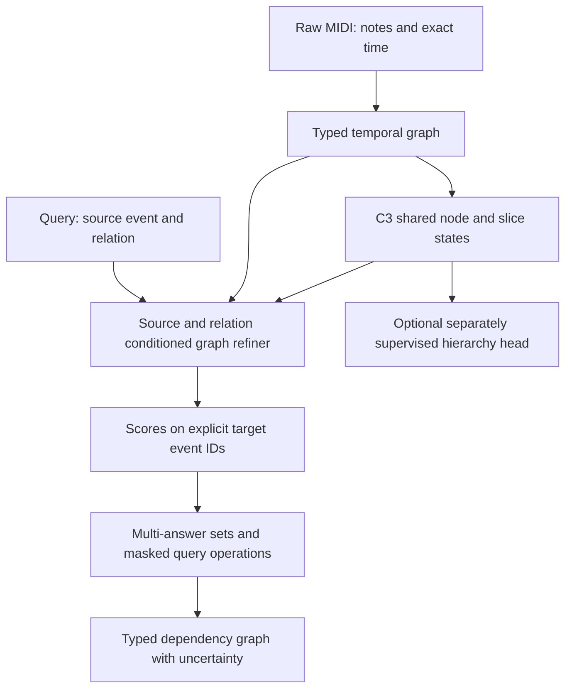

# От TransE к рассуждению по музыкальному графу

Дата проверки: 25 октября 2026. Фаза: исследование архитектурных вариантов.

**Вопрос:** как предсказывать типизированные музыкальные зависимости и их
композиции, сохраняя адресуемые события, промежуточных участников и несколько
уровней структуры, вместо обязательного сравнения двух статических embeddings?

**Рекомендация для проверки:** оставить C3 поставщиком raw-признаков, добавить
source/relation-conditioned проход по графу в духе NBFNet, а ответы и простые
пересечения сначала представлять явно по кандидатам, как в GNN-QE.
Иерархическое pooling и гиперболическая геометрия решают другие части задачи;
их следует проверять отдельными условиями. Это предложение, не принятая замена.

## Граница свидетельств

Проверен checkout `287bf856643f9e555352e1661a7bf0563772178a` с существующими
незакоммиченными изменениями. Основания: текущий код, авторитетные документы,
сохранённый [отчёт пилота](../experiments/LLM_RELATION_PROBE_20261024_RU.md),
официальные материалы Stanford и первичные статьи. При обзоре не читались
музыкальные payload/checkpoints, не выполнялись inference, обучение, GPU
диагностики или импорт новых экспериментальных результатов. Legacy не читался.

Внешние результаты ниже принадлежат авторам работ. Предполагаемая полезность
для Music Critic — гипотеза переноса. Поиск охватывает проверенные работы
2013–2026 годов, но не является исчерпывающим systematic review или рейтингом
SOTA. Два независимых source reviews сопоставлены с первоисточниками.

## 1. Где в нашей реализации находится сжатие

Весь граф произведения сейчас не заменяется одним вектором. В
[`PLLContextEncoder._encode_graph`](../../src/music_critic/pll/encoder.py)
сохраняются отдельные строки `note`, `slice`, `onset`, `beat`, `bar`, `track`,
`song`. Базовый encoder содержит локальный message passing, pooling по
наблюдаемому containment, coarse Transformer и top-down fusion обратно в
исходные строки. Последующие C3 temporal layers снова используют рёбра.
См. [`hierarchy.py`](../../src/music_critic/models/hierarchy.py) и
[`temporal_slices/graph.py`](../../src/music_critic/experiments/analysisgnn/temporal_slices/graph.py).

Ограничение возникает при чтении ответа. В
[`relation_probe/model.py`](../../src/music_critic/relation_probe/model.py)
событие представлено конкатенацией `note128 + slice128 + raw10`; затем общая
линейная проекция даёт нормированный вектор64. Парная голова получает только
два таких состояния. У неё нет повторного доступа к raw edges, отдельным
соседям, идентичностям промежуточных участников или query-conditioned состояниям.

Для фиксированного source и единичных target-векторов наш TransE ranking
алгебраически эквивалентен dot product с запросом `u_source + r`:

```text
-||u_source + r - u_target||²
 = constant(source,r) + 2 <u_source+r, u_target>.
```

Это свойство текущей формулы; оно не доказывает, что именно размерность64
ограничила качество. Тем более оно не объясняет автоматически always-linked
поведение existence-head. Пилот не сравнивал ширины, query-conditioned проходы
или контекстные окна. Его C3 работает по bounded tiles:4core bars +1halo с
каждой доступной стороны, а не по неограниченному графу всей пьесы. Проверка
полной формальной иерархии произведения в этом опыте не проводилась.

Три разных ограничения требуют разных проверок:

| Возможное ограничение | Что оно означает | Различающая проверка |
|---|---|---|
| Endpoint readout | Универсальное состояние события должно обслужить любой запрос | Статический decoder против source-conditioned graph pass |
| Oversquashing | Дальние сведения плохо проходят через топологию и агрегирование | Зависимость качества от дальности/узких связей; controlled shortcuts |
| Потеря множества/участников | Одна точка или независимые scores не сохраняют все допустимые ответы и joins | Явное множество и запросы с общим witness |

[Di Giovanni et al., ICML2023](https://proceedings.mlr.press/v202/di-giovanni23a.html)
связывают oversquashing с шириной, глубиной и топологией; добавление слоёв само
по себе не является общим решением. В нашем графе этот диагноз не измерялся.
Наличие векторов не является ошибкой: вопрос в том, что сохраняется адресуемым
и когда выполняется агрегация.

## 2. Что действительно разобрано в Stanford

Прочитаны официальные программы и доступные слайды; полные видеозаписи не
просматривались. Содержимое закрытого Canvas не реконструируется. Материалы
разных лет явно разделены; текущая программа2026 не означает, что все её
поздние лекции уже состоялись.

| Материал | Полезный раздел | Связь с нашей задачей |
|---|---|---|
| [CS224W2025, lecture10: Knowledge Graphs](https://snap.stanford.edu/class/cs224w-2025/slides/10-kg.pdf) | Embedding lookup, scoring triples, TransE/TransR/ComplEx и свойства отношений | Различает выразительность scorer и индуктивный graph encoder; менять метрику недостаточно для query execution |
| [CS224W2024, lecture11: Reasoning over KGs](https://snap.stanford.edu/class/cs224w-2024/slides/11-reasoning.pdf) | Projection, intersection, box queries, ограничения union и DNF | Прямая связь с исходной идеей пересечения ответов; особенно блок PDF-страниц40–65 |
| [CS224W2025, lecture15: KG Foundation Models](https://snap.stanford.edu/class/cs224w-2025/slides/15-KGFoundationModels.pdf) | Перенос на новые entities/relations, equivariance, relation graph | Словарь отношений также может иметь структуру; это не готовый музыкальный checkpoint |
| [Stanford Online2021, lecture11.1](https://www.youtube.com/watch?v=X9yl0pTP9fY) | Публичная запись введения в reasoning | Маршрут для самостоятельного просмотра; не выдаётся за запись курса2025 |

Официальные [программа2025](https://snap.stanford.edu/class/cs224w-2025/) и
[текущая программа](https://web.stanford.edu/class/cs224w/) помогают продолжить
чтение про heterogeneous graphs и graph Transformers. Центральное различие
для проекта: оценка тройки, выполнение составного запроса и построение
музыкальной иерархии — три отдельные задачи.

## 3. Как развивалась идея TransE

| Семейство | Что изменяется | Что остаётся ограничением для нас |
|---|---|---|
| [TransE,2013](https://proceedings.neurips.cc/paper/2013/hash/1cecc7a77928ca8133fa24680a88d2f9-Abstract.html) | Перенос `h+r≈t` | Один запрос тянет несколько ответов к одной точке; нет собственного executor для AND/joins |
| [TransR,2015](https://ojs.aaai.org/index.php/AAAI/article/download/9491/9350) | Проекция в пространство отношения | Более богатый scorer по представлениям; не возвращает подграф в вычисление автоматически |
| [ComplEx,2016](https://proceedings.mlr.press/v48/trouillon16.html) | Комплексная факторизация, симметричные/асимметричные отношения | Хороший дешёвый контроль, но без явных промежуточных участников |
| [RotatE,2019](https://arxiv.org/abs/1902.10197) | Вращения, структуры inverse/composition/symmetry | Другой geometric bias; универсальная логика или музыкальная иерархия не возникают автоматически |

Добавление измерений расширяет параметризацию, но сохраняет форму оператора.
В индуктивном Music Critic новые ноты получают embeddings от encoder;
обученная таблица ID всех нот не требуется. Поэтому «много сущностей в KG» и
«много параметров нашей модели» нельзя отождествлять.

## 4. Три наиболее релевантные линии

### 4.1. Подграф пары: SEAL и GraIL

[SEAL, NeurIPS2018](https://papers.nips.cc/paper/2018/hash/53f0d7c537d99b3824f0f99d62ea2428-Abstract.html)
классифицирует окружающий предполагаемую связь подграф с обозначенными концами.
[GraIL, ICML2020](https://proceedings.mlr.press/v119/teru20a.html) переносит
структурное рассуждение на typed relations и новые сущности. Ограниченный
класс представимых правил не равен произвольной логике.

Это полезный контроль: сохраняем одинаковый кандидатный пул, но predictor
видит окружающую структуру пары. Для музыки обязательно оставить pitch/time
features и направления. Обрабатывать подграф для каждой из32пар дороже одного
общего source-query pass. Воспроизводить topology-only ограничения чужого
benchmark как музыкальную спецификацию не следует.

### 4.2. Запрос меняет вычисления на графе: NBFNet

[NBFNet, NeurIPS2021](https://papers.nips.cc/paper/2021/file/f6a673f09493afcd8b129a0bcf1cd5bc-Paper.pdf)
строит состояния пар через source/query-conditioned message passing,
агрегируя пути обучаемыми Indicator/Message/Aggregate. За один запрос
`(source,relation,?)` оцениваются разные tails. При фиксированном числе
итераций стоимость source-query порядка `O(|E|d + |V|d²)`; параметры и
стоимость выполнения запроса — разные величины. Векторы по-прежнему есть,
но они зависят от вопроса и продолжают обмениваться сообщениями по графу.

**Наша гипотеза адаптации:** C3 вычисляет общие признаки; дополнительный
небольшой refiner получает relation embedding и маркер события
`(note_id, exact_slice)`. После нескольких typed проходов каждый кандидат
имеет состояние относительно этого source. Для удержанной ноты недостаточно
пометить только note_id. Raw temporal/containment edges и числовые признаки
остаются входом, а `resolves_to` остаётся целью.

### 4.3. Ответ — набор реальных кандидатов: GNN-QE и FIT

[GNN-QE, ICML2022](https://proceedings.mlr.press/v162/zhu22c/zhu22c.pdf)
разделяет relation projection через GNN и fuzzy logic над membership-векторами
реальных вершин. Промежуточный набор ответов адресуем; его не нужно упаковывать
в одну точку. В исходном обучении используются все отрицательные ответы
сгенерированных запросов; traversal dropout имитирует неполноту графа.
Эту политику negatives нельзя автоматически переносить на наши masks.

Для проекта сначала можно хранить `p_resolves(i,j)` для допустимых событий j,
отдельно получать scores второго ограничения и объединять их по одинаковым
event IDs, времени и view. Membership scores не обязаны суммироваться в1:
допускаются несколько ответов и пустой ответ. Для простого AND стоит сравнить
`min`, product и learned combination. Product — выбранный fuzzy operator,
а не доказанная вероятность независимых свидетельств.

[FIT, ICLR2024](https://proceedings.iclr.cc/paper_files/paper/2024/hash/55ce0d74cf90dc79f08a422ab61295cb-Abstract-Conference.html)
также связывает neural link prediction с fuzzy query evaluation и расширяет
проверяемые формы запросов. Его корректность при идеальных relation matrices
не переносится на ошибки музыкальных weak labels. Формирование матриц по
известным фактам и complement-based negatives требуют адаптации.

Общий кандидатный universe нужен до пересечения. Если один retrieval stage
не предложил событие, это потеря coverage, а не доказанное false. Для сложных
запросов локальный пул32может оказаться недостаточным даже при идеальном scorer.

## 5. Области, распределения и общие промежуточные участники

[Query2box, ICLR2020](https://arxiv.org/abs/2002.05969) представляет запрос
областью возможных ответов, обучает projection/intersection и обрабатывает
disjunction через DNF с несколькими областями. Это компактная альтернатива
явному набору, но learned intersection не является гарантированным точным
пересечением. Одна область плохо описывает произвольно разобщённые ответы.

[BetaE, NeurIPS2020](https://arxiv.org/html/2010.11465v1) использует параметры
Beta-распределений и нейронные операции conjunction/disjunction/negation.
Распределение в latent space не равно откалиброванной вероятности музыкальной
истинности. Поддержка набора логических операторов не означает поддержку
любого query graph без ограничений на переменные и декомпозицию.

Новое существенное различие показывает
[DAGE, WWW2025](https://arxiv.org/html/2410.22105v2): tree-form декомпозиция
может потерять идентичность общего existential witness. DAGE расширяет query
embeddings на определённый класс DAG-запросов через relational combinator
и логические ограничения; это не универсальный executor любого графа.

Уточнение примера, 25 октября: обычная цепочка `A→H→B` сама по себе не
демонстрирует ограничение Query2box — path queries уже входят в его постановку.
Существенный случай — две ветви должны ссылаться на одного и того же
промежуточного участника.

Условный, не корпусный пример: найти фразу x, которая начинается и
заканчивается в одной и той же мажорной тональности k:

```text
q(x) = ∃k: major(k) AND starts_in(x,k) AND ends_in(x,k)
```

Пересечение «начинается в какой-то мажорной» и «заканчивается в какой-то
мажорной» теряет равенство k: фраза C-major→G-major проходит обе независимые
проверки, но не исходный запрос. Здесь k обозначает тональность как tonal
identity, не два отдельных события-аннотации. Нужно сохранить соответствия
`(x,k)` до объединения условий либо поддержать role conjunction в query
representation. Обычное пересечение финальных множеств x этого не гарантирует.
Такой пример иллюстрирует общую постановку DAGE, не заявляя о наличии этих
labels или готового phrase/key inference в нашем corpus.

Box/Beta heads разумны как контроль компактности, а первым механизмом
пересечения для ограниченного пула удобнее считать явные membership scores:
их проще отлаживать, проверять по участникам и снабжать availability masks.

## 6. Что именно у нас является иерархией

| Структура | Возможное представление | Чего нельзя предполагать |
|---|---|---|
| Наблюдаемые время/containment | Нота–slice–такт, track, multiscale raw windows | Track×time — не одна простая цепочка вложенности |
| Семантическая организация | Предсказанные harmony/phrase/process nodes, incidence по ролям | Gold boundaries/voices доступны на MIDI inference |
| Онтология типов | Подтип `suspension_resolution` наследует общие параметры `resolves_to` | Такое наследование уже верифицировано для всего корпуса |
| Пролонгационная редукция | Нота сохраняется или исчезает на уровнях анализа | Уровни автоматически выводятся из длительности/аккордовой принадлежности |
| Граф зависимостей | Типизированные направленные, иногда многоместные связи | Все семейства образуют одно дерево или один транзитивный порядок |
| Query graph | Пути, AND, общий witness, несколько anchors | Совпадение низких расстояний доказывает логический вывод |

[Hyperbolic Entailment Cones, ICML2018](https://proceedings.mlr.press/v80/ganea18a.html)
представляют DAG-иерархии через частичный порядок и вложенные конусы.
[HGCN, NeurIPS2019](https://papers.neurips.cc/paper_files/paper/2019/hash/0415740eaa4d9decbc8da001d3fd805f-Abstract.html)
даёт индуктивные узловые представления в гиперболическом пространстве.
Геометрия может помочь проверенной иерархии; одна симметричная дистанция не
задаёт направление ancestor/descendant. HGCN не добавляет executor запросов.

Возможный отдельный опыт — небольшой cone/hyperbolic head для размеченного
structural-subordination или type hierarchy. Raw время и зависимости могут
остаться в Euclidean пространстве. Нет основания объявлять весь музыкальный
граф гиперболическим только из-за слова «иерархия».

Многоместные отношения следует сохранять как объекты с participant roles
или factor/incidence nodes. Разворачивание группы в полный набор бинарных пар
может поменять смысл; текущий pilot такие случаи исключает. Это отдельный
проектный вариант, не свойство, полученное от TransE.

## 7. Прямые музыкальные работы и новые источники

[GraphMuse, ISMIR2024](https://arxiv.org/abs/2407.12671) даёт музыкальный graph
processing и sampling с иерархическими элементами. Проверяемые там pitch
spelling/cadence задачи не равны адресуемым зависимостям. Уже имеющаяся
иерархия C3 означает, что простое добавление coarse Transformer не изолирует
новизну или полезность query-conditioned readout.

[AnalysisGNN, CMMR2025](https://arxiv.org/abs/2509.06654) объединяет разные
аналитические targets через multitask-подход. Это близкий контекст для
частичной разметки, но задача классификации локального анализа не тождественна
предсказанию участников отношений и выполнению составных запросов.

**[AutoSchA, arXiv20.12.2025](https://arxiv.org/html/2512.18232)** — особенно
близкий музыкальный источник. Он учит multi-relational node isolation:
выживание нот на уровнях редукции, с supervision по глубинам и monotonicity
regularizer. Это предсказанная аналитическая иерархия, а не только pooling
для получения вектора. Основной benchmark —88анализов тем фуг Bach/Pachelbel;
экспертная оценка использует выбранные экспертом thresholds. Перенос на наши
многожанровые complete works и автоматическую работу без настройки не доказан.
Наши labels `resolves_to` не заменяют depth-survival supervision.

[GraphGPS, NeurIPS2022](https://papers.nips.cc/paper_files/paper/2022/hash/5d4834a159f1547b267a05a4e2b7cf5e-Abstract-Conference.html)
сочетает structural/positional encodings, local message passing и global
attention. Он полезен как encoder-направление для дальних взаимодействий;
сам по себе не вводит relation queries или joins. Увеличение токенов и
внимания также требует контроля стоимости.

## 8. Foundation models и масштабирование запросов

[ULTRA, ICLR2024](https://proceedings.iclr.cc/paper_files/paper/2024/file/85dd09d356ca561169b2c03e43cf305e-Paper-Conference.pdf)
использует граф взаимодействий типов отношений и условные relation
representations для переноса на новые KG. Авторы сообщают177k parameters,
pretraining на2A100 и fine-tuning наRTX3090. Это свидетельство практичности
семейства, не замер нашей адаптации и не доказанный zero-shot music transfer.
Наблюдаемые semantic KG facts существенно отличаются от raw temporal edges.

[A*Net, NeurIPS2023](https://proceedings.neurips.cc/paper_files/paper/2023/file/b9e98316cb72fee82cc1160da5810abc-Paper-Conference.pdf)
обучает приоритет выбора узлов/рёбер при query-conditioned поиске. Это
направление для большого графа, если полный проход уже дорог. Pruning создаёт
новый источник потери candidate/path recall; уменьшение числа сообщений не
гарантирует пропорционального ускорения wall time.

Из проверенного2026года:
[KGPFN, arXiv v2 от02.10.2026](https://arxiv.org/abs/2605.14907v2) сочетает
relation graph, локальные NBFNet-представления и внимание к размеченным
положительным/отрицательным support examples отношения. Это интересная линия
для few-shot адаптации словаря. Исходный negative sampling и inference support
не соответствуют автоматически нашим weak masks; музыкального результата
нет. В этом обзоре проверен preprint, независимое воспроизведение отсутствует.

Вместимость на3090 нужно считать по `queries × nodes/edges × layers`, а не
только по числу параметров. На первом этапе разумны bounded tiles, ограниченное
число одновременных source queries и shared C3 features. Точные memory/latency
для нового refiner неизвестны; текущий эксперимент их не измеряет.

## 9. Предлагаемая схема для Music Critic

Это архитектурная гипотеза, вдохновлённая несколькими работами, не их готовая
реализация и не новая принятая спецификация.



1. Сохранить raw graph и матрицы узловых состояний на нескольких уровнях.
2. Query refiner повторно обращается к графу с marker source-event и relation.
3. Прочитать scores на допустимых `(note,time,view)` targets. Existence
   остаётся отдельной задачей; несколько ответов не превращать в softmax1.
4. Простые conjunction делать по общим IDs; shared-witness queries сохраняют
   явного промежуточного участника. Семантические hypotheses получают provenance.
5. Supervised hierarchy branch добавлять только после установления targets;
   выход не обязан образовывать единственное дерево всех видов анализа.

В исходных KG работах reasoner часто опирается на наблюдаемые semantic edges.
У нас gold harmony, voice, resolves_to и phrase segmentation не должны стать
входами raw-MIDI режима. Возможны два честно разделённых режима: reasoning
только по raw evidence или reasoning по предсказанному semantic graph с его
ошибками. Oracle semantic graph допускается лишь как явно названный diagnostic.

## 10. Обучение, данные и минимальная проверка

Сохранённый pilot review относится к64runtime works:52fit/12dev. Его
Recall@5=56.30% у full-pretrained TransE — условная ranking-метрика; always-linked
existence-head и72.44%endpoint coverage не устанавливают качество полной
системы. Эти цифры взяты из существующего отчёта; новых измерений нет.

Количество точных joint queries, hierarchy-depth targets и reviewed negatives
по каждому новому типу неизвестно. Тысячи комбинаций внутри пьесы не создают
тысячи независимых произведений. Достаточность64works для полного словаря и
музыкальной иерархии не установлена.

Для partial labels:

- Positive и reviewed-negative имеют loss; unknown/conflicting остаются masked.
- Подтверждённый AND-positive требует обоих фактов в совместимом view/scope.
  Один reviewed-false конъюнкт даёт false; остальные неполные случаи unknown.
- Отрицание existential требует исключить всех допустимых witnesses. Низкая
  score или отсутствие annotation этого не доказывают.
- Голды, inverse-копии целевого ребра и дублирующие семантические пути не должны
  незаметно раскрывать ответ при training/evaluation.

**Предлагаемая первая проверка, без запуска:**

| Условие | Что изолируется |
|---|---|
| Статическая TransE head | Сохранённая базовая геометрия |
| Статический MLP, сопоставимый по trainable budget | Простая дополнительная ёмкость |
| Source-conditioned typed graph refiner | Доступ к структуре после появления запроса |
| Такой же refiner без source marker | Контроль полезности conditioning |

На первом этапе одинаковый frozen C3, один relation, те же tiles/candidates,
availability masks, family split, sampling и paired seeds. До запуска нужно
уточнить loss/sampling для existence и считать constant controls: вырожденная
голова не должна быть скрыта одной macroF1. Следующий этап full-finetune
отделяется от первого, чтобы не смешивать новый readout и адаптацию encoder.
В marker ablation требуется заранее определить оставшиеся source features:
убрать marker не означает убрать любое возможное source conditioning.

Считать candidate coverage, query-macro multi-answer Recall/Hits, existence
precision/recall по классам и произведениям, empty-answer handling, calibration,
time/distance strata, GPU peak memory и query latency. Independent work holdout
и raw-pretraining overlap остаются разными вопросами. Структурные rewiring
контроли не должны разрушать само определение правильного музыкального ответа.

После атомарного результата: два типа связей к одному event и проверенные
joint-query labels; сравнить fixed score combination, explicit-set executor
и компактную box head. Лишь затем shared-witness DAG queries и отдельно
supervised hierarchy. Никакого нового compute budget этот обзор не выделяет.

## 11. Что поддержано и что остаётся открытым

| Утверждение | Статус |
|---|---|
| Текущий C3 сохраняет отдельные node/slice representations, relation head читает два64d состояния | Наблюдение по коду |
| Семейства query-conditioned и explicit-set reasoning существуют | Подтверждено первичными работами |
| AutoSchA непосредственно учит музыкальную иерархическую редукцию | Подтверждено конкретной постановкой preprint |
| NBFNet-inspired refiner улучшит наш corpus | Непроверенная гипотеза |
| Гиперболическая геометрия устранит все музыкальные неоднозначности | Не поддержано |
| Нынешний провал existence вызван64d bottleneck | Причина не изолирована |
| Имеющихся меток достаточно для полной query algebra/иерархии | Не установлено |
| Нужно немедленно заменять C3 крупной foundation model | Оснований для такого решения нет |

Следующее решение — выбрать один различающий readout experiment после
контракта source-query/targets и достаточности supervision. Производственная
архитектура, terminal records и исторические научные выводы не изменены.

Проверка поставки:5локальных ссылок, whitespace/fences и STATUS diff-check
прошли. Независимое source review разделов1,4,8–11 по NBFNet/GNN-QE/ULTRA,
raw/semantic boundary и сравнению не выявило существенных неточностей;
это не отдельное независимое review всех остальных источников. Исполняемый
код не менялся, unit/model tests не запускались.
