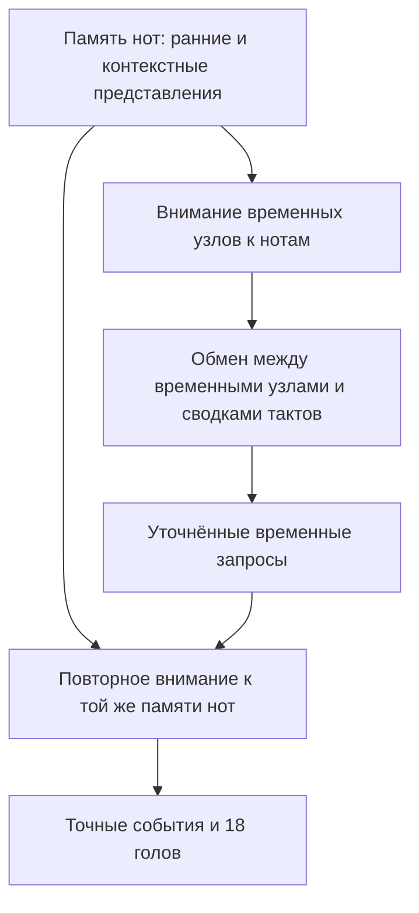

# Внимание и повторное уточнение музыкального графа в латентном пространстве

15 сентября 2026. Исследование `EXP-TEMPORAL-LATENT-RESEARCH-001`.
Проверены текущий код, сохранённые метрики и первичные публикации. Это предложения для следующих экспериментов: текущий запуск, исходники модели и утверждённый бюджет не изменены. Новых forward, обучения, загрузки checkpoint, SSH или доступа к TEST не было.

**Наиболее перспективный следующий архитектурный шаг — дать временным узлам выбирать информацию из нот через внимание. Следующая отдельная гипотеза — повторять это чтение после обмена более широким музыкальным контекстом.** Увеличение глубины остаётся конкурирующим объяснением уже полученного прироста. Ни литература, ни текущие результаты ещё не доказывают пользу предложенных блоков именно для нашего проекта.

## 1. На 15k преимущество действительно больше — с оговоркой об источнике

| Обновления | Историческая C2 | Temporal C2 | Разница |
|---|---:|---:|---:|
| 5 000 | 0,294941 | 0,305268 | +0,010327 |
| 10 000 | 0,358226 | 0,367509 | +0,009283 |
| 15 000 | 0,391343 | ≈0,409100 | ≈+0,017757 |

На 15k это примерно +4,54% относительно исторического score. Разрыв вырос между 10k и 15k; последовательного роста на всех трёх точках нет, поскольку от 5k к 10k он немного сокращался.

Исторические числа извлечены из `c2_validation` архива, SHA и размер которого сверены с `EXP-TASKATTN-80K-REVIEW-002`. Temporal 5k/10k ранее проверены по producer-отчётам в [EXP-TEMPORAL-PROGRESS-001](../experiments/TEMPORAL_PROGRESS_001_RU.md). **Temporal 15k = 0,4091 — округлённое число из текущего сообщения пользователя; серверный отчёт 15k в этом исследовании не получен.** Поэтому нельзя переносить на 15k прежние подробные выводы о головах, confusion matrix и unseen tuples без нового отчёта.

Одна ранняя кривая позволяет говорить о перспективной конфигурации. Она не разделяет эффект точных позиций, новых связей, добавленных параметров и различий исторического runtime. Результат 80k и перенос на другие seeds остаются открытыми.

## 2. Что уже делает наша реализация

После исходной C2 новые временные узлы получают по 128 чисел из 14 временных и метрических признаков. Два графовых слоя обмениваются сообщениями через отношения `starts`, `holds`, `ends`, принадлежность доле/такту, совпадение с onset и соседство срезов. Для каждого отношения предусмотрено обратное направление.

Точная операция одного слоя:

\[
m_v=\sum_r\frac{1}{|N_r(v)|}\sum_{u\in N_r(v)}W_r h_u,
\qquad h'_v=\mathrm{LN}_{type(v)}\bigl(h_v+\mathrm{Dropout}(\mathrm{GELU}(m_v))\bigr).
\]

Пустое соседство даёт ноль. Внутри одного типа связи соседи имеют одинаковый вес, а средние разных типов суммируются. Отдельного выбора соседа по запросу получателя сейчас нет. Есть обучаемые преобразования отправителей, residual и LayerNorm; отдельной attention-матрицы, relation gate и FFN после агрегации нет. [Код слоя](../../src/music_critic/experiments/analysisgnn/temporal_slices/model.py).

Первый слой одновременно обновляет note/onset/beat/bar/slice, второй — note/beat/slice. Второй использует результаты первого, а не одновременно вычисляемые состояния других узлов второго слоя. Добавлено 429 952 параметра: 14 и 12 матриц 128×128 в двух слоях, восемь LayerNorm и проекция 14→128. Это арифметика конструкторов, без запуска модели.

Важные границы:

- Нотные состояния уже содержат контекст такта, дорожки и произведения из C2. Onset BiGRU непосредственно обновляет onset/beat/bar; нотные состояния этот последний блок непосредственно не меняет.
- Новые срезы стартуют с временных признаков, а высоты и другие сведения получают через закодированные ноты. Отдельного повторного входа исходных нотных признаков пока нет.
- Новый блок стоит после исходного глобального Transformer. Обогащённые срезы обратно через этот Transformer не проходят.
- Все точные позиции остаются отдельными; гармонические головы используют slice с прежним beat fallback, cadence — slice, пять нотных голов — note.

Источники: [corrected_model.py](../../src/music_critic/experiments/analysisgnn/corrected_model.py), [hierarchy.py](../../src/music_critic/models/hierarchy.py), [onset_bigru.py](../../src/music_critic/models/onset_bigru.py), [контракт temporal-графа](../TEMPORAL_SLICE_GRAPH.md). Файлы temporal model/graph совпадают по SHA с допущенным снимком запуска.

## 3. Residual, внимание и повторный доступ — разные части конструкции

**Residual отвечает за способ обновления:** к существующему состоянию добавляется вычисленная поправка. Так устроен и текущий temporal-блок. **Cross-attention отвечает за получение поправки:** один набор представлений запрашивает информацию у другого. **Повторное чтение отвечает за порядок вычислений:** после изменения контекста тот же узел снова обращается к памяти нот. Эти механизмы совместимы. Базовый принцип остаточного обучения описан в [ResNet](https://arxiv.org/abs/1512.03385).

Для нашего случая запрос Q можно получать из временного узла, а ключи K и значения V — из нот. При прямой замене нынешней агрегации первый запрос slice основан только на его 14 временных/метрических признаках; глобальный контекст сначала доступен в нотных K,V. После первого обновления запрос slice уже содержит полученный музыкальный контекст. Предварительное pooling для начального запроса было бы ещё одним изменением. Повторное чтение той же музыки не создаёт новых наблюдений; оно может извлекать другие детали. Итеративное обращение к входной памяти имеет прямой архитектурный прецедент в [Perceiver](https://arxiv.org/abs/2103.03206), а запросы выходных позиций — в [Perceiver IO](https://arxiv.org/abs/2107.14795).

Для управляемого добавления ветвей интересна форма:

\[
h' = h + \alpha\,F(\mathrm{LN}(h), M),
\]

где M — память нот или более крупных фрагментов. При α=0 именно этот блок сохраняет вход. У текущего post-LN слоя отключение сообщений оставляет LN(h), а не h. Нулевая/малая начальная сила ветви — отдельная гипотеза для стабильности, а не обещание лучшего качества. Такие механизмы изучались в [ReZero](https://arxiv.org/abs/2003.04887); в [Flamingo](https://arxiv.org/html/2204.14198v2) новые gated cross-attention блоки включают информацию между слоями уже обученной модели. Это аналогия механизма, не перенос результатов визуально-языковой задачи на музыку.

Практические ограничения: не следует одновременно обнулять gate и сам выход ветви так, чтобы исчезли оба пути начального градиента. А тождественность отдельного residual-блока ещё не даёт тождественности всей исторической C2: у temporal-варианта другие выходные позиции. Сравнение с нуля и продолжение от checkpoint также отвечают на разные вопросы.

## 4. Первый кандидат: внимание по существующим музыкальным связям

Сохранить нынешние узлы, рёбра, две стадии, ширину, выходные позиции и задачи. Заменить равномерное усреднение на веса, зависящие от состояния получателя, отправителя и типа отношения:

\[
a_{vu}^{(r)}=\operatorname{softmax}_{u\in N_r(v)}
\left(\frac{q_v^\top k_u^{(r)}}{\sqrt d}+b_r(\Delta t,\text{raw relation features})\right).
\]

Для первого T-attn в этой общей формуле явно установить b=0: добавление относительных признаков рёбер — отдельный опыт. Различия отношений пока задают типизированные преобразования. Константный bias одного отношения внутри softmax по этому же отношению сократился бы и не изменил веса.

Так временной узел сможет различать вклад длительного баса, краткого украшения, только что вступившей ноты и заканчивающегося звука. При этом сами понятия «басовая функция» или «проходящая нота» не назначаются вручную: веса обучаются через доступные задачи. Правильная музыкальная специализация должна проявиться в проверках, а не предполагается заранее.

Прецеденты: [Heterogeneous Graph Transformer](https://arxiv.org/abs/2003.01332) использует типы узлов/рёбер и временную информацию; [GATv2](https://arxiv.org/abs/2105.14491) рассматривает более гибкое обусловливание ранжирования соседей запросом, чем исходный GAT. Для нас достаточно небольшого relation-aware оператора, без обязательного воспроизведения всей HGT.

Предпочтительный первый вариант: softmax отдельно внутри каждого отношения. Суммирование отношений первоначально оставить прежним. При единственном соседе softmax всегда равен 1; выбор в первом опыте происходит преимущественно между несколькими нотами. Если сразу объединить все рёбра в один softmax, многочисленные нотные сообщения начнут конкурировать с единичным контекстом доли/такта. Обучаемый выбор между отношениями полезно проверить отдельной модификацией.

Высотные интервалы, относительное время и признаки принадлежности дорожке — ещё одна отдельная ось. [MusGConv](https://arxiv.org/html/2405.09224v1) исследует музыкально мотивированные относительные признаки для graph convolution. Это основание проверить такие сообщения, но не доказательство прироста именно нашего harmonic macro-F1. Интервал между нотами вычислим из raw; ступень относительно истинной тональности нельзя тайно подать как вход.

## 5. Окна разного размера: вертикаль и горизонталь

Для музыки полезно разделить два вида внимания. Вертикальное связывает срез с одновременно звучащими нотами разных дорожек. Горизонтальное связывает последовательные музыкальные моменты. Разные масштабы прежде всего нужны второму направлению.

| Масштаб прямого обмена | Возможная музыкальная польза — гипотеза |
|---|---|
| Одновременно звучащие ноты | Состав созвучия, регистр, удвоения, взаимодействие вступивших и удержанных нот |
| Окрестность примерно одной доли | Проходящее движение, синкопированное вступление, локальная смена созвучия |
| Такт или несколько тактов | Подготовка и разрешение, последовательность гармоний, кадансовое окружение |
| Сводки тактов по произведению | Тональный план, повторяющиеся обороты и более дальний контекст |

Размеры здесь иллюстративные; это не выбранные гиперпараметры и не утверждение, что окно автоматически выучит соответствующую функцию. Текущие 18 задач не содержат полноценной разметки всех перечисленных отношений.

Механизм shifted windows из [Swin](https://arxiv.org/abs/2103.14030) переносим как смену разбиения между слоями: соседние события, разделённые границей первого окна, оказываются вместе на следующем шаге. Более общий прецедент сочетания локальных рёбер и глобального внимания — [GraphGPS](https://arxiv.org/abs/2205.12454). Наша предлагаемая метрическая версия — адаптация для нерегулярного графа, а не буквальный Swin над MIDI.

Окна следует определять музыкальным временем и raw-метрикой. Десять нот в арпеджио и десять длинных нот покрывают разные длительности. Один такт тоже не равен фиксированному числу четвертей при смене размера. Для первого опыта достаточно двух масштабов с одним заданным правилом разбиения; много свободных размеров создадут большой поиск по validation.

Обязательные свойства реализации:

- Одновременные события не разделяются из-за порядка строк; продолжающаяся нота учитывается даже при начале до окна.
- Сдвиг не создаёт циклическую связь конца песни с началом; батчи произведений изолированы.
- Затакт, смена размера, тишина, границы и окончания нот обрабатываются по точному времени.
- При перекрытии окон одна выходная позиция остаётся одной; правило объединения задано заранее.
- Укрупняются сводки контекста, а точные узлы для предсказаний сохраняются.

**Маленькое окно после C2 не означает, что модель видит только маленький контекст.** Его входы уже прошли глобальную обработку. Окно ограничивает прямой обмен детальными состояниями, а не весь радиус видимости модели. Соответствие «малое = грамматика, большое = семантика» остаётся интуицией, которую нужно проверять.

## 6. Повторное чтение нот после более широкого контекста

Это наиболее содержательный следующий шаг после проверки простого внимания:

Например, сначала модель получает представление неоднозначного созвучия. После ознакомления с соседними событиями запрос меняется, и повторное чтение может усилить вклад ноты, важной для последующего разрешения. Это описание потенциального вычисления; оно не доказывает, что модель научилась музыкальному рассуждению.

Второй цикл полезно начать с повторного использования весов первого: тогда число параметров почти не растёт, но вычислений становится больше. Это помогает отделить итерации от ёмкости; равенства вычислительного бюджета всё равно нет. Бесконечно копировать нотные токены не нужно — достаточно доступной памяти и обновляющихся запросов.

Есть два разных источника памяти. Контекстные состояния C2 уже используются сегодня. Доступ к ранним нотным embedding либо признакам до глобального смешивания будет новым обходным путём. Он может сохранить доступ к высоте, длительности и метрическому положению, если поздние состояния их сжали. Если память содержит только уже сжатые состояния, повторное внимание не гарантирует восстановление потерянной детали.

Отдельно можно действительно замкнуть цикл **срезы → новые сводки тактов → контекст между тактами → срезы/ноты**. Сейчас этого нет: первый Transformer не переобрабатывает temporal-состояния. Проверять достаточно один дополнительный цикл. Архитектурная близость к локально-глобальным графовым моделям не означает, что такой цикл непременно будет полезен при наших данных.

## 7. Другие направления и их приоритет

| Идея | Что проверяет | Приоритет |
|---|---|---|
| Gate между типами сообщений | Когда важнее удержанные ноты, начала, окончания или метрический контекст | Небольшое отдельное изменение после базового attention |
| Несколько латентных сводок на такт/окно | Достаточно ли одного агрегированного вектора для нескольких одновременно происходящих процессов | После двухмасштабного варианта |
| Ранние нотные признаки как отдельная память | Теряются ли детали до последней стадии | Высокий, если attention на поздних состояниях не помогает |
| Относительные высотно-временные признаки рёбер | Полезно ли прямо представить отношения между нотами | Самостоятельная музыкально мотивированная абляция |
| Совместные локальные и дальние разреженные связи | Нужен ли прямой доступ к деталям удалённых моментов | После измерения ограничений окон/сводок |
| JEPA на группах событий/тактах | Улучшается ли представление при предсказании скрытого контекста без меток | Отдельный будущий SSL-эксперимент |

Несколько сводок могут распределить информацию между разными векторами, но их нельзя автоматически называть мелодией, басом или голосами. Дорожка не обязательно равна голосу; даже attention-head не имеет заранее установленной музыкальной роли.

[I-JEPA](https://arxiv.org/abs/2301.08243) даёт пример обучения через предсказание скрытых представлений. Для нас это ось **цели обучения**, совместимая с предлагаемым энкодером, а не замена внимания. На PDMX можно исследовать предсказание скрытого события/фрагмента с сохранением музыкальных задач через supervised replay. Но скрытая информация не должна проникать в online-ветвь через parent-сводки, соседние states, признаки или повторно читаемую память. Без такого контроля результат SSL будет недостоверным.

## 8. Где усложнение способно навредить

Softmax-внимание остаётся взвешенным средним. Повторение идентичных сообщений может не изменить результат, поэтому число нот и удвоения не гарантированно сохраняются. Это известное ограничение attention-агрегации множеств; см. [Cardinality Preservation](https://arxiv.org/abs/1907.02204). Число начал/удержаний/окончаний, наличие соседей и sum-ветвь можно проверить отдельно. Нынешняя базовая иерархия уже использует count-признаки при pooling, поэтому нельзя утверждать, что вся модель вообще не видит количество нот.

Большая глубина может усиливать похожесть состояний узлов — oversmoothing. Сжатие многочисленных дальних сигналов через небольшое число векторов — oversquashing; это другой эффект. Остаточные пути не являются автоматическим решением обоих. [GCNII](https://proceedings.mlr.press/v119/chen20v.html) исследует сохранение начальных признаков и identity mapping, а [survey об oversmoothing](https://arxiv.org/abs/2303.10993) подчёркивает, что устранения сглаживания недостаточно для универсальной выразительности. По текущей глубине и F1 мы не диагностировали ни один из этих эффектов.

Окно фиксированной музыкальной длительности не ограничивает число событий в плотной полифонии. Разреженное внимание по рёбрам масштабируется с числом выбранных пар, но добавляет вычисления весов и память. Полное self-attention всех slice имеет квадратичное число пар; доли/такты как более редкая память могут снизить стоимость. Практическую скорость на RTX 3090 надо измерять: нынешний ускоренный CPU-кеш не гарантирует быстрого GPU-attention.

Дополнительные риски — переобучение на небольшом числе независимых произведений, концентрация внимания на частых шаблонах и вытеснение редких сообщений. Attention сам по себе не исправляет дисбаланс классов. Карты весов полезны для диагностики, но не являются доказательством причинного объяснения или музыкальной правильности.

## 9. Как поставить различимые эксперименты

Сначала завершить текущий разрешённый запуск. Затем выбрать ограниченный набор гипотез; следующая таблица не означает запуск всех вариантов или ещё одного обязательного 80k-контроля.

| Вариант | Что меняется | Что позволяет выяснить |
|---|---|---|
| T0 | Текущие два temporal-слоя | Опорная конфигурация |
| C-depth | Сопоставимая дополнительная глубина у C2 с прежними позициями ответа | Насколько правдоподобно объяснение «помогли ещё слои»; точное разделение всех факторов не даёт |
| T-read | Те же точные выходные позиции, но однократное чтение нот/контекста без полного двустороннего refinement | Совместный вклад дополнительного раунда и обратных обновлений сверх разрешения выходов; параметрическую разницу учитывать |
| T-attn | Только веса соседей в T0 становятся query-dependent | Польза выборочного агрегирования на том же графе |
| T-window | К T-attn добавляется один заданный тип метрического оконного обмена | Польза дополнительных прямых временных связей |
| T-memory | Отдельная ветка от T-attn с ранней нотной памятью | Нужен ли доступ к менее обработанным деталям |
| T-cycle | Один дополнительный цикл чтение→контекст→чтение | Польза итеративного уточнения |

Практический первый выбор — **T-attn против T0**. Контроли C-depth/T-read особенно полезны для научного объяснения нынешнего выигрыша; их стоимость и бюджет нужно выбрать отдельно, не выдавая контроль за обязательное новое долгое обучение. Если одновременно изменить внимание, глубину, окна, gates, loss и набор задач, причина результата снова останется неясной.

При сравнении сохранять состав TRAIN/VALIDATION, маски, задачи/классы/loss, порядок произведений и транспозиций, batch2 и горизонт learning rate. Внутри temporal-вариантов сохранять также выходные позиции; C-depth намеренно использует прежние позиции и сравнивается по общему составу доступных таргетов. Для новых arms использовать одно runtime. Одинаковый seed не делает траекторию dropout и вычисления идентичными при другой архитектуре. Отдельно показывать число параметров, время, память и качество при одинаковых обновлениях; одинаковые updates не равны одинаковому FLOP/wall budget.

500 обновлений подходят для проверки работоспособности, но не для окончательного отбора качества. Учебный бюджет и критерии остановки стоит задать до просмотра новых кривых; текущие 5k/10k/15k иллюстрируют, что ранжирование и разрыв меняются. Сохранять checkpoint на заранее определённых шагах и сравнивать кривые, затем проверять перспективную пару на дополнительных seeds.

## 10. Чем проверять пользу для музыкального контекста

Нужны отдельные результаты по восьми primary и десяти auxiliary головам, joint accuracy, unseen tuples, редким классам с support и распределению по произведениям. Один средний score способен скрыть регресс root или слабое обобщение сочетаний, как уже было на temporal 10k.

Полезные группы событий: несколько гармонических целей внутри доли; только одно событие на долю; атаки против удержаний/окончаний; различная полифоническая плотность; границы тактов и смены размера. Группы определяются до анализа ошибок. Доли прироста на них помогут различить пользу выходного разрешения и более широкого контекста.

Для будущего критика интересны пары с одинаковым локальным фрагментом и разным окружением, а также изменения одной удержанной или разрешающей ноты. При этом **изменение ответа показывает чувствительность, а не музыкальную правильность**. Функциональный смысл после изменения контекста может потребовать новой аннотации или проверки музыкантом. Существующие [context diagnostics](../../src/music_critic/experiments/context_diagnostics.py) дают основу механики; сравнение с nearest-centroid из прежнего исследования не изолирует вклад внимания или глубины нашей архитектуры.

Для подготовки–задержания–разрешения и голосоведения нужны пригодные цели либо независимый размеченный набор проверки. Внимание даёт способ связать события, но не создаёт эти таргеты. Улучшение harmonic F1 — полезный промежуточный результат для backbone, а способность оценивать музыкальное качество ещё требует отдельного обучения и оценки критика.

## 11. Итоговая рекомендация

Развивать направление стоит: оно улучшает доступ к музыкальным сущностям и их отношениям до классификации. Первый небольшой шаг — внимание на нынешних точных рёбрах. Следующий содержательный шаг — метрический контекст и повторное чтение нот с сохранением отдельных временных позиций. Масштабная переработка всего энкодера, много окон и новый SSL-loss одновременно сейчас затруднят интерпретацию.

Этот документ фиксирует гипотезы, а не меняет архитектурное решение. Новое обучение не запущено. Отчёт и происхождение чисел зарегистрированы отдельно от неизменных исторических результатов; проверки целостности и реестра приводятся в терминальной записи исследования.
