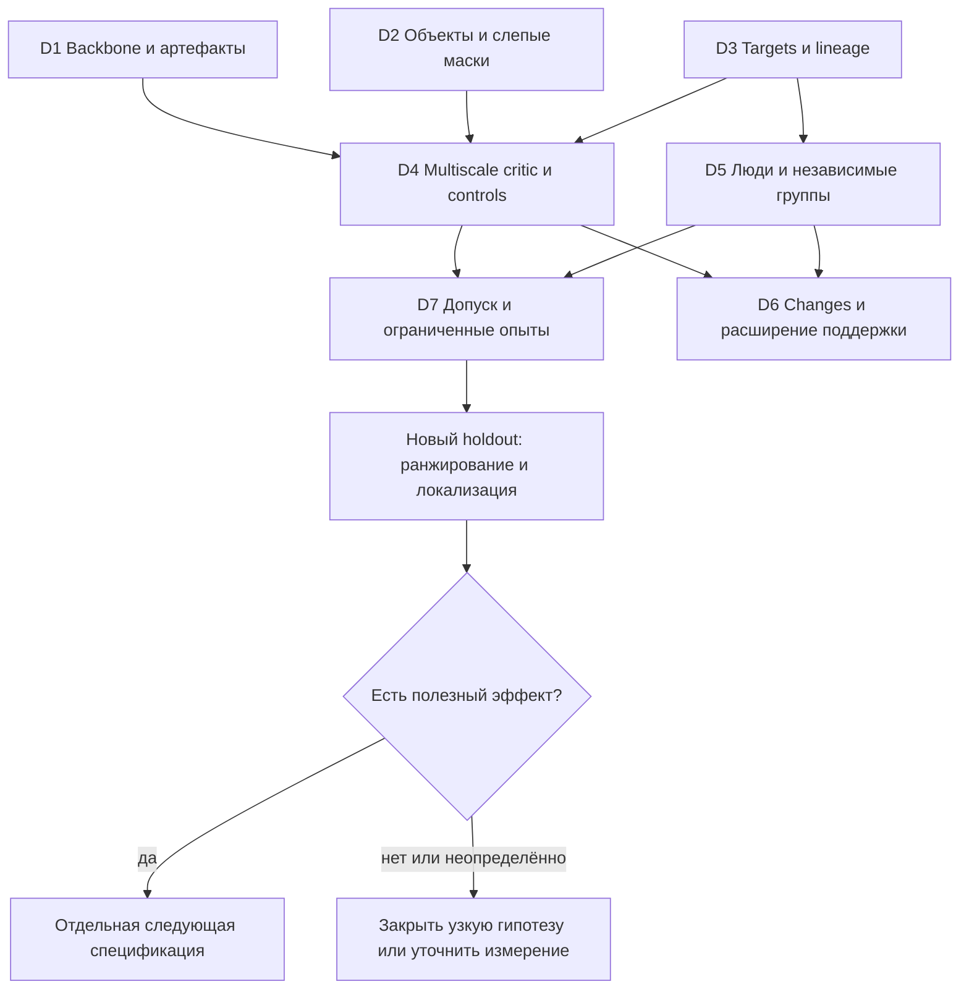

# От музыкального энкодера к первому проверяемому критику

Дата карты:21сентября2026; обновлена22сентября. Статус: **v1 реализован;
первый C3 critic pilot остановлен пользователем на 1364 обновлениях,
лучший оценённый checkpoint — 1000; VM выключена**.
Фаза: существующая 9E; планирование ограниченного прототипа Phase 12 и его
вероятностной ветки. Phase 10/11/12 не объявляются выполненными.

Реализация22сентября: по следующему указанию пользователя выполнен bounded
critic v1 с локализацией вмешательств, обучением/resume и one-MIDI inference.
[Итоги и проверки](implementation.md), [API](../../../CRITIC_V1.md).
Последовавший real-data запуск и его ограничения описаны в
[протоколе](../../../experiments/CRITIC_C3G_CLOUD_PROTOCOL_RU.md).

Новое направление: [LLM анализирует произведение и проектирует контекстные
правки](llm-authored-interventions.md). Пользователь подтвердил отдельные
варианты и сочетания; предполагается последующая человеческая проверка
выборки. Design note не означает выполненную генерацию или новое обучение.

Готовность22сентября: после согласия пользователя добавить локализацию создана
[спецификация v1](spec.md). Она фиксирует multilevel export, три recurrent пути,
четыре аспектных выхода, отдельную локализацию синтетического вмешательства,
loss/маски, score policy и проверяемую приёмку. Можно начинать инженерную
реализацию; реальные данные/checkpoint/native run/budget допускаются отдельно.
Локализация вмешательства не объявляется доказанной подсветкой музыкальных ошибок.

Уточнение22сентября: пользователь сообщает около7300₽ в Cloud и хочет быстрее
увидеть результат на искажениях, затем обучить changes. [Актуальная очередь и
лимиты](decisions/07-budget-gates.md#уточнение-пользователя-и-рекомендуемая-очередь--22-сентября):
первый frozen critic → changes-only pilot → условное парное дообучение с pcsetv2.
Probability branch и scratch80k отложены в этом предложении. Порядок ещё не
означает согласованный запуск. Локальная сохранность C2 byte-verified;
pcsetv2 исправлен в main, но новые данные/runtime ещё не подготовлены.

Последующее уточнение22сентября **заменяет harmony-only/beat-only основной
вариант**: пользователь хочет rhythm/harmony/melody/structure, совместные
представления нескольких уровней, последовательный контекст и взвешенный итог.
[Новая конструкция](../../../research/MULTISCALE_ASPECT_CRITIC_DESIGN_20260922_RU.md):
frozen multilevel encoder → три recurrent пути → обмен контекстом → аспектные
readouts. Это предложение для спецификации; beat probe сохраняется контролем.
Whole-form quality не заявляется на30-секундных фрагментах.

## Сначала — достоверность отправной точки

Подробная проверка, таблица результатов и доступность первичных артефактов находятся
в [обзоре доказательств](../../../research/CRITIC_WAYFINDER_EVIDENCE_20260921_RU.md).

| Статус | Что установлено при проверке |
|---|---|
| Подтверждено | `main`, HEAD `287bf856643f9e555352e1661a7bf0563772178a`; существенные modified/untracked материалы и отдельные worktrees. Энкодер, temporal, SSL и intervention suite существуют. |
| Подтверждено с границей | Основные C0/C2/temporal/fusion результаты сохранены; сравнения одного seed и разных budgets описательные. Relation gate завершён на 80k; обычный three-pass известен до 60k. |
| Уточнение | 1 619 — records, а не доказанно независимые произведения: известны 1 507 components; TRAIN 1 295 records / 1 209 components. |
| Устарело | Раннее «changes targets отсутствуют» и предложение нового запуска на 3090. Targets подготовлены; 3090 больше недоступна по текущему указанию пользователя. |
| Новое отрицательное свидетельство | В изолированном повторном аудите найдено неверное толкование DLC `pitch_class_set`; применимый участок кода совпадает с main/C3. Это отдельная auxiliary-цель, не доказанная причина всех результатов backbone. |
| Неизвестно | Обычный three-pass после 60k; обучение с changes; точная ранняя SSL decoder-матрица без локальных первичных итогов; текущие баланс/квоты/сохранность удалённых checkpoints. |
| Пока не проверено | Музыкальная полезность PLL, обученного критика и согласие с людьми на новых произведениях. |

## Цель и рекомендуемый первый прототип

Получить **многомасштабный аспектный критик**, принимающий обычный MIDI,
выдающий rhythm/harmony/melody/local-structure оценки и прозрачный взвешенный
итог с указанием доступности и горизонта. Внутренние сигналы совместимости,
реакции на синтетические изменения и человеческое предпочтение измерять
раздельно. Полная форма, семантическое голосоведение и arrangement quality
требуют дополнительной поддержки; правильная локализация не следует из clip loss.

Актуальный первый путь и отдельные дальнейшие проверки на сохранённом backbone:

1. Многомасштабный recurrent critic: notes/track events, sounding slices,
   bars/spans, четыре аспектных readouts. Weak aspect pairs из искажений позволяют
   начать без новых listener labels;20works — feasibility, не достаточная база
   для надёжного обучения всей модели. Raw summaries, beat probe и multilevel
   pooling без новых GRU — контрольные варианты.
2. Позже: условная вероятность **целых созвучий и последовательностей созвучий** при
   наблюдаемом ритме: event, track×span и all-tracks×span маски. Полная дорожка
   и неизвестный ритм — следующие отдельные контракты.
3. Реакция на вмешательства и нейтральные преобразования как диагностика
   чувствительности; направление «лучше/хуже» устанавливают оценки людей.

Сочетать сигналы только если ограниченная калибровка добавляет пользу к лучшему
отдельному пути. Не заменять постановку удалением 18 голов и одним MLP; сохранённые
теоретические головы остаются диагностикой. Не требовать масштабного PDMX SSL
до дешёвой проверки возможности критика.

## Индекс решений

Статусы: **установлено** — факт/ограничение; **источник** — нужны конкретные
артефакты; **выбор** — материальное решение пользователя; **эксперимент** — ответ
можно получить только измерением; **отложено** — вне первого прототипа.
Зависимости ниже — между решениями, не разрешения запускать работу.

| ID и решение | Статус | Зависимости | Владелец / ближайшее действие |
|---|---|---|---|
| D1 [Backbone и сохранность](decisions/01-backbone.md) | источник → эксперимент | — | Агент: связать checkpoint/source/schema; затем дешёвый C2/C3 контроль |
| D2 [Объекты, контекст и маски](decisions/02-objects-masks.md) | предложение → выбор → контракт | — | Пользователь: принять ограничение «pitch content при видимом ритме»; агент: synthetic leakage gate |
| D3 [Источники и targets](decisions/03-data-targets.md) | установлено / источник | — | Агент: отделить raw-derived targets от исторической PC-головы, закрыть lineage |
| D4 [Многомасштабный критик, вероятность, fragility](decisions/04-objectives.md) | конструкция предложена; эффект не проверен | D1, D3; D2 для PLL | Агент: спецификация pyramid/context/aspect contracts и одинаковые controls |
| D5 [Человеческая оценка](decisions/05-human-evaluation.md) | ресурс подтверждён; протокол предложен | D3 | Пользователь + 1–2 слушателя; агент: схема пар/аспектов и независимый holdout |
| D6 [Changes и расширение аспектов](decisions/06-expansion.md) | changes отдельно; четыре аспекта перенесены в D4 | D3, D4, D5 | Отдельные ablations; whole-form/arrangement за пределами первого quality claim |
| D7 [Стоимость и последовательность gates](decisions/07-budget-gates.md) | тариф проверен; аккаунт неизвестен | D1, D2, D3, D4, D5 | Агент: конкретные лимиты; пользователь: выбор этапа и бюджета позже |

## Порядок работы

Сначала закрываются переносимость артефактов, raw-only границы, multilevel
export/context и weak aspect target contracts; параллельно готовится human
protocol. Затем synthetic реализация, native admission и bounded frozen critic
pilot. PLL имеет отдельный более поздний mask/decoder gate. Только после
замораживания модели/порогов открывается новый evaluation cohort; существующий
корпусный TEST остаётся закрытым. Детальные лимиты и критерии остановки записаны
один раз в [плане gates](decisions/07-budget-gates.md).

В ходе этой задачи root координировал карту; три независимых агента проверили
результаты, данные и model/mask paths. Исследование этих источников завершено;
исполнителей реализации и запусков пока нет. Не считать прежний `running` или
владельца VM назначением нового исполнителя.

## Что уже можно передать дальше

[Передача в mc-to-spec / mc-to-tickets](handoff.md) содержит границы интерфейсов,
проверяемые условия приёмки и будущие срезы работ. Synthetic contract slice можно
специфицировать без знания остатка облачного бюджета. Выбор checkpoint, полный
human protocol и бюджет нужны перед соответствующим исполнением, а не для
завершения этой карты. Рекомендации не становятся принятыми решениями молча.

Подтверждённый выбор пользователя: **он и ещё 1–2 слушателя**, несколько аспектов,
совместные уровни представления и взвешенная общая оценка. Конкретные три GRU,
размеры, числа произведений, нормировка, decoder и бюджет пока рекомендации.

Вне задачи: обучение, новый real-data inference, массовая обработка, новые VM,
оплачиваемые операции, TEST, renderer teacher, GRPO, исправление исторических
run artifacts, публикация issues/PR. Legacy не инспектировался и не переиспользован.
