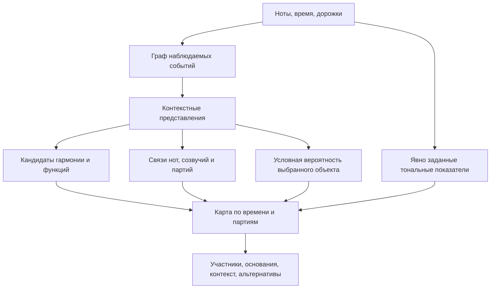

# Граф, выходы анализа и визуальная проверка

Статус: текущие интерфейсы прочитаны; предлагаемый анализатор не реализован.
Зависимости: [смысл карты](01-meaning.md), [доступность данных](03-data.md).

## Что уже есть в репозитории

- [C3 training policy](../../../../../src/music_critic/experiments/analysisgnn/training_policy.py)
  перечисляет 18 активных теоретических целей, включая тональность, root,
  качество, обращение, каденцию и нотную принадлежность аккорду. В этом
  перечне нет прямых выходов напряжения или связей разрешения.
- [Critic inference](../../../../../src/music_critic/critic/inference.py)
  отдаёт локальные `intervention_evidence` значения. Они относятся к следам
  обучающих вмешательств, а не к распознанному напряжению. Существующую
  локализацию нельзя просто переименовать в новый музыкальный показатель.

- [PLLContextEncoder](../../../../../src/music_critic/pll/encoder.py)
  экспортирует note/onset/beat/bar/track/song/slice представления. Исторические
  theory heads C3 заморожены и не используются в этом пути. Следовательно,
  наличие C3-архитектуры внутри HCM не даёт готового функционального анализа.
- [RelationRefiner](../../../../../src/music_critic/pll/relations.py)
  использует семейства activity/rhythm/vertical/melodic для коррекции
  распределений. Его латентные компоненты не имеют размеченного смысла
  «подготовка», «разрешение» или «доминанта».
- [C3 adapter](../../../../../src/music_critic/critic/c3_backbone.py)
  разрешает исследовать attention weights, но прямо отделяет их от
  причинного объяснения и калиброванной уверенности.
- [scoring](../../../../../src/music_critic/pll/scoring.py) выдаёт NLL для
  заданных масок; [masking](../../../../../src/music_critic/pll/masking.py)
  выбирает события по интервалу атак и дорожкам. Эта маска не позволяет
  независимо скрыть одну выбранную ноту среди одновременных нот той же
  дорожки. [decoder](../../../../../src/music_critic/pll/decoder.py) возвращает
  также вероятности токенов: их вклад при teacher forcing не равен
  независимому leave-one-note-out анализу.
- [WholePieceHCM](../../../../../src/music_critic/pll/whole_model.py) и
  [whole contracts](../../../../../src/music_critic/pll/whole_contracts.py)
  предусматривают полный источник с ограниченной памятью. Это покрытие
  источника, а не гарантия сохранения каждой дальней детали без потерь.

Это статические факты о коде. Качество сохранённых весов для новых семантических
выходов и полезность их представлений сейчас не измерены.

Уточнение по надстройкам: 17-классовый `quality` в
[multitask_contract](../../../../../src/music_critic/experiments/analysisgnn/multitask_contract.py)
не имеет отдельных `sus2/sus4/9/11/13`; другие heads включают Roman и
pitch-class-set, поэтому нельзя сводить все выходы к одной этой категории.
В POP-проекции [projection](../../../../../src/music_critic/experiments/pop909_cl_frozen/projection.py)
`sus2`, `sus4`, `mM7`, `+7` дают отсутствующий quality target, а не
насильственную метку трезвучия. При этом
[нотный граф](../../../../../src/music_critic/graph/builder.py) сохраняет
высоту/регистр, onset и duration отдельных нот. Ограниченный словарь supervision
не равен удалению материала надстроек с raw-входа, но и не доказывает
освоения их гармонической роли нынешними весами.

## Предлагаемая конструкция

Граф полезен как способ сопоставить горизонтальные связи голоса, вертикальные
созвучия и более длительные зависимости. **Польза именно GNN остаётся
экспериментальным вопросом**: Transformer тоже может предсказывать связи.
Для визуализации не требуется, чтобы все выходы были attention weights.

В предлагаемом анализаторе отдельный выход оценивает тип связи между
кандидатами и её область действия. Например, связь разрешения должна указывать
участников, а не только подсвечивать такт. Высокоуровневое объяснение собирается
из проверяемых выходов; свободное описание LLM не заменяет их.

Гармонические/семантические узлы, если понадобятся, должны формироваться
из raw-кандидатов или предсказаний. Эталонные аккорды, голоса и фразы можно
давать только отдельному диагностическому режиму с явной маркировкой.
Это сохраняет raw-MIDI inference и не меняет принятые схемы графа заранее.

Уточнение о всех уровнях: [состав масштабов](01-meaning.md) должен сохранять
доступ от фразы/раздела к полной реализации созвучия, а не только к predicted
root/quality. Обратный контекст нужен для различения роли конкретных тонов.
Диаграмма выше показывает общий поток, а не фиксирует устройство этих связей.
Способ передачи информации и размер памяти ещё предстоит выбрать и проверить;
пуллинг на крупном масштабе не освобождает от проверки потерь значимых деталей.

## Что считать объяснением

В карте отдельно различаются:

1. Прогнозируемое музыкальное отношение, гармоническая гипотеза и их уверенность.
2. Наблюдаемые свойства участников: высоты, время и вычисленные интервалы.
3. Чувствительность ответа модели к контролируемому изменению этих участников.

Первое проверяется музыкальными аннотациями, второе — кодом преобразования,
третье — отдельным исследованием поведения модели. Наличие любого одного
пункта не доказывает остальные. Удаление ребра может создавать неестественный
граф; для музыкальных выводов нужны ещё правки исходных нот и повторное
построение графа с проверкой того, что музыкальное отношение изменилось.

Не принято: перекрашивать существующую attention-матрицу и называть её
готовой картой напряжения. Следующая архитектурная спецификация должна
сначала назвать выходы и проверку, затем способ обучения этих выходов.
