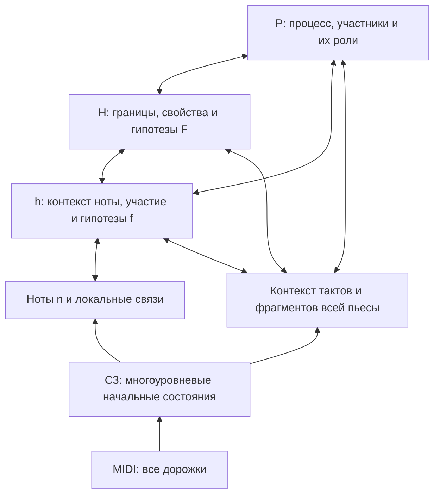

# Кампания HIERGRAPH-20261027: многоуровневый графовый анализатор музыки

> Current continuation: [factorized chord targets V2](factorized-chord-targets.md) adds
> core/seventh/modifications and source-bound export; preserves all source H/h
> geometry. Earlier V1 implementation statements below are historical.

Дата: 27 октября 2026. Фаза: T08, проектирование следующей исследовательской кампании.
Статус: направление согласовано; выполнены availability audit current67 и synthetic implementation slice projection consumer (S1).
Нормализованный training export, новая модель и новые training/evaluation runs ещё
не выполнены. [Паспорт супервизии](../../../experiments/HIERGRAPH_SUPERVISION_20261027_RU.md)
содержит измеренные counts, masks, joins и оставшиеся ограничения.

> Уточнение после проверки GitHub: [существующие adapters и альтернативы H detector](../../../research/H_EVENT_DISCOVERY_AND_ADAPTER_REUSE_20261027_RU.md).
> Общая подготовка targets и pure model-facing consumer реализованы; native admission и fit-only export ещё впереди.
> Описанный ниже fixed raw bank сохраняется как baseline, окончательный H decoder
> выбирается до A/B/C. Число91.8% относится к исторической сетке аудитора с неполным
> вычислением метрических концов; исправленный bank ещё не пересчитан.

> Состав сравнения расширен по запросу пользователя: **все пять E1–E5** —
> raw span bank, segmentation, anchor-free endpoints, event queries и
> graph-assignment pooling. [AutoSchA и план пяти вариантов](../../../research/AUTOSCHA_HIERARCHICAL_POOLING_PILOT_20261027_RU.md).
> Сначала сравниваются способы создания H с общими головами H/F; затем A/B/C,
> P и обратные связи. E5 — адаптация learned coarsening, не reproduction AutoSchA.

> Выходной словарь и общая часть модели закреплены в
> [output-vocabulary v0](output-vocabulary.md): source annotation → explicit
> projection → fit-only numerical vocabulary. F/h-role/P-type поля раздельны,
> compound descriptions и unknown/OOV имеют явные правила. [Consumer implementation](projection-implementation.md)
> проверен синтетически; последующий [factorized V2 export](factorized-chord-targets.md) завершил family split и зарегистрированную CPU подготовку.

## 1. Цель и проверяемая гипотеза

По обычному многодорожечному MIDI строить структурированный анализ произведения:
гармонические события и их границы, состав и функции, контекстные роли нот,
музыкальные процессы, подготовку/разрешение и конкретные связи участников.
Сохранять подробные состояния всех уровней и совместно уточнять их через граф.

Главный вопрос: улучшает ли повторный обмен между нотами, гармониями и процессами
сквозной анализ при одинаковых входах, кандидатах, supervision и контексте?
Отдельный вопрос: помогает ли обмен явно предсказанными вероятностями функций
и ролей, а также свойств процессов, по сравнению с передачей только скрытых состояний?

Цель не сводится к единому эстетическому баллу или независимым классификаторам.
Иерархия не гарантирует музыкальную правильность, объяснимость или преимущество
над LLM. Скорость локального анализа — измеряемая гипотеза, не обещание realtime.

## 2. Текущее состояние и связь с предыдущими опытами

C3 уже предоставляет note/onset/beat/bar/track/song/slice states, pooling,
coarse Transformer и top-down fusion. Старый H/member Graph также передаёт
сообщения. Поэтому «C3 превращает всё в один вектор» — неточная диагностика.
Ограничения прежнего пилота: frozen C3, локальный контекст, oracle H и одна
узкая задача membership. Они не проверяют полный обучаемый анализатор.

Предыдущие terminal результаты сохраняются:
- [H/member](../../../experiments/HMEMBER_20261025_RU.md);
- [30k](../../../experiments/HMEMBER_LONG_20261025_RU.md);
- [80k](../../../experiments/HMEMBER_80K_20261026_RU.md);
- [диагностика](../../../experiments/HMEMBER_DIAGNOSIS_20261026_RU.md).

Их метрики нельзя напрямую сравнивать с raw-H end-to-end задачей. Для новой
задачи baseline переобучается на тех же новых targets/candidates, что и граф.

Обоснование выбора и проверенные первичные источники:
[Stanford CS224W, HGT, NBFNet, Query2box и альтернативы](../../../research/HIERARCHICAL_GRAPH_REASONER_CHOICE_20261027_RU.md).
Полезные исходные документы: [направление анализатора](../../../research/STRUCTURED_MUSIC_ANALYZER_DIRECTION_20261027_RU.md),
[предыдущая постановка](../../2026-10-25/harmonic-event-reasoner/spec.md).

## 3. Объекты, области действия и выходной граф

| Объект | Смысл |
|---|---|
| n | Наблюдаемое MIDI-событие ноты, с точным временем, высотой и track ID |
| H | Экземпляр кандидата гармонического события: интервал, scope, участники, свойства |
| h | Контекст конкретной n внутри конкретного H; raw кандидат — их пересечение, target может занимать подинтервал |
| F | Функция H относительно тонального и музыкального контекста |
| f | Контекстные свойства/роли h; membership, degree и тип украшения — разные поля |
| P | Кандидат процесса: интервал, тип, конкретные H/h-участники и их роли |
| p | Типизированное направленное отношение, например prepares или resolves_to |
| context | Временные состояния тактов/фрагментов для дальнего контекста |

F/f первоначально являются свойствами экземпляров, а p — ребром; отдельные
узлы этих типов не обязательны. Общий класс «доминанта» не объединяет разные H.
Одна удержанная n может иметь несколько h последовательно при смене гармонии.
Не нужно заново учить начало/конец физической MIDI-ноты или вводить независимую
сегментацию каждого атрибута F. Наличие связи p не создаёт автоматически gold P.

Различаются participant_scope, конкретные semantic participants и context_scope.
Основной целевой режим — совместное звучание всех дорожек, с сохранением track ID.
Track не равен голосу. Локальные и групповые H допустимы лишь при совместимых
targets; ensemble label не копируется на каждую дорожку. Первый список групп
ограничивается raw политикой: перебор всех подмножеств дорожек не нужен.

Наблюдаемые временные связи, геометрическое попадание в интервал и предсказанное
семантическое участие — разные типы рёбер. Non-chord ноты остаются доступны,
поскольку могут определять подготовку, задержание или разрешение.
Кандидаты могут перекрываться. Итоговый выбранный view соблюдает эксклюзивность
гармонических состояний/контекстов из DATA_CONTRACT; альтернативные views
и перекрывающиеся P сохраняются отдельно.

## 4. Архитектура

### 4.1 Начальные состояния и кандидаты

C3 и raw признаки инициализируют состояния нот/времени/дорожек/фрагментов.
До A/B/C сравниваются все пять H constructors E1–E5 с одним downstream contract:
raw bank, segmentation, anchor-free, event queries и graph-assignment pooling.
E1 использует exact raw anchors и durations, E2–E5 имеют явно заданные temporal
resolution/capacity/decoding policies. Входные опоры не берутся из annotations.
h создаются по допустимым пересечениям n и predicted H; target h может быть
подинтервалом. Для held notes разрешено несколько последовательных контекстов.

E5 получает S из graph-assignment head и строит H states мягкой агрегацией;
границы предсказывает отдельно. S не объявляется semantic membership или
Schenker depth. Raw graph сохраняется. Дополнительные индуцированные coarse
edges и P не включаются исключительно в E5 первого сравнения.

Raw candidate/capacity ceiling отдельно считается для каждого метода, H/P и
p endpoints. Сопоставление с targets выполняется вне forward по общим geometry,
scope, view и overlap правилам. Unmatched не означает negative без известной
полноты соответствующей области; это относится ко всем пяти loss designs.
Oracle H/P — отдельная диагностика. После выбора H constructor P начинает с
bounded raw proposals; иные P constructors получают отдельный контраст.

### 4.2 Общий updater

Начальный инженерный размер: width 128, 4 attention heads, 3 повторения общего
updater. Это стартовая конфигурация, а не найденный optimum. Типизированные
сообщения учитывают source/receiver/edge type, относительное время и raw
музыкальные признаки; node IDs используются для routing, не corpus-ID lookup.

Каждый цикл выполняет local note updates, h→H, H/h→P, общий временной контекст
и обратный проход P→H, P→h, H→h/n. Прямой h↔P предусмотрен явно. Heads после
цикла уточняют свойства, objectness, участие и адресные отношения p.
Residual/raw channels сохраняются; soft semantic weights не удаляют raw
геометрические связи. Направление музыкального p отличается от технического
обратного ребра message passing: обратное сообщение не означает resolves_from label.

C3 достаточно вычислить один раз за forward. В live режиме gradient из общей
системы проходит в C3; в frozen контроле используется detached cache. Это разные
freeze policies, а не эквивалентные способы совместного обучения.

### 4.3 Дополнительный канал явных гипотез

Базовая C передаёт скрытые состояния. В C+soft к сообщениям добавляются
обучаемые проекции предсказанных распределений F/f и поддержанных свойств P
предыдущего круга: softmax для взаимоисключающих классов, sigmoid для отдельных
бинарных/многозначных свойств. Активация выбирается для каждого поля отдельно:
membership, degree и роль могут сосуществовать; общего softmax по всем f нет.
Типы и class order определяет замороженный словарь.

На круге k+1 используются предсказания круга k. Основной вариант сохраняет
сквозной gradient, без detach; глубина ограничена числом повторов. Gold labels,
availability masks и аннотационная confidence не входят в forward или рёбра.
При отсутствии trainable task/support канал целиком отключается по config,
а не per-example по target availability. Вероятности не объявляются калиброванными.

C+soft сравнивается с C отдельно: проверяются польза, ошибки и самоподдержка
неверных гипотез. C сохраняет те же головы и их supervision. Дополнительные
параметры проекций и compute явно учитываются; улучшение само по себе не
доказывает семантическое объяснение внутренних вычислений. Этот контраст
проверяет совокупный F/f/P feedback; эффект отдельно F/f или P требует
дополнительного заранее заданного сравнения и не выводится из него автоматически.

### 4.4 Полное произведение

Локальный encoder работает по tiles с уникальным core ownership и halo.
H/P через границы tiles имеют единый ID и не отбрасываются из-за границы окна.
Временная последовательность bar/block states переносит дальний контекст;
один SONG vector не является единственным доступом к деталям.
Dense global attention по M coarse nodes сохраняет стоимость порядка M².
Supported length, truncation exclusions, latency и peak memory измеряются.
Первый режим offline и использует полный контекст; causal/streaming — позднее.

## 5. Задачи, supervision и оценка

| Семейство | Предсказание | Основные оценки |
|---|---|---|
| H detection | Начало/конец, существование, поддержанный scope | Candidate recall; boundary F1 с фиксированным допуском; event overlap |
| H properties | Созвучие/состав и нормализованные root/quality/bass где известны | Masked per-field macroF1; совместное качество свойств |
| F/key | Тональный контекст и функция H | MacroF1, OOV и coverage |
| h membership/degree | Участие ноты и ступень относительно H | PR, macroF1, known-negative FPR |
| f roles | Раздельные определённые роли нот | Per-role precision/recall/F1 и support по works |
| P | Интервал/тип, участники и направленные роли | Event, participant и role metrics с раздельными masks |
| p relations | Existence, тип и адресат | PR/F1; same-source Recall@1/5; typed-edge F1 |
| Whole analysis | Совместные адресные ответы | End-to-end метрики, противоречия, length/distance slices, latency/memory |

Это семейства heads, не фиксированное требование «20 задач» и не один класс
для каждого сочетания атрибутов. Общая loss — взвешенная сумма task losses,
нормализованных по известным targets каждой задачи. Веса/sampling выбираются
до основной оценки. Missing/ambiguous остаются masked; negative scopes явные.

Главный эффект B→C оценивается по сквозному анализу с predicted H. Конкретный
primary endpoint и минимально практически значимое улучшение фиксируются
после проверки support, но до обучения сравниваемых моделей. Предпочтение —
end-to-end typed-edge F1 на известной разметке, если его denominator и negatives
обоснованы. Нельзя выбрать лучший показатель после просмотра результатов.

Отдельно публикуются условное качество на oracle H, coverage/пропуски, raw
candidate recall, результаты по произведениям/семьям, seeds, длине и расстоянию.
Confidence intervals строятся по независимым families, не по миллионам нот.
Threshold/selection policy использует inner selection; dev не служит калибровкой.
Разные selected updates не выдаются за matched-update сравнение.

## 6. Данные и научные ограничения

Начальная опора — опубликованный current-v2 источник с 67 работами и source/LLM
enrichment. [Аудит AUDIT-002](../../../experiments/HIERGRAPH_SUPERVISION_20261027_RU.md)
повторно проверил exact current67 admission из RELEASE003: 201 файла, 31 field-state
счётчик, 67 family IDs. Это availability census, не 67 готовых runtime graphs.
Старые prepared H/member/resolution caches не являются готовым датасетом полного
анализатора. Raw pretraining overlap C3 остаётся unknown.

Аудит подтвердил поддержку P.process (1872 в61works) и прямых h/H-участников,
но не uniform participant roles или явного track/group scope H. Совместный
process+explicit H+known F support —930 P в32works. h membership+H.function —81291
контекст в53works. У960 h target является подинтервалом note×H; matching/aggregation
должны учитывать это явно. Банк только на note attacks покрывает61.6% начал H;
расширенные raw anchors обе границы91.8%, bounded span recall ещё не измерен.
`analysis.voice` содержит локальные ID; семантическая роль melody/bass задана
отдельным `analysis.voice_role`. Sonority/Roman требуют структурной нормализации.

Первый этап создаёт паспорт нового admitted export: source/release hashes,
канонические IDs, intervals/scope/view, provenance, confidence, masks, known
positives/negatives и независимые works/families на задачу/класс. Структурированные
авторские dicts раскладываются на поля; не превращаются целиком в случайные классы.
Native/source labels и LLM weak labels считаются отдельно. Chord membership,
полученный из authored pitch set, не становится независимой экспертной аннотацией.

Семьи, дубли и версии не пересекают fit/selection/dev. Split и vocabulary
строятся по разрешённому TRAIN и фиксируются до модели. Ранее использованный dev
остаётся exploratory; расширение/возврат исключений получает новую версию.
Corpus TEST закрыт. OOV, конфликты views и неразмеченные поля не исправляются
через подглядывание в dev или автоматическое заполнение labels.

Поля P в schema не доказывают полноту процессов и направленных ролей. Если
support недостаточен, верхние span states остаются латентными context nodes;
их нельзя представлять как распознанные разрешения. D→T не создаёт gold P.
«Напряжение» не сводится к non-chord membership: субъективное напряжение,
музыкальная ошибка и эстетическая оценка требуют собственных целей/проверки.

## 7. Последовательность кампании

| Этап | Работа | Условие завершения |
|---|---|---|
| S0: план | Этот документ и согласование архитектуры | Сохранён план; актуальный прогресс в STATUS |
| S1: passport | Availability census, factorized projection V2 и current67 CPU export завершены;44/10/13 split, fit vocabulary и masks verified; далее candidate coverage и model-native gate | Нормализованные задачи/классы после joint masks и exclusions; либо заключение о нехватке данных |
| S2: mechanics | Общий raw graph/candidates, updater, heads, matching и trainer | Synthetic contracts, leakage/gradient/identity tests и независимый review |
| S3: native gate | Отдельный bounded real-data/resource/replay gate на актуальном устройстве | Протокол и record; finite loss/gradients, память, throughput и завершение в cap |
| S3H: пять H constructors | E1–E5, общие frozen C3 inputs и H/F heads | Все пять bounded pilots, затем paired seeds17/42/73; immutable evidence, selection и recovery budget заранее |
| S4: основной опыт | A/B/C при выбранном H constructor с общими frozen C3 features | Paired seeds/exposure, заранее заданная selection и terminal evidence всех попыток |
| S5: role feedback | C против C+soft | Та же data/freeze policy; отдельная оценка явных гипотез |
| S6: live C3 | Baseline/иерархия при одинаковом дообучении C3 | Эффект иерархии отделён от encoder adaptation; при бюджете 2×2 frozen/live |
| S7: addressed reasoning | NBF-like decoder против одинаково conditioned pair/self decoder | Польза для адресата сверх сильного baseline; стоимость по числу запросов |
| S8: composition | Явные candidate-set queries, затем Query2box | Одинаковые answer IDs и shared-witness semantics; поддержанные joint targets |

Этапы не означают автоматического запуска всего grid. S1 может уменьшить набор
задач; S3 определяет допустимую конфигурацию и бюджет до S4. Отрицательные
результаты сохраняются. Если польза B→C не подтверждается или цена неприемлема,
не переходить к массовому усложнению без отдельного обоснования.

Для S3H proposed primary — family-macro recall известных H при фиксированном
raw-duration prediction budget и one-to-one matching. Неполная разметка не
позволяет считать все unmatched predictions ложными. Joint H+F recovery,
conditional F, oracle-H и ресурсы публикуются отдельно; precision/F1 лишь
на подтверждённых полных scopes. Численные tolerances/caps фиксируются до runs.
S3H является сравнением constructor packages, не доказательством полезности
каждого их компонента; E5 coarse adjacency требует отдельной абляции.

### Основное сравнение

| Вариант | Механизм |
|---|---|
| A | Один проход снизу вверх, тот же выбранный H constructor и heads |
| B | Повторный bottom-up; semantic top-down отключён |
| C | Повторный двунаправленный обмен, включая H↔P и h↔P |
| C+soft | C плюс предсказанные F/f/P распределения между кругами; отдельный этап |

Основной причинно ограниченный контраст — B/C. Доступ каждого уровня к общему
coarse context, local/global processing, inputs, candidates, heads, masks и
sampling одинаков. Переключаются обратные semantic messages. Residual/self
refinement depth выравнивается; actual parameters/FLOPs/latency публикуются.
A задаёт ориентир, но не изолирует эффект глубины. C+soft не заменяет этот контраст.

Предлагаемые paired seeds: 17/42/73. Это план репликации, не выполненные runs.
Число updates, checkpoint grid, LR, task weights, object limits, primary metric,
min effect и per-run/total wall caps пока не зафиксированы. Они запечатываются
после паспорта/native gate, до основного сравнения; post-hoc продление запрещено.
Scratch C3, дополнительный corpus, новые LLM labels, вся комбинация NBF×boxes×
freeze×width×depth и online режим не входят в первый запуск.

## 8. Реализация и тестируемые границы

Предлагаемый новый opt-in пакет:
`src/music_critic/experiments/hierarchical_graph_analyzer/` (пока не создан).
Старый `harmonic_event_reasoner` сохраняется для воспроизводимости.

Контракты интерфейсов уточняются в implementation slice:
- `propose_h(raw, encoder_states, policy)`: общий output H для пяти constructors, target-independent forward;
- `build_candidates(raw, policy)`: raw bank для E1/P; без target-side geometry;
- `build_state(raw, encoder_states, candidates)`: typed nodes/edges;
- `match_targets(candidates, target_sidecar, policy)`: отдельные targets/masks;
- `refine(state, context, config)`: повторные обновления без gold input;
- `predict(state)`: node properties, участники и addressed edges по IDs;
- `evaluate(predictions, targets, coverage)`: oracle и end-to-end раздельно.

Повторное использование: [C3 outputs](../../../../src/music_critic/pll/encoder.py),
[иерархия](../../../../src/music_critic/models/hierarchy.py),
[whole-piece assembly](../../../../src/music_critic/pll/whole_model.py),
[временная память](../../../../src/music_critic/pll/whole_memory.py),
[нынешний graph comparator](../../../../src/music_critic/experiments/harmonic_event_reasoner/model.py).
Это seams для адаптации, не заявление о готовом обученном whole-piece reasoner.
Generative HCM decoder/PLL loss и legacy runtime переносить не требуется.

Обязательные тесты реализации:
1. Изменение/удаление target sidecar не меняет raw candidates/forward.
2. Exact boundary handling, held note с разными h, padding/empty scopes.
3. Unique core ownership и неизменная identity H/P через tiles.
4. Permutation consistency при корректном переносе IDs.
5. Gradient из P/relations в h/H, и в C3 только при live policy.
6. Unknown/masked targets не дают negative gradient.
7. Direct h↔P работает; non-chord note сохраняет raw путь.
8. Feedback использует прошлый круг, predicted distributions и общий class order.
9. Разделение views, перекрывающихся P и shared-witness IDs в будущих queries.
10. B/C отличаются только заявленным каналом; checkpoint/config replay сохраняет policy.

Synthetic pass подтверждает механику, native gate — исполнимость, а S4+ —
сравнение качества на слабых labels. Эти критерии не взаимозаменяемы.

## 9. Учёт, ресурсы и остановка

Каждое substantial preparation/gate/run/review получает собственный ID и
sealed planned record по [EXPERIMENT_LOGGING](../../../EXPERIMENT_LOGGING.md)
до работы с реальными данными. Запущенные records переходят только вперёд;
terminal evidence не переписывается. Этот campaign ID не заменяет registry ID.
Текущая документационная задача не создала новые experiment records.

В records/config фиксируются точный source snapshot с dirty/untracked файлами,
data/split/vocab/candidate hashes, seeds, schedules, applied/skipped updates,
wall/memory, selection/checkpoints, failures и claim boundaries. Затем обновляются
STATUS и ledger штатным registry CLI. Full logs/caches/weights остаются в ignored
outputs или внешнем evidence root с hashes/size; в Git — код и компактные receipts.

RTX3090 — предполагаемая площадка, её доступность/занятость сейчас не проверялась.
До запуска задать per-worker и total caps, cleanup/termination policy и monitor
limit. Не возобновлять бесконечно, не создавать дубликаты. Stop: leakage,
недостаточная поддержка primary task, некорректные negatives, replay/NaN/OOM,
превышение bound или неполные обязательные артефакты. Причина остаётся в record.

Историческое разрешение на bounded пилоты не является бюджетом этой новой
кампании. Этот план не запускает GPU, платные ресурсы, LLM API или публикацию.
Account quota и GPU wall time — разные бюджеты; оба фиксируются перед работой.

## 10. Git и точка сохранения плана

Документ ведётся в изолированном Git worktree
`/Users/aavalsamakin/.codex/worktrees/harmonic-event-pilot/music-critic-v2`.
Основной release checkout `/Users/aavalsamakin/Projects/music-critic-v2`
этой задачей не редактируется. Новый план пока local/uncommitted, не на GitHub.

Снимок read-only проверки 27 октября 2026 **до добавления этого файла**:
- remote и local main: `645922d4db282ff0c3a06c1cf82ecc9d0594f5c7`;
- [PR46](https://github.com/nairary/music_critic_v2/pull/46) merged;
  [Linux CI](https://github.com/nairary/music_critic_v2/actions/runs/40195871242) success
  на `fa5e00ce5026eb2466646a8bde2b1ca422e612c4`; это прошлый release CI, не новая проверка модели;
- open PR: 0; main: 5 modified tracked files, 45 untracked, staged 0;
- isolated HEAD: `287bf856643f9e555352e1661a7bf0563772178a`, detached, на 6 commits
  позади main, 41 modified tracked files, 809 untracked, staged 0, конфликтов нет;
- из 850 dirty/untracked файлов isolated checkout 702 побайтово совпадают с
  tracked blobs опубликованного main, 18 отличаются, 130 отсутствуют в main.

Большое dirty count частично связано со старой базой и перенесённым содержимым.
Оставшиеся differences нельзя массово коммитить как одну новую архитектуру:
там смешаны прежние experiments, documents и отличия release fixes. Следующая
Git-задача — сохранить scoped manifest/backup, выбрать явную research branch
и переносить только нужные изменения с reconciliation 18 различий. Сейчас
branch/reset/rebase/commit/push/cleanup не выполняются.

## 11. Что считается готовностью следующего шага

Документационный план готов, когда сущности, вычислительный путь, задачи,
сравнения, ограничения labels и критерии этапов согласованы и доступны в repo.

До первого основного обучения нужно закрыть: task passport; finite candidate
policy/matching; primary metric и минимальный эффект; fit/selection/dev hashes;
resource/update budget; implementation tests/review; native resource/replay gate.
Если один пункт не поддержан, фиксируется конкретная недостающая информация,
а не достраивается уверенное утверждение о пригодности всех 67 произведений.

Авторитетные границы: [ARCHITECTURE](../../../ARCHITECTURE.md),
[DATA_CONTRACT](../../../DATA_CONTRACT.md), [DECISIONS](../../../DECISIONS.md),
[ROADMAP](../../../ROADMAP.md). Этот файл описывает согласованное направление и план исследовательской
кампании и не подменяет действующие schema/contracts или результаты экспериментов.
