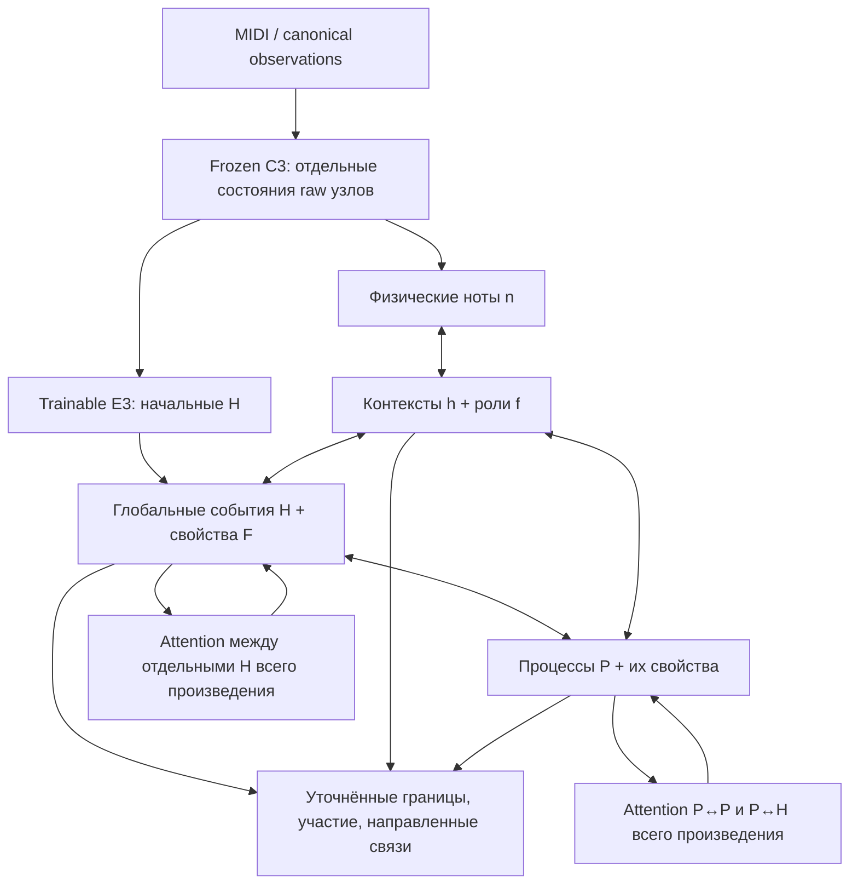

# Полная модель HIERGRAPH с E3: реализация 29 октября 2026

После этого снимка реализации выполнен первый запуск на 500 обновлений.
[Итоговый отчёт](../../../experiments/HIERGRAPH_FULL_20261029_RU.md) содержит
метрики и ошибку финализации; ниже сохранено состояние до запуска обучения.

Реализован отдельный путь анализа целого произведения с H/h/P, уточнением
границ и обратными сообщениями. Это код первого полного baseline; обучение
на реальном корпусе и проверка его музыкального качества ещё не проводились.
Рабочая копия: `harmonic-event-pilot`, исходный HEAD
`287bf856643f9e555352e1661a7bf0563772178a` плюс существовавший WIP.
Основной checkout, прежняя кампания E1–E5 и её результаты не изменены.

## Что вычисляет модель

1. E3 создаёт H по сырым временным опорам. Каждая опора принадлежит одному
   центральному окну по точному рациональному времени. H сохраняет своё состояние
   и адрес; отдельные H всего произведения участвуют в последующих вычислениях.
2. Для пересекающихся физических нот и H создаются контексты h. По умолчанию
   доступны два подинтервала на пару: их границы и свойства обучаются раздельно.
   Само пересечение не объявляет ноту аккордовой.
3. P получает начальные предложения по окнам из 1/2/4/8/16 тактов. Эти окна
   создаются из наблюдаемой музыки; дальше границы P обучаемо уточняются.
4. В каждом из трёх раундов сигналы идут снизу вверх и обратно. P влияет на H/h,
   h влияет на физические ноты; мягкие распределения предсказанных свойств
   возвращаются в состояния. H/P читают отдельные дальние H/P через attention.
5. После изменения H пересобираются пары с нотами. h остаётся внутри своей
   физической ноты и текущего H; H/P могут пересечь исходные границы окна.
   Начальные представления C3 не пересчитываются: обновляется trainable часть.

F/f — наборы независимых типизированных полей соответствующих H/h, а не один
обязательный класс и не новая жёсткая ступень дерева. Участие в P и отношения
`prepares`/`resolves_to` предсказываются отдельно. Техническое обратное сообщение
не означает автоматически обратную музыкальную связь.

## Данные, задачи и проверка качества

Используются существующие `HiergraphNumericTargets@3`, сохранённые исходные
канонические произведения и C3 raw cache. Адаптер отделяет raw от targets,
сохраняет аналитические варианты, маски, исходные адреса и provenance. Активные
H/h/P головы берутся из словаря и поддержки fit; снимается только прежняя
отсрочка P, связанная с первым H-only этапом. Unknown остаётся unknown.

| Задача | Супервизия | Отчёт |
|---|---|---|
| H: предложение и границы | Однозначное сопоставление с известными H | Known-H recovery, joint H+F, conditional field macroF1 |
| Свойства H/F | Доступные поля и их маски | Поддержка и macroF1 отдельно для каждого поля |
| Контексты h и роли f | Та же физическая нота, сопоставленный H, отдельный интервал | Recovery h, свойства и coverage |
| P: предложение, границы, тип | Размеченные harmonic_process объекты | Known-P recovery, свойства P |
| Участники P | Явные адреса участников | Recall/доступные precision-F1, coverage |
| Направленные отношения | Явные положительные/отрицательные адресованные связи | Recall@1/5, known-link metrics, coverage |

Метрики агрегируются по семействам источников. При неполной разметке нельзя
читать precision/F1 как оценку всех возможных связей; неизвестные кандидаты
не становятся отрицательными. Unsupported/непокрытые известные цели остаются
в знаменателях. Oracle H/P оценивается отдельно: он фиксирует и предложения,
и геометрию, поэтому это условная диагностика, а не чистый эффект одной границы.

Обучающий draw выбирает произведение, затем его аналитический вариант.
Считаются attempted/applied/skipped, сохраняются цепочка exposure и состояния
optimizer/RNG. All-unknown draw не делает Adam update. Selection milestones,
метрика и бюджет должны быть заданы до нового запуска; dev оценивается на
выбранном checkpoint. Global TEST остаётся закрыт.

## Файлы и использование

- `full_data.py`: целое произведение и отдельные target views.
- `full_model.py`: E3, глобальные H/h/P, feedback, геометрия и связи.
- `full_losses.py`, `full_metrics.py`: сопоставление, masks, metrics/coverage.
- `full_runtime.py`: fit/selection/dev, checkpoint/resume API, экспорт графа.
- `full_inference.py`: новый MIDI/canonical JSON → C3 → граф без разметки.
- `scripts/run_hiergraph_full.py`: зарегистрированные команды `gate`, `train`,
  `infer`; шаблоны — `configs/hiergraph_full_{e3,infer}.template.json`.

Путь к модулям: `src/music_critic/experiments/hierarchical_graph_analyzer/`.
Шаблоны намеренно имеют `prepared:false`: путь к данным, проверенные SHA,
выходной словарь, бюджет и fresh ExperimentRecord не подменяются заглушками.
CLI требует переносимые относительные `protocol.evidence_root` и
`protocol.output_root`, точный `protocol.launch` и машинный `--evidence-base`
(по умолчанию parent снимка source). Путь результата проверяется целиком.
Внутри checkout допустимы только ignored `outputs/` или `artifacts/experiments/`.
Новая CLI-попытка пишет новый каталог; точное продолжение реализовано API
checkpoint, а прежняя E3 инициализация копирует только проверенные веса.

## Явные ограничения baseline

- C3 frozen; NBFNet, Query2box и транспонирование не добавлены.
- Базовые направленные кандидаты — одиночные H→H и h→h. Составная связь с
  несколькими исходными/целевыми узлами не разлагается на выдуманные пары и пока
  может остаться coverage miss. Участники P представлены через H/h; неподдержанные
  адреса и контексты без H явно учитываются.
- Нулевые интервалы исходных событий не превращаются в искусственные интервалы.
  Grace/percussion ноты остаются наблюдениями; точечная нота не получает
  фиктивного положительного h.
- Есть явные бюджеты H/P/h/связей. Известные лимиты H/P проверяются до построения
  локальных autograd-графов. Overlap считается блоками, relation search использует
  один временной sort и ограниченных соседей; глобальный attention всё равно
  требует измерения памяти и времени на длинных произведениях.
- Старый cache004 содержит известное исключение core для work044. Строгий
  whole-work consumer отвергнет неполное покрытие; перед кампанией необходимы
  новый source-bound cache/поддержка этой геометрии либо явно зарегистрированная
  область доступных произведений. Скрытого пропуска произведения нет.
- Один шаг теперь обрабатывает целое произведение. Старые времена/80k локальных
  шагов нельзя переносить на новую модель. Нужен отдельный native resource gate.

## Проверка реализации

Только synthetic/native CPU fixtures: проекция V3, raw graph builder, настоящий
full-model forward/backward, новый MIDI, маски, exact ownership, движение границ,
влияние дальнего контекста, градиенты P→H→E3/ноты, checkpoint/optimizer/RNG replay,
semantic vocabulary/C3/source/output bindings. C3 в маленьком inference fixture
заменён stub; проверка настоящего checkpoint на GPU остаётся gate.

Две независимые оси review: Standards и Spec. Реальные данные и обучение не
запускались, новые научные результаты не заявляются. Legacy не использовался,
зависимости не добавлялись, commit/push не выполнялись.

Итог: **337 passed, 1 CUDA-only skipped, 118 subtests passed**; одно существующее
предупреждение TorchScript. CLI help и `git diff --check` прошли; реестр —
541 valid record. Полный scope, исправленные замечания и команда тестирования:
[review.md](review.md), [SHA256 inventory](review-scope.json).
